# Document A – Étude d'architecture · PsyMate, plateforme de suivi clinique

Oct 22, 2026 · @Hayes · Version 1.2 (bêta 50 praticiens) · révisé le 25 octobre 2026 : préférences, vérification des praticiens, administration (A10) ; points d'ancrage réservés pour le compagnon patient (A11)

Mis à jour le 29 octobre 2026 : renommages et décisions de docs/G-decisions.md (PsyMate, com.psymate, psymate-api / psymate-web). Quand ce document et G se contredisent, G l'emporte.

## Résumé exécutif

La plateforme est un monolithe modulaire Spring Boot derrière une SPA Angular, sur PostgreSQL seul, où chaque fait clinique est une **entrée** datée et versionnée et chaque relation est un **lien** de première classe. Cette structure est suffisante pour 50 praticiens en bêta et 500 à terme, et c'est elle, pas l'IA, qui rend la V2 possible.

### L'architecture en 10 points

1. **Un monolithe modulaire** (Spring Modulith) avec 7 modules : `identity`, `patients`, `clinical` (entrées), `linking`, `search`, `overview`, `events` ; `ai` est réservé pour la V2 ; `directory` (annuaire public, ajouté le 24 octobre 2026) expose en lecture seule les profils publics des praticiens aux visiteurs.
2. **Modèle hybride d'entrées** : une table `entry` commune (identité, temps, visibilité, auteur, version) + une table de détail par type (`entry_feeling`, `entry_medication`, …). Le générique est indexable, le spécifique est typé.
3. **Six types d'entrées V1** : note, événement, situation, ressenti, séance, médicament. Toute entrée appartient à une séance (`session_id` obligatoire) : une « séance d'accueil » est créée avec le patient, et un contact hors rendez-vous (appel, e-mail) se saisit comme une séance de modalité « contact ».
4. **Le temps est à deux axes** : `occurred_at` (quand c'est arrivé, avec précision et plage début/fin) et `recorded_at` (quand c'est saisi). Les situations peuvent être en cours (`ended_at` null).
5. **Les liens sont des arêtes** dans une table `link` : source, cible, type, provenance (`manual`, `ai_suggested`, `ai_confirmed`), statut (`proposed`, `accepted`, `rejected`, `superseded`), confiance, justification, preuves. Les rejets sont conservés.
6. **Ressentis structurés légers** : émotion d'un vocabulaire contrôlé (base Plutchik, à valider cliniquement, extensible par chaque praticien avec une traçabilité « custom ») + intensité 0-10 + texte + tags, avec valence et activation stockées en cachette pour les corrélations V2.
7. **Append-only pour le contenu clinique** : une correction crée une nouvelle version dans `entry_version` ; suppression = archivage (`archived_at`). Rien n'est jamais perdu en silence.
8. **Recherche PostgreSQL natif** : `tsvector` pondéré + `pg_trgm` pour les fautes de frappe, index GIN, facettes par type / émotion / tag / période. Suffisant jusqu'à plusieurs millions d'entrées.
9. **Vue d'ensemble = projection** : une table `patient_overview` rafraîchie par les événements de domaine, pas une requête lourde à chaque ouverture ; cible 200 ms.
10. **Graphe en SQL** : table `link` + CTE récursives, c'est-à-dire des requêtes SQL récursives sur des tables indexées, sans base de données graphe séparée ; profondeur limitée à 3, niveau de détail côté API ; Apache AGE ou un moteur dédié seulement si les requêtes dépassent 300 ms à l'échelle cible.

### Les 5 décisions les plus risquées

| # | Décision | Risque | Mitigation |
| --- | --- | --- | --- |
| 1 | Vocabulaire d'émotions global (Plutchik) extensible par chaque praticien | Émotions personnalisées incohérentes entre praticiens, corrélations V2 diluées | Validation avec les praticiens pilotes une fois l'application utilisable (G Q10) ; émotions personnalisées tracées « custom » avec famille obligatoire (valence et activation remplies avant la V2) ; vocabulaire versionné |
| 2 | Modèle hybride d'entrées | Deux tables à maintenir par type ; agents qui oublient la table de détail | Convention stricte + test d'architecture Modulith + migration Flyway par type |
| 3 | Graphe en PostgreSQL | Requêtes lentes sur gros graphes | Profondeur bornée, LOD, projection `link_neighbor_count` ; seuil mesuré déclenchant la V2 graphe |
| 4 | Séance obligatoire pour toute entrée | Friction si le praticien doit choisir une séance à chaque saisie | Champ `session_id` présélectionné (séance en cours, sinon la dernière) ; séance d'accueil créée avec le patient |
| 5 | Bêta à 50 praticiens, pas MVP | Exigence de robustesse (auth, perf, données) plus haute qu'un MVP solo | Milestone « durcissement » avant la bêta ; seed de 100 patients × 2 000 entrées pour les tests de charge |

### Ce qui doit être juste en V1 pour que la V2 fonctionne

- Chaque ressenti porte `emotion_code`, `intensity`, `valence`, `arousal`, `occurred_at` précis, `patient_id` : c'est la matière première des corrélations.
- Chaque lien porte `provenance` et `status`, même si en V1 ils valent toujours `manual` / `accepted`.
- Les suggestions rejetées ont une place (`status = rejected`, `provenance = ai_suggested`) dès le schéma V1.
- La table `outbox_event` reçoit `EntryCreated`, `EntryCorrected`, `LinkAccepted`, `LinkRejected` dès la V1.
- Le texte libre de chaque entrée est stocké en clair dans une colonne dédiée (`body`), jamais mélangé au JSON, pour le découpage et les embeddings.
- La colonne `embedding vector(1536)` et l'extension `pgvector` sont réservées dans la migration, pas remplies.
- Chaque entrée porte `author_type` (`practitioner` en V1) et un `submission_id` nullable (toujours `NULL` en V1), pour qu'un futur compagnon patient (A11) puisse déposer des entrées sans migration de `entry`.

## A1. Hypothèses et glossaire

### Hypothèses retenues (tes réponses du 22 octobre 2026)

| # | Sujet | Hypothèse | Conséquence sur la conception |
| --- | --- | --- | --- |
| H1 | Contexte de saisie | Pendant et après la séance, à parts égales | Deux modes d'éditeur : « capture » (minimal, brouillon) et « rédaction » (complet) ; tout brouillon est une entrée réelle avec `status = draft` |
| H2 | Séance | Entrée de type séance, **conteneur obligatoire** : toute autre entrée porte un `session_id` non nul (décision révisée le 22 octobre 2026) | Séance d'accueil créée avec le patient ; contact hors rendez-vous = séance de modalité « contact » ; séance présélectionnée à la saisie ; regroupement par séance garanti en timeline et pour l'IA |
| H3 | Ressenti | Autonome, lien fortement incité à la saisie | Le formulaire de ressenti propose les événements/situations récents ; le lien reste une arête explicite |
| H4 | Émotions | Vocabulaire global d'inspiration Plutchik, extensible par émotions personnalisées tracées « custom », + valence/activation cachées | Table `emotion` versionnée ; nuances par tags praticien ; **à valider cliniquement** |
| H5 | Temps | Précision déclarée : exacte, jour, mois, année, période, phase de vie | Colonnes `occurred_from`, `occurred_to`, `occurred_precision` sur toute entrée |
| H6 | Backend | Spring Modulith, package par fonctionnalité, hexagonal léger | Ports uniquement pour persistance et services externes ; pas de couche adapter généralisée |
| H7 | Auth | Spring Security maison, e-mail + mot de passe, `tenant_id` dès la V1 | Pas d'IdP externe ; le partage futur passe par `tenant` + `patient_access` |
| H8 | Utilisateurs | Bêta de 50 praticiens avec données réelles | Niveau « produit », pas prototype : audit, versions, tests de charge, onboarding soigné |
| H9 | Médicament | Type d'entrée distinct | `entry_medication` avec molécule, posologie, début, fin ; l'IA V2 corrèle traitement et ressentis |
| H10 | Accueil patient | La vue d'ensemble | La timeline et le graphe sont des vues secondaires accessibles en un clic |

Hypothèses implicites supplémentaires : un patient appartient à un seul praticien en V1 ; les dates sont stockées en UTC et affichées dans le fuseau du praticien ; le volume cible est 500 praticiens × 100 patients × 50 entrées/an soit 2,5 M d'entrées/an.

**H11 — Annuaire public (ajouté le 24 octobre 2026)** : la plateforme expose aux visiteurs non connectés un annuaire des praticiens inscrits. Trois professions : psychologue, psychiatre et **coach** (affiché « coach » ou « coach mental », jamais « personal coach »). Un praticien choisit d'y apparaître (opt-in) et renseigne un profil public : photo, présentation, spécialités, publics, modalités, langues, localisation, moyens de contact, disponibilité. Le visiteur voit la liste, filtre, ouvre une fiche détaillée et contacte le praticien ; il n'a aucun accès aux dossiers. Conséquence : un module `directory` en lecture seule, une table `practitioner_profile`, et une colonne `profession` sur le praticien.

### Langage ubiquitaire

| Terme | Définition | Exemple | Ce que ce n'est pas |
| --- | --- | --- | --- |
| **Patient** | Personne suivie par un praticien ; porte identité, contexte et dossier | « Marie D., 34 ans, suivie depuis mars 2025 » | Un utilisateur de l'application |
| **Entrée** | Unité d'information clinique datée, typée, versionnée, rattachée à un patient | Toute ligne de la timeline | Une version (voir plus bas) |
| **Note** | Observation libre du praticien, sans date d'occurrence propre autre que sa rédaction | « Semble plus détendu qu'à la dernière séance » | Un événement vécu par le patient |
| **Événement** | Fait ponctuel vécu par le patient, daté | « Licenciement le 12 mars » | Une situation qui dure |
| **Situation** | État ou contexte durable du patient, avec début et fin éventuelle | « Conflit avec le père, depuis l'enfance » ; « Chômage, mars → juin » | Un événement ponctuel |
| **Ressenti** | Émotion rapportée, avec intensité, texte, tags, datée | « Anxiété 8/10, le soir, avant les appels » | Un diagnostic |
| **Séance** | Rencontre praticien-patient, datée, avec durée et compte rendu | « Séance du 20 octobre, 50 min » | Un simple rendez-vous : c'est aussi le conteneur obligatoire de toute entrée |
| **Médicament** | Traitement prescrit ou pris, avec posologie et période | « Sertraline 50 mg, depuis le 1er mai » | Une note |
| **Lien** | Relation orientée et typée entre deux entrées, avec provenance et statut | « Licenciement → *déclenche* → Anxiété 8/10 » | Une clé étrangère cachée dans une entrée |
| **Tag** | Étiquette libre du praticien, réutilisable sur ses patients | `#famille`, `#travail`, `#sommeil` | Une émotion du vocabulaire contrôlé |
| **Version** | Photographie d'une entrée à un instant ; une correction en crée une nouvelle | Version 1 : « mardi » ; version 2 : « mercredi » | Une entrée distincte |

Ajout du 24 octobre 2026 — **Praticien** s'élargit : psychologue, psychiatre ou coach (mental). **Profil public** : la vitrine facultative d'un praticien dans l'annuaire (photo, présentation, spécialités, contact), distincte de son compte et de ses dossiers. **Visiteur** : personne non connectée qui consulte l'annuaire ; ce n'est pas un patient au sens de l'application.

**Les cinq entrées** sont les choses que le praticien saisit. On les distingue par une question simple :

- *Qui parle ?* Si c’est le regard du praticien → **note**. Tout le reste est vécu par le patient.
- *Combien de temps ça dure ?* Ponctuel → **événement** (un licenciement). Durable, avec un début et parfois pas de fin → **situation** (un conflit familial, le chômage).
- *Est-ce une émotion ?* → **ressenti** : une émotion + une intensité 0-10 + un texte.
- *Est-ce un traitement ?* → **médicament**, avec posologie et période.      

### Chevauchements et résolutions

| Chevauchement | Problème | Résolution retenue |
| --- | --- | --- |
| Note vs événement | Une note peut décrire un fait daté | Règle : si le fait est vécu par le patient et daté, c'est un événement ; la note est le regard du praticien. L'éditeur propose la conversion note → événement sans perte (nouvelle entrée + lien `follows` + archivage de la note) |
| Événement vs situation | Un événement peut ouvrir une situation | Les deux coexistent et se lient (`triggers`). Règle : ponctuel = événement, durable = situation. Un événement sans fin déclarée reste un événement |
| Ressenti vs note d'humeur | Le praticien écrit parfois l'humeur en note | **Décision (développeur, 24 octobre 2026)** : l'humeur décrite par le praticien d'après sa perception reste dans la note en V1. Aucune détection lexicale ni proposition de conversion automatique. Le praticien crée un ressenti seulement quand il veut une mesure (émotion + intensité) exploitable dans la tendance et par l'IA V2. |
| Séance vs note de séance | Le compte rendu est-il une note ou la séance ? | La séance porte son propre `body` (compte rendu). Les notes prises pendant portent `session_id` |
| Tag vs émotion | `#anxiété` en tag et « anxiété » en émotion | Les tags qui coïncident avec une émotion sont refusés à la création avec suggestion de l'émotion |

## A2. Exigences et cas d'usage

### Exigences fonctionnelles (MoSCoW)

| ID | Exigence | Priorité | Version |
| --- | --- | --- | --- |
| F1 | Inscription, connexion, déconnexion, réinitialisation du mot de passe | Must | V1 |
| F2 | Créer, modifier, archiver un profil patient (identité, contexte, historique, flags) | Must | V1 |
| F3 | Ajouter une entrée de chaque type : note, événement, situation, ressenti, séance, médicament | Must | V1 |
| F4 | Mode capture rapide (brouillon en moins de 20 s, clavier seul) | Must | V1 |
| F5 | Corriger une entrée avec historique de versions consultable | Must | V1 |
| F6 | Lier deux entrées avec un type de lien, modifier ou retirer le lien | Must | V1 |
| F7 | Timeline filtrable (type, émotion, tag, période) avec zoom | Must | V1 |
| F8 | Vue d'ensemble patient (faits clés, activité récente, tendance d'intensité, situations actives, flags) | Must | V1 |
| F9 | Recherche plein texte tolérante aux fautes avec facettes | Must | V1 |
| F10 | Carte mentale / graphe des entrées liées, centrée sur une entrée ou sur le patient | Should | V1 |
| F11 | Séance courante présélectionnée (ouverte, sinon dernière, sinon nouvelle ou contact hors rendez-vous) ; compléter une séance passée à tout moment (pendant, juste après le départ du patient, ou des semaines plus tard), chaque ajout gardant sa date de saisie ; la séance d'une entrée reste un simple champ modifiable, sans fonction « déplacer » ; timeline en mode chronologique (date de l'événement, pastille « dit en séance du… ») ou regroupée par séance | Should | V1 |
| F12 | Tags praticien réutilisables avec autocomplétion | Should | V1 |
| F13 | Interface FR/EN avec changement à chaud (G Q23 : français d'abord, l'anglais peut être en retard) | Should | V1 |
| F14 | Export d'un dossier patient en PDF ou Markdown | Could | V1 |
| F15 | Visibilité `private` / `clinical` sur chaque entrée | Could (champ Must, UI Could) | V1 |
| F16 | Partage d'un patient avec un confrère | Won't | V2+ |
| F17 | L'IA propose des liens entre entrées avec justification et preuves | Must | V2 |
| F18 | Accepter, rejeter, modifier une suggestion ; les rejets ne reviennent pas | Must | V2 |
| F19 | Rapport de motifs : déclencheurs récurrents, corrélations, cycles | Should | V2 |
| F20 | Question en langage naturel sur un patient avec citations | Should | V2 |
| F21 | Accès patient en lecture ou journal de ressentis | Won't | V3 |

Exigences ajoutées le 24 octobre 2026 (annuaire public) :

| ID | Exigence | Priorité | Version |
| --- | --- | --- | --- |
| F22 | Le praticien renseigne sa profession (psychologue, psychiatre, coach) à l'inscription et un profil public facultatif (photo, présentation, spécialités, publics, modalités, langues, ville, contact, disponibilité) | Must | V1 |
| F23 | Le praticien active ou désactive sa présence dans l'annuaire à tout moment (opt-in, désactivé par défaut) | Must | V1 |
| F24 | Un visiteur non connecté consulte l'annuaire : liste, recherche par mot-clé et ville, filtres (profession, modalité, public, langue, nouveaux patients) | Must | V1 |
| F25 | Un visiteur ouvre la fiche détaillée d'un praticien et voit ses moyens de contact (téléphone, e-mail, site, adresse) tels que le praticien a choisi de les afficher | Must | V1 |
| F26 | Un visiteur envoie une demande de contact depuis la fiche (formulaire relayé par e-mail au praticien, avec protection anti-spam) | Should | V1 |
| F27 | L'annuaire est indexable par les moteurs de recherche (pages publiques rendues côté serveur ou pré-rendues, métadonnées) | Could | V1 |

### Catalogue des cas d'usage

| ID | Nom | Acteur | Déclencheur | Préconditions | Flux principal | Flux alternatifs | Postconditions | Ver. |
| --- | --- | --- | --- | --- | --- | --- | --- | --- |
| UC-01 | S'inscrire / se connecter | Praticien | Arrive sur l'application | Aucune | 1. Saisit e-mail et mot de passe 2. Le système crée le compte et un `tenant` 3. Ouvre la liste des patients | A1 e-mail déjà utilisé → message. A2 mot de passe oublié → lien de réinitialisation | Session ouverte, `practitioner` et `tenant` existent | V1 |
| UC-02 | Créer / modifier / archiver un patient | Praticien | Clique « Nouveau patient » ou ouvre un profil | Connecté | 1. Saisit identité et contexte (seul le nom affiché est obligatoire) 2. Enregistre 3. Arrive sur la vue d'ensemble vide | A1 Archivage → patient masqué de la liste, données conservées. A2 Nom dupliqué → avertissement non bloquant | Patient créé ou mis à jour ; séance d'accueil créée ; `PatientCreated` et `EntryCreated` émis | V1 |
| UC-03 | Ajouter une note / événement / situation / ressenti / médicament | Praticien | Touche `N` ou bouton « + » sur une vue patient | Patient ouvert ; une séance est présélectionnée (en cours, sinon la dernière), modifiable en un clic | 1. Choisit le type (ou tape `/evt`, `/res`) 2. Remplit les champs minimaux (type, texte ou émotion, date par défaut = maintenant) 3. Enregistre | A1 Mode capture → brouillon enregistré, à compléter plus tard. A2 Séance ouverte → `session_id` prérempli. A3 Ressenti → propose les 5 événements/situations récents à lier | Entrée en version 1, `EntryCreated` émis, projections mises à jour | V1 |
| UC-04 | Enregistrer une séance et ses entrées | Praticien | Clique « Démarrer une séance » | Patient ouvert | 1. Séance créée avec `occurred_from = maintenant` 2. Toutes les entrées saisies pendant portent `session_id` 3. Clôture : durée et compte rendu | A1 Séance saisie a posteriori avec date passée. A2 Clôture oubliée → rappel à la prochaine ouverture du patient | Séance avec compte rendu, entrées regroupées | V1 |
| UC-05 | Corriger une entrée | Praticien | Ouvre une entrée, clique « Modifier » | Entrée existante non archivée | 1. Modifie les champs 2. Indique un motif optionnel 3. Enregistre | A1 Consulte l'historique et restaure une version → nouvelle version identique à l'ancienne. A2 Règle de grâce : même auteur, moins de 1 h 15 après la création (G Q31), entrée sans lien ni version → modification en place, aucune version créée | Nouvelle `entry_version`, `EntryCorrected` émis, texte de recherche réindexé | V1 |
| UC-06 | Lier deux entrées | Praticien | Glisser-déposer dans le graphe, bouton « Lier » ou raccourci `L` | Deux entrées du même patient | 1. Choisit la cible (recherche ou liste récente) 2. Choisit le type de lien 3. Ajoute une justification optionnelle 4. Enregistre | A1 Lien déjà existant → propose de le modifier. A2 Auto-lien → refusé | `link` en `manual` / `accepted`, `LinkAccepted` émis | V1 |
| UC-07 | Parcourir la timeline | Praticien | Onglet Timeline | Patient ouvert | 1. Timeline chargée sur les 12 derniers mois 2. Zoom, défilement, filtres 3. Clic sur une entrée → panneau de détail | A1 Historique de 10 ans → chargement par fenêtre, virtualisation | Aucune | V1 |
| UC-08 | Explorer le graphe | Praticien | Onglet Graphe ou « Voir dans le graphe » depuis une entrée | Patient avec au moins un lien | 1. Graphe centré (patient ou entrée) à profondeur 2 2. Développe un nœud, filtre par type de lien 3. Clic → détail, double-clic → recentrer | A1 Plus de 150 nœuds → regroupement par type et par période | Aucune | V1 |
| UC-09 | Voir la vue d'ensemble | Praticien | Ouvre un patient | Patient existant | 1. Lecture de la projection `patient_overview` 2. Affichage des blocs en moins de 200 ms | A1 Projection obsolète → recalcul à la volée et réécriture | Aucune | V1 |
| UC-10 | Rechercher dans l'historique | Praticien | Touche `/` ou champ de recherche | Patient ouvert | 1. Saisit des mots 2. Résultats classés avec surlignage et facettes 3. Affine par type, émotion, tag, période | A1 Fautes de frappe → `pg_trgm` propose des correspondances. A2 Aucun résultat → suggestions de tags proches | Aucune | V1 |
| UC-11 | Gérer ses tags | Praticien | Paramètres ou saisie d'un tag inconnu | Connecté | 1. Crée, renomme, fusionne un tag 2. Fusion → les entrées et les patients sont réétiquetés par leurs modules, en asynchrone (`TagsMerged`, G Q42) | A1 Tag égal à une émotion → refusé avec suggestion | Tags cohérents | V1 |
| UC-12 | Consulter l'historique des versions | Praticien | « Historique » sur une entrée | Entrée avec ≥ 2 versions | 1. Liste des versions avec auteur, date, motif 2. Comparaison côte à côte | — | Aucune | V1 |
| UC-V2-01 | L'IA propose des liens | Service IA | `EntryCreated` ou `EntryCorrected` dans l'outbox | Module IA activé pour le tenant | 1. Lit l'entrée et ses voisins temporels 2. Calcule des candidats 3. Écrit des `link` en `ai_suggested` / `proposed` avec confiance, justification, preuves | A1 Candidat déjà rejeté → ignoré. A2 Confiance sous le seuil → non proposé | Suggestions visibles au praticien | V2 |
| UC-V2-02 | Accepter / rejeter / modifier une suggestion | Praticien | Badge « suggestion » sur l'entrée ou la vue d'ensemble | Suggestion en `proposed` | 1. Lit la justification et les preuves 2. Accepte (→ `ai_confirmed` / `accepted`), rejette (→ `rejected`, conservé) ou modifie le type (→ nouveau lien `manual`, l'original `superseded`) | — | Lien décidé, `LinkAccepted` ou `LinkRejected` émis, feedback enregistré | V2 |
| UC-V2-03 | Rapport de motifs | Praticien | Bouton « Motifs » sur la vue d'ensemble | ≥ 20 ressentis sur le patient | 1. Calcul des corrélations situation ↔ émotion, déclencheurs récurrents, cycles 2. Rapport avec citations | A1 Données insuffisantes → message explicite | Rapport consultable, non stocké comme fait | V2 |
| UC-V2-04 | Question en langage naturel | Praticien | Champ « Poser une question » | Embeddings calculés | 1. Retrouve les entrées pertinentes (recherche hybride) 2. Génère une réponse citant les entrées 3. Chaque citation est cliquable | A1 Aucune source → « je ne trouve pas » sans invention | Aucune (réponse non persistée) | V2 |

Cas d'usage ajoutés le 24 octobre 2026 (annuaire public) :

| ID | Nom | Acteur | Déclencheur | Préconditions | Flux principal | Flux alternatifs | Postconditions | Ver. |
| --- | --- | --- | --- | --- | --- | --- | --- | --- |
| UC-13 | Renseigner et publier son profil public | Praticien | Paramètres → « Mon profil public » | Connecté | 1. Remplit photo, présentation, spécialités, publics, modalités, langues, ville, contact, disponibilité 2. Prévisualise la fiche telle que les visiteurs la verront 3. Active « Apparaître dans l'annuaire » | A1 Profil incomplet (pas de nom affiché ni de contact) → activation refusée avec la liste des champs manquants. A2 Désactivation → la fiche disparaît de l'annuaire en moins d'une minute, les données sont conservées | `practitioner_profile` enregistré, `ProfilePublished` ou `ProfileUnpublished` émis | V1 |
| UC-14 | Consulter l'annuaire | Visiteur | Ouvre la page publique | Aucune | 1. Voit la liste des praticiens publiés 2. Recherche par mot-clé et ville 3. Filtre par profession, modalité, public, langue, nouveaux patients 4. Trie par pertinence, distance ou nom | A1 Aucun résultat → suggestions d'élargir (visio, autre ville). A2 Plus de 20 résultats → pagination | Aucune | V1 |
| UC-15 | Voir une fiche et contacter un praticien | Visiteur | Clique sur une fiche | Praticien publié | 1. Voit photo, présentation, spécialités, publics, modalités, langues, adresse, disponibilité 2. Voit les moyens de contact choisis par le praticien 3. Envoie une demande via le formulaire | A1 Praticien en liste d'attente → le bouton devient « Rejoindre la liste d'attente ». A2 Spam détecté → demande refusée silencieusement | Demande relayée par e-mail au praticien ; rien n'est écrit dans un dossier | V1 |

UC-11 et UC-12 sont ajoutés parce que les tags cohérents et l'historique consultable sont des conditions de F9 et F5.

## A3. Modèle de domaine

Huit contextes bornés en V1 (plus l'IA en V2), chacun un module Spring Modulith, communiquant par événements ou par des API Java publiques étroites ; aucun module n'écrit dans les tables d'un autre. Seuls les modules de projection (Search, Overview) lisent en SQL les tables d'autres modules, en lecture seule (G Q34).

### Contextes bornés et agrégats

| Contexte | Responsabilité | Agrégat racine | Entités / objets-valeur | Dépend de |
| --- | --- | --- | --- | --- |
| Identity | Comptes praticiens, tenants, authentification | `Practitioner` | `Tenant`, `Credential` | — |
| Patients | Profil, contexte, archivage, propriété | `Patient` | `PatientProfile`, `PatientFlag`, `PatientAccess` (V2) | Identity |
| Clinical record | Entrées de tous types, versions, brouillons, tags, séances | `Entry` | `EntryVersion`, `FeelingDetail`, `MedicationDetail`, `SessionDetail`, `TimeSpan`, `Tag` | Patients, Vocabulary |
| Vocabulary | Émotions contrôlées, types de liens, tags praticien | `Emotion`, `LinkType`, `Tag` | `EmotionFamily` | Identity |
| Linking | Liens entre entrées, cycle de vie, provenance | `Link` | `LinkEvidence`, `LinkDecision` | Clinical record, Vocabulary |
| Search | Index plein texte, facettes, classement | aucun (projection) | `SearchDocument` | Clinical record, Linking (lecture via événements) |
| Overview | Projection de la vue d'ensemble, tendances | aucun (projection) | `PatientOverview`, `IntensityPoint` | Clinical record, Linking (événements) |
| Events | Outbox, publication des événements de domaine | `OutboxEvent` | — | tous (émetteurs) |
| AI (V2) | Suggestions, motifs, questions | `Suggestion` (vue de `Link`) | `Embedding`, `Chunk`, `PatternReport` | Events, Clinical record (lecture), Linking (écriture `proposed`) |

Contexte ajouté le 24 octobre 2026 — **Directory** (module `com.psymate.directory`) : responsable de l'annuaire public et des profils publics. Agrégat `PractitionerProfile` (photo, présentation, spécialités, publics, modalités, langues, localisation, contact, disponibilité, `published`). Dépend de **Identity** (profession, identité du praticien) uniquement ; **ne dépend jamais** de Patients, Clinical record ou Linking, et aucun de ces modules ne dépend de lui. Expose seulement les événements `ProfilePublished` / `ProfileUnpublished` ; aucune façade, car aucun module ne lit l'annuaire (M9-06). Les contrôleurs publics (`/public/…`) sont les seuls accessibles sans session ; ils ne lisent que `practitioner_profile`. Le décompte passe à neuf contextes en V1.

Contexte **réservé** le 25 octobre 2026, non construit en V1 — **Companion** (module `com.psymate.companion`, voir A11) : réception des lots envoyés par l'application mobile du patient et appairage des appareils. Au même titre que `ai`, il n'existe en V1 que par ses colonnes et ses tables vides.

L'agenda synchronisé Google (fiches 15, 15b) est **hors V1** (G Q25) : aucun contexte `scheduling` n'est créé.

### Carte des contextes

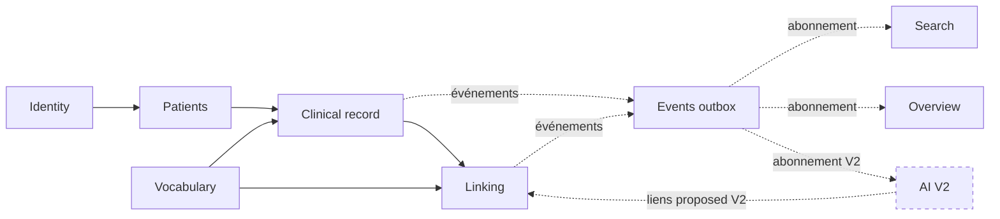

Les flèches pleines sont des dépendances de compilation (API publique du module), les pointillés des flux d'événements. `Search` et `Overview` sont déclenchés par les événements, mais ils dépendent aussi à la compilation de l'API de `patients` (garde de propriété), d'`identity` et de `clinical` (et de `linking` pour Overview), et ils lisent en SQL les tables de `clinical`, `patients`, `linking` et `vocabulary` (`tag`, `emotion`, `entry_type`) pour construire leurs projections (G Q34, voir A5).

### Diagramme de classes du domaine

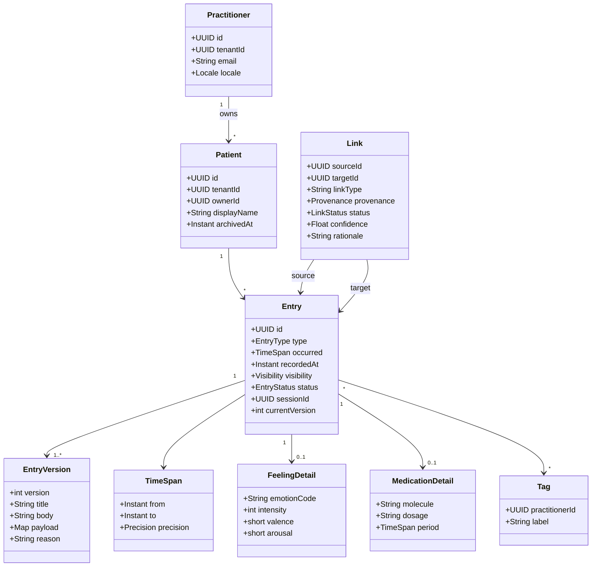

`Entry` est la racine : une version, un détail typé et des tags ne vivent jamais sans elle. `Link` est un agrégat séparé pour que le module Linking (et l'IA en V2) le fasse évoluer sans toucher aux entrées.

### Correspondance avec les modules Spring Boot

**Décision** : Spring Modulith avec un package racine par contexte (`com.psymate.identity`, `com.psymate.patients`, `com.psymate.clinical`, `com.psymate.vocabulary`, `com.psymate.linking`, `com.psymate.search`, `com.psymate.overview`, `com.psymate.events`, `com.psymate.ai`), organisation par rôle à l'intérieur (`api / controller / dto / service / repository / model / config`, G Q33).

| Critère | Spring Modulith | Package par couche classique | Hexagonal strict par module |
| --- | --- | --- | --- |
| Frontières vérifiables par test | Oui (`ApplicationModules.verify()`) | Non | Oui mais par convention |
| Cérémonie pour un développeur seul | Faible | Très faible | Élevée (ports, adapters, mappers partout) |
| Lisibilité pour un agent IA | Élevée : un module = un dossier = un contexte | Faible : une fonctionnalité éparpillée dans 4 dossiers | Moyenne : beaucoup d'indirection |
| Événements de domaine et outbox | Fournis (`@ApplicationModuleListener`, event publication registry) | À construire | À construire |
| Extraction future en service séparé | Possible module par module | Difficile | Possible |

**Recommandation** : Spring Modulith. **Pourquoi** : les frontières sont testées automatiquement, ce qui est la protection principale contre un agent qui « corrige » un module en en cassant un autre. **Alternatives rejetées** : hexagonal strict (trop de fichiers par fonctionnalité pour un solo), couches classiques (aucune frontière). **Conséquences** : chaque module expose un package `api` (façades, vues, événements, exceptions publiques). Le reste est interne au module : ses classes sont publiques entre dossiers du même module, la frontière entre modules est vérifiée par Modulith et celle entre dossiers par ArchUnit (G Q33). **Impact V2** : le module `ai` s'ajoute comme un module de plus, abonné aux événements, sans modifier les autres.

Structure d'un module (G Q33, décidée le 2 novembre 2026 ; chaque module y passe par sa tâche M9 du plan C8) :

```
com/psymate/<module>/
  package-info.java   @ApplicationModule(allowedDependencies = {"patients :: api", "events :: api", "shared"})
  api/                ce que les autres modules voient : EntryFacade, EntrySummary, EntryCreated (événement), exceptions publiques
  controller/         points d'entrée HTTP : EntryController, gestionnaire d'erreurs du module
  dto/                ce qui entre et sort en JSON : EntryDto, CreateEntryRequest (un fichier par DTO, G Q35), EntryMapper (MapStruct), *Assembler (mapping écrit à la main)
  service/            la logique : EntryService, commandes, implémentations des façades et ports, listeners, jobs
  repository/         l'accès à la base : repositories Spring Data, fragments *NativeQueries, requêtes JdbcClient (G Q32, Q38)
  model/              les objets métier : Entry, EntryVersion (entités JPA ou records), TimeSpan, règles, exceptions métier
  config/             configuration Spring : sécurité, filtres, propriétés
```

| Dossier | Suffixes attendus |
| --- | --- |
| `api/` | `*Facade`, `*View`, `*Port`, événements au passé |
| `controller/` | `*Controller`, `*ExceptionHandler`, `*Advice`, `*Messages` |
| `dto/` | `*Dto`, `*Request`, `*Mapper`, `*Assembler` |
| `service/` | `*Service`, `*FacadeImpl`, `*Adapter`, `*Listener`, `*Job`, `*Mailer` |
| `repository/` | `*Repository`, `*Queries`, `*NativeQueries`, `*Row` |
| `model/` | pas de suffixe imposé (`*Exception`, `*Policy`, `*Rules`) |
| `config/` | `*Config`, `*Configuration`, `*Properties`, `*Filter` |

Règles : un dossier n'existe que s'il contient une classe ; un module ou sous-domaine de moins de 8 classes reste plat ; sous-domaines admis seulement dans identity (`auth`, `admin`, `verification`, `preferences`) et clinical (`export`), avec les mêmes dossiers. Sens des dépendances : `controller → service, dto` ; `dto → model` (seuls les `*Mapper` et `*Assembler` touchent aux entités) ; `service → repository, model` ; `repository → model` ; `model` ne dépend que de `model` et `api` ; personne ne dépend de `controller`.

## A4. Architecture des données

Tout repose sur quatre tables : `entry` (générique), ses tables de détail, `entry_version` (historique) et `link` (arêtes). Les autres sont des vocabulaires ou des projections reconstructibles.

### A4.1 Modèle d'entrée

| Critère | A. Une table `entry` + JSONB | B. Une table par type | C. Hybride : `entry` commune + table de détail par type (**recommandé**) |
| --- | --- | --- | --- |
| Ajouter un type | Aucune migration | Nouvelle table + jointures partout | Nouvelle table de détail + une ligne dans `entry_type` |
| Timeline et recherche (requêtes transversales) | Simple, une table | `UNION` de 6 tables, index dupliqués | Simple : tout passe par `entry` |
| Validation et typage | Faible (JSON Schema côté appli) | Forte (colonnes) | Forte sur les champs structurés, libre dans `payload` pour le reste |
| Requêtes V2 sur les ressentis (`intensity`, `emotion_code`) | Index sur expression JSONB, lent et fragile | Natif | Natif : `entry_feeling` est une vraie table |
| Risque agent | Champs JSON incohérents entre entrées | Oubli d'une des 6 tables dans une requête transversale | Oubli de la table de détail à la création d'un type (couvert par test) |

**Décision** : hybride. **Pourquoi** : la timeline, la recherche, les versions et les liens ne connaissent que `entry` ; l'IA V2 exige des colonnes typées sur les ressentis et les médicaments. **Alternatives rejetées** : JSONB pur (corrélations V2 illisibles), table par type (chaque vue transversale devient une union). **Conséquences** : un type = une migration Flyway qui crée sa table de détail et insère sa ligne de type. **Impact V2** : aide ; les champs que l'IA corrèle sont des colonnes indexées.

### A4.2 Modélisation du temps

Chaque entrée porte deux axes : `recorded_at` (saisie, toujours exact) et la plage d'occurrence `occurred_from` / `occurred_to` avec une `occurred_precision`.

| Précision | Saisie praticien | Stockage `occurred_from` → `occurred_to` | Tri timeline |
| --- | --- | --- | --- |
| `exact` | 12/03/2026 14:30 | même instant des deux côtés | par `occurred_from` |
| `day` | 12/03/2026 | 00:00 → 23:59:59 | idem |
| `month` | mars 2026 | 01/03 → 31/03 | idem |
| `year` | 2019 | 01/01 → 31/12 | idem |
| `period` | « été 2019 » | 21/06 → 22/09, libellé conservé dans `occurred_label` | idem |
| `life_phase` | « enfance » | calculé depuis la date de naissance (0 → 12 ans), libellé conservé | regroupé dans une zone « avant le suivi » |
| ongoing (situation) | « depuis mars 2026 » | 01/03 → `NULL` | affiché comme une bande ouverte |

Le tri se fait sur `occurred_from`, l'affichage sur la plage, les corrélations V2 sur le chevauchement des plages (`tstzrange`). La colonne générée `occurred_range tstzrange` sert d'index GiST pour « quelles situations étaient actives quand ce ressenti est apparu ? ». **Impact V2** : indispensable ; sans précision déclarée, l'IA ne peut pas distinguer une coïncidence exacte d'une approximation.

### A4.3 Liens de première classe

```sql
CREATE TABLE link (
  id            uuid PRIMARY KEY,
  tenant_id     uuid NOT NULL,
  patient_id    uuid NOT NULL,
  source_id     uuid NOT NULL REFERENCES entry(id),
  target_id     uuid NOT NULL REFERENCES entry(id),
  link_type     text NOT NULL REFERENCES link_type(code),
  directed      boolean NOT NULL DEFAULT true,
  provenance    text NOT NULL CHECK (provenance IN ('manual','ai_suggested','ai_confirmed')),
  status        text NOT NULL CHECK (status IN ('proposed','accepted','rejected','superseded')),
  confidence    real,                       -- NULL en V1
  rationale     text,
  evidence      jsonb,                      -- [{entry_id, version, span}] en V2
  author_id     uuid,                       -- praticien ou NULL (IA)
  decided_by    uuid,
  decided_at    timestamptz,
  superseded_by uuid REFERENCES link(id),
  version       int NOT NULL DEFAULT 1,
  created_at    timestamptz NOT NULL DEFAULT now(),
  updated_at    timestamptz NOT NULL DEFAULT now(),
  CHECK (source_id <> target_id)
);
CREATE UNIQUE INDEX ux_link_active ON link(source_id, target_id, link_type)
  WHERE status IN ('proposed','accepted');
```

Types de liens initiaux (conservés tels quels, G Q12) : `triggers`, `caused_by`, `worsens`, `relieves`, `co_occurs` (non orienté), `follows`, `part_of`, `treats` (médicament → situation/ressenti). Chaque type porte `inverse_code` pour l'affichage dans les deux sens et `allowed_source_types` / `allowed_target_types` pour la validation.

Règles : un rejet est conservé avec `status = rejected` et interroge l'IA avant toute nouvelle proposition identique ; une modification de type crée un nouveau lien `manual` et marque l'ancien `superseded` ; l'index unique partiel empêche un doublon actif. **Impact V2** : c'est la table que l'IA écrit (toujours `ai_suggested` / `proposed`) et dont elle apprend (`rejected`).

### A4.4 Requêtes de graphe en PostgreSQL

Voisinage à profondeur bornée :

```sql
WITH RECURSIVE hood AS (
  SELECT id, source_id, target_id, link_type, 1 AS depth
  FROM link WHERE status = 'accepted' AND (source_id = :root OR target_id = :root)
  UNION
  SELECT l.id, l.source_id, l.target_id, l.link_type, h.depth + 1
  FROM link l JOIN hood h
    ON l.status = 'accepted' AND h.depth < :max_depth
   AND (l.source_id IN (h.source_id, h.target_id) OR l.target_id IN (h.source_id, h.target_id))
)
SELECT DISTINCT * FROM hood;
```

Avec `max_depth = 3` et des index sur `(source_id)` et `(target_id)` filtrés sur `status = 'accepted'`, un patient de 2 000 entrées et 1 500 liens répond en moins de 50 ms. Le graphe entier d'un patient tient en mémoire côté client (quelques milliers d'arêtes), donc l'API livre le voisinage, pas le graphe complet.

Seuils de bascule : plus de 300 ms médians sur la CTE, ou besoin de chemins les plus courts et de centralité (V2 motifs). Chemin V2 : d'abord Apache AGE (extension PostgreSQL, Cypher, mêmes données), puis seulement un moteur dédié si AGE ne suffit pas. Aucune migration de schéma : AGE lit les tables existantes via une vue.

### A4.5 Données des ressentis pour la V2

```sql
CREATE TABLE emotion (
  code            text PRIMARY KEY,        -- 'anxiety' ; custom : 'c_<uuid court>'
  scope           text NOT NULL CHECK (scope IN ('global','custom')),
  practitioner_id uuid,                    -- NULL si global, obligatoire si custom
  created_by      uuid, created_at timestamptz NOT NULL DEFAULT now(),
  family          text NOT NULL,           -- 8 familles Plutchik, choisie aussi pour une custom
  valence         smallint,                -- -2..+2 ; NULL en V1, rempli par migration avant la V2
  arousal         smallint,                -- 0..4 ; idem
  label_fr        text NOT NULL, label_en text,
  vocabulary_version int NOT NULL, active boolean NOT NULL DEFAULT true,
  promoted_to     text REFERENCES emotion(code)  -- custom fusionnée dans une globale, V2
);
CREATE UNIQUE INDEX ux_emotion_custom_label ON emotion(practitioner_id, lower(unaccent(label_fr)))
  WHERE scope = 'custom';
CREATE TABLE entry_feeling (
  entry_id     uuid PRIMARY KEY REFERENCES entry(id),
  emotion_code text NOT NULL REFERENCES emotion(code),
  intensity    smallint NOT NULL CHECK (intensity BETWEEN 0 AND 10),
  valence      smallint,                -- copié d'emotion à la saisie, NULL si non défini
  arousal      smallint,
  context_note text,
  bodily_signs text[]                   -- optionnel, liste contrôlée
);
```

Vocabulaire global de départ : 8 familles (joie, confiance, peur, surprise, tristesse, dégoût, colère, anticipation) × 3 niveaux d'intensité lexicale = 24 codes, plus `anxiety`, `guilt`, `shame`, `emptiness`, `calm` ajoutés parce que fréquents en clinique. Décision G Q11 (29 octobre 2026) : les 29 codes de E5.2 sont livrés tels quels ; `shame` reste en famille `disgust`, `calm` en famille `trust`. Les codes sont stables, les libellés traduisibles, le vocabulaire versionné pour ne jamais réécrire d'anciens ressentis ; la validation clinique se fera avec les praticiens une fois l'application utilisable (G Q10).

Émotions personnalisées : un praticien peut créer une émotion `custom` depuis le formulaire de ressenti en donnant un libellé et en choisissant obligatoirement une famille ; valence et activation restent vides en V1 (décision du 24 octobre 2026) et seront complétées en V2 par un écran « Compléter vos émotions », l'IA utilisant la famille seule tant qu'elles manquent. Elle est visible de lui seul, tracée (`created_by`, `created_at`) et affichée avec un marqueur « personnalisée » partout. Grâce à la famille, à la valence et à l'activation, l'IA V2 corrèle une émotion custom comme une globale ; `promoted_to` permet plus tard de fusionner les doublons créés par plusieurs praticiens dans une émotion globale sans toucher aux ressentis existants. La fusion de deux émotions custom du même praticien est disponible dès la V1, la promotion en émotion globale en V2 (G Q8).

Un ressenti s'attache à une situation ou un événement par un `link` (`triggers`, `co_occurs`, `relieves`), jamais par une clé étrangère : le même ressenti peut se rattacher à plusieurs causes, et l'IA peut proposer un rattachement sans toucher à l'entrée.

Champs exacts que l'IA V2 utilisera : `patient_id`, `occurred_from`, `occurred_to`, `occurred_precision`, `emotion_code`, `family`, `valence`, `arousal`, `intensity`, `session_id`, les tags, `body`, et pour les situations `occurred_range`. Corrélation type : pour chaque situation active, distribution de `(valence, intensity)` des ressentis dont `occurred_range` chevauche, comparée à la ligne de base du patient.

### A4.6 Vocabulaires et tags

|  | Vocabulaire global (émotions, types de liens, types d'entrées) | Tags praticien |
| --- | --- | --- |
| Propriétaire | Produit, versionné par migration | Chaque praticien (`practitioner_id`) |
| Mutabilité | Ajout seulement ; désactivation, jamais suppression | Création, renommage, fusion libres |
| Usage V2 | Axe de corrélation | Signal secondaire (co-occurrence de tags) |
| Table | `emotion`, `link_type`, `entry_type` | `tag`, `entry_tag` |

Coexistence : trois niveaux, du plus structuré au plus libre. Les émotions globales (produit), les émotions `custom` (praticien, mais structurées par famille, valence, activation) et les tags (praticien, libres). Un tag dont le libellé normalisé égale un libellé d'émotion globale ou custom du praticien est refusé avec proposition de l'émotion ; l'autocomplétion propose d'abord les émotions globales, puis les custom du praticien, puis les tags. Un tag partagé global (`practitioner_id NULL`) est prévu dans le schéma pour une V2 « tags recommandés », non utilisé en V1.

### A4.7 Entrées privées et cliniques

Colonne `visibility text NOT NULL DEFAULT 'clinical' CHECK (visibility IN ('private','clinical'))` sur `entry` dès la V1. `private` = réflexion personnelle du praticien, exclue par défaut de tout partage, export et traitement IA ; `clinical` = fait du dossier. En V1 l'interface montre un simple interrupteur « note privée ». Coût : une colonne et un filtre dans les requêtes ; gain : le partage V2 n'a aucune migration de données à faire.

### A4.8 Versions et suppression

| Critère | Mise à jour en place + audit | Append-only (**recommandé**) |
| --- | --- | --- |
| Perte silencieuse | Possible si l'audit échoue | Impossible : l'ancien texte est une ligne |
| Lecture courante | Directe | Directe aussi via `entry.current_version_id` |
| Comparaison de versions | Reconstruction depuis l'audit | Deux lignes à comparer |
| Réindexation IA après correction | À déclencher à la main | `EntryCorrected` porte les deux versions |

Schéma : `entry` garde les colonnes stables (type, patient, temps, visibilité, statut) et un pointeur `current_version_id` ; `entry_version` porte `version`, `title`, `body`, `payload`, `reason`, `author_id`, `created_at`. Les tables de détail suivent la version courante (réécrites à chaque correction, historisées dans `payload` de la version). Suppression = `archived_at` sur `entry` ; les liens d'une entrée archivée passent en `superseded`. Aucune donnée clinique n'est purgée physiquement ; seules les tables listées en E « Suppressions physiques autorisées » le sont (tables d'association, purges planifiées, sessions : G Q37).

**Règle de grâce (pas de version pour une coquille)** : une modification faite par le même auteur, moins de 1 h 15 après la création de l'entrée (G Q31), alors que l'entrée n'a encore aucun lien, aucune autre version et n'a pas été consultée par l'IA, est appliquée en place sans créer de version ; seul `updated_at` change. Dès qu'une de ces conditions tombe, toute modification crée une version. La règle est un paramètre de configuration (`versioning.grace-period = 75m`), désactivable par tenant. Elle évite d'encombrer l'historique de corrections triviales sans ouvrir de brèche : une entrée liée ou âgée reste intégralement tracée.

### A4.9 Hooks de préparation V2

| Hook | Où il se branche | Coût V1 | Ce qu'il permet |
| --- | --- | --- | --- |
| `outbox_event` (Modulith event publication registry) | Après chaque commit de `EntryService` et `LinkService` | 1 table, 4 classes d'événements | L'IA et les projections s'abonnent sans scan |
| `CREATE EXTENSION vector` + `entry_embedding (entry_id, version, model, embedding vector(1536))` | Migration V1, table vide | 1 migration | Recherche sémantique et similarité sans refonte |
| `entry_chunk (id, entry_id, version, ordinal, text, token_count)` | Migration V1, table vide | 1 migration | Découpage des longs comptes rendus pour RAG avec citations précises |
| `body` en colonne texte séparée du `payload` JSONB | Dès `entry_version` | aucun | Chunking et embeddings sans parser du JSON |
| `link.evidence jsonb`, `link.confidence` | Dès `link` | aucun | Justifications citées |
| `ai_feedback (link_id, decision, reason, decided_at)` | Migration V1, table vide | 1 migration | Évaluation des suggestions |
| `entry.author_type`, `entry.submission_id` + tables vides `patient_submission`, `patient_device` (A11) | Migration V1 ; colonnes à leur défaut, tables vides | 2 colonnes, 2 tables, 1 contrainte | Un compagnon patient dépose des lots d'entrées sans migration de `entry` ni des vues |

Règle M4-01 : tout abonné `@ApplicationModuleListener` est idempotent (support `EventDeduplicator` du module `events`) ; les publications incomplètes plus vieilles que `app.events.republish-older-than` sont rejouées au démarrage (`EventRepublisher`), les complétées de plus de `app.events.completed-retention` purgées chaque nuit (`EventPublicationPurgeJob`) ; les incomplètes ne sont jamais purgées.

### A4.10 Profil public du praticien (ajouté le 24 octobre 2026)

```sql
ALTER TABLE practitioner ADD COLUMN profession text NOT NULL DEFAULT 'psychologist'
  CHECK (profession IN ('psychologist','psychiatrist','coach'));

CREATE TABLE practitioner_profile (
  practitioner_id  uuid PRIMARY KEY REFERENCES practitioner(id),
  published        boolean NOT NULL DEFAULT false,
  display_name     text NOT NULL,
  title_label      text,                 -- « Psychologue clinicienne », « Coach mental »
  photo_asset_id   uuid,                 -- référence vers le stockage de fichiers
  bio              text,
  specialties      text[] NOT NULL DEFAULT '{}',   -- codes de la liste fermée directory_vocabulary (G Q15), pas de saisie libre
  audiences        text[] NOT NULL DEFAULT '{}',   -- codes de la liste fermée : adults, young_adults, adolescents, children, couples_families
  modalities       text[] NOT NULL DEFAULT '{}',   -- in_person, video, home
  languages        text[] NOT NULL DEFAULT '{}',   -- codes ISO 639-1
  city             text, postal_code text, country text DEFAULT 'FR',
  geo              point,                -- pour le tri par distance
  contact_phone    text, contact_email text, website_url text, address text,
  show_phone boolean NOT NULL DEFAULT false, show_email boolean NOT NULL DEFAULT false,
  show_address boolean NOT NULL DEFAULT false,
  availability     text NOT NULL DEFAULT 'unknown'
                   CHECK (availability IN ('accepting','waitlist','closed','unknown')),
  next_slot_at     date,
  search_vector    tsvector,             -- bio + spécialités + ville, maintenu par trigger
  published_at     timestamptz, updated_at timestamptz NOT NULL DEFAULT now()
);
CREATE INDEX ix_profile_public ON practitioner_profile(published, updated_at DESC)
  WHERE published;
CREATE INDEX ix_profile_search ON practitioner_profile USING gin(search_vector);
CREATE INDEX ix_profile_geo ON practitioner_profile USING gist(geo) WHERE published;
```

Spécialités et publics (G Q15, 29 octobre 2026) : vocabulaire **fermé**, stocké dans une table `directory_vocabulary` (`kind ∈ specialty|audience`, `code`, `label_fr`, `label_en`, `sort_order`, `active`), servi par `GET /api/vocabulary/directory` et modifiable par un administrateur (`/api/admin/vocabulary/directory`, tâche M1-14b) ; aucune saisie libre, un code hors liste est refusé `422`.

Règles : rien de ce qui est dans `practitioner_profile` ne touche un dossier patient ; les moyens de contact ne sont rendus publics que si le praticien a coché l'affichage correspondant ; la photo est servie en taille fixe sans métadonnées. Le libellé affiché de la profession `coach` est « Coach » (ou « Coach mental » si le praticien le précise dans `title_label`), jamais « personal coach ». **Impact V2** : aucun ; l'annuaire est hors du périmètre de l'IA.

### Diagramme entité-relation

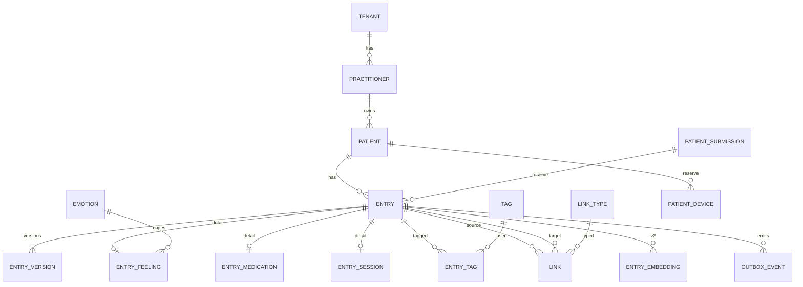

`ENTRY_EMBEDDING` et `OUTBOX_EVENT` existent en V1 mais ne sont remplies que par l'outbox ; `ENTRY_EMBEDDING` reste vide jusqu'à la V2. `PATIENT_DEVICE` et `PATIENT_SUBMISSION` sont réservées pour le compagnon patient (A11) et restent vides en V1.

### Dictionnaire des tables centrales

| Table | Colonne | Type | Notes |
| --- | --- | --- | --- |
| `entry` | `id` | uuid PK |  |
|  | `tenant_id`, `patient_id` | uuid | tous deux indexés, règle de propriété |
|  | `type` | text FK `entry_type` | `note`, `event`, `situation`, `feeling`, `session`, `medication` |
|  | `status` | text | `draft`, `final` |
|  | `visibility` | text | `private`, `clinical` |
|  | `author_type` | text | `practitioner` (seule valeur en V1), `patient` (réservé, A11) ; `NOT NULL DEFAULT 'practitioner'` |
|  | `submission_id` | uuid FK `patient_submission` nullable | lot envoyé par le compagnon patient (A11) ; toujours `NULL` en V1 |
|  | `occurred_from`, `occurred_to` | timestamptz | `to` NULL = en cours |
|  | `occurred_precision` | text | `exact`, `day`, `month`, `year`, `period`, `life_phase` |
|  | `occurred_label` | text | libellé d'origine (« été 2019 ») |
|  | `occurred_range` | tstzrange generated | `tstzrange(occurred_from, coalesce(occurred_to,'infinity'))` |
|  | `recorded_at` | timestamptz | saisie |
|  | `session_id` | uuid FK `entry` nullable | séance de rattachement, obligatoire (NULL uniquement pour l'entrée séance elle-même, et pour une entrée `author_type = patient` dont le lot n'est pas encore rattaché, A11) |
|  | `current_version_id` | uuid FK `entry_version` |  |
|  | `search_vector` | tsvector | maintenu par trigger depuis la version courante |
|  | `archived_at` | timestamptz nullable | soft delete |
| `entry_version` | `id`, `entry_id`, `version` |  | unique `(entry_id, version)` |
|  | `title`, `body` | text | `body` = texte libre en clair |
|  | `payload` | jsonb | champs non structurés, copie du détail au moment de la version |
|  | `reason`, `author_id`, `created_at` |  | `author_id` = praticien ; `NULL` si la version vient du patient (A11) |
| `entry_feeling` | voir A4.5 |  |  |
| `entry_medication` | `molecule`, `dosage`, `frequency`, `prescriber`, `period_from`, `period_to` |  |  |
| `entry_session` | `duration_min`, `modality` (`in_person`, `video`, `phone`), `summary_version_id` |  |  |
| `link` | voir A4.3 |  |  |
| `tag` / `entry_tag` | `practitioner_id`, `label`, `normalized_label` |  | unique `(practitioner_id, normalized_label)` |
| `patient` | `id`, `tenant_id`, `owner_id`, `display_name`, `birth_date`, `profile jsonb`, `flags text[]`, `archived_at` |  |  |
| `patient_overview` | `patient_id` PK, `payload jsonb`, `computed_at`, `source_rev` |  | projection |
| `outbox_event` | `id`, `event_type`, `aggregate_id`, `payload jsonb`, `published_at`, `completed_at` |  | géré par Modulith |
| `patient_submission`, `patient_device` | voir A11 |  | réservées, vides en V1 |

### Stratégie d'index

| Usage | Index | Raison |
| --- | --- | --- |
| Timeline par patient et période | `btree (patient_id, occurred_from DESC) WHERE archived_at IS NULL` | parcours par fenêtre temporelle |
| Timeline filtrée par type | `btree (patient_id, type, occurred_from DESC)` | filtres combinés |
| Chevauchement de plages (situations actives) | `gist (patient_id, occurred_range)` | requêtes « actif à cette date » |
| Ressentis par émotion / intensité | `btree (emotion_code, intensity)` sur `entry_feeling` | facettes et V2 |
| Tags | `btree (tag_id, entry_id)` et inverse | facettes |
| Graphe | `btree (source_id) WHERE status='accepted'`, `btree (target_id) WHERE status='accepted'`, `btree (patient_id, status)` | CTE récursive, listes de suggestions V2 |
| Recherche plein texte | `gin (search_vector)` | `@@` |
| Fautes de frappe | `gin (title gin_trgm_ops)` sur la version courante + `gin (body gin_trgm_ops)` | `ILIKE '%mot%'` et similarité |
| Propriété | `btree (tenant_id, owner_id)` sur `patient` | filtre systématique |
| V2 | `hnsw (embedding vector_cosine_ops)` sur `entry_embedding` | créé en V2 seulement |
| Compagnon (réservé) | `btree (submission_id) WHERE submission_id IS NOT NULL` sur `entry` | « ce que le patient a envoyé le … » ; index partiel, vide en V1 |

## A5. Architecture système

Un seul déployable backend, une seule SPA, une seule base : la complexité est dans les modules, pas dans l'infrastructure.

### Modules et dépendances autorisées

| Module | Responsabilité | Peut dépendre de | Expose |
| --- | --- | --- | --- |
| `identity` | Comptes, tenants, sessions, mots de passe, vérification, administration | `events` | `CurrentPractitioner`, `PractitionerFacade`, `EncryptedStorageFacade`, `SuspendedAccountAuthenticator`, `PractitionerRejected`, `PractitionerSuspended` ; sans abonné en V1, annotés `@Reserved` (G Q40) : `PractitionerRegistered`, `PractitionerApproved`, `PreferencesChanged`, `VerificationSubmitted` |
| `patients` | Profils, propriété, archivage | `identity`, `vocabulary`, `events` | `PatientFacade`, `PatientOwnershipGuard`, `PatientRef`, `PatientCreated`, `PatientUpdated` ; sans abonné en V1 (G Q40) : `PatientArchived` |
| `vocabulary` | Émotions, types de liens, tags | `identity`, `events` | `EmotionCatalog`, `LinkTypeCatalog`, `TagFacade` et leurs vues ; fusions (G Q42) : `EmotionsMerged`, `EmotionMergeReverted`, `TagsMerged`, `MergeFacade` (état des fusions pour les abonnés), `EmotionUsagePort` (implémenté par clinical) |
| `clinical` | Entrées, versions, séances, brouillons, export | `identity`, `patients`, `vocabulary`, `events` | `EntryFacade` (lecture des entrées pour linking, et `adjustLinkCount`), `EntryLinksPort`, `EntryLinksReadPort`, `EntrySummary`, `EntryCreated`, `EntryCorrected`, `EntryArchived`, `EntriesRelabeled` (réétiquette après une fusion du vocabulaire, G Q42) |
| `linking` | Liens, cycle de vie, graphe | `clinical`, `vocabulary`, `events`, `identity`, `patients` | `LinkAccepted` ; `LinkRejected` (`@Reserved`, V2). Le graphe n'est pas exposé : `GraphQueryService` reste interne (G Q39) |
| `search` | Index, requêtes, facettes | `events` (écoute), `patients` (garde), `identity`, `clinical` ; lecture SQL des tables de clinical et de vocabulary (`tag`, `emotion`, `entry_type`) (G Q34) | aucun package `api` : endpoint REST seulement |
| `overview` | Projection vue d'ensemble | `events` (écoute), `patients` (garde), `identity`, `clinical`, `linking` ; lecture SQL des tables de clinical, patients, linking et vocabulary (`emotion`) (G Q34) | aucun package `api` : endpoint REST seulement |
| `events` | Outbox, republication, abonnés | — | `DomainEvent`, `DomainEventPublisher`, `EventDeduplicator` |
| `ai` (V2) | Suggestions, motifs, questions | `events`, `clinical` (lecture), `linking` (écriture `proposed`), chacun par son `api` | `SuggestionFacade` |
| `companion` (réservé, A11) | Appairage d'appareils patients, réception des lots | `patients`, `clinical` (dépôt d'entrées `author_type = patient`), `events` ; jamais `identity.admin`, `directory` | `SubmissionReceived`, `SubmissionAttached` |
| `shared` | Infrastructure web transverse utilisée par au moins deux modules : erreurs RFC 9457 (`ProblemException`), limitation de débit, i18n des messages, adresses IP (`shared.web.IpAddresses`), horodatages UTC à la microseconde (`shared.time.Timestamps`) | — (ne dépend d'aucun module) | outils techniques, aucune table : ni `JdbcClient` ni `EntityManager` (garde ArchUnit sans exception depuis M9-05 ; le journal d'audit est dans `identity.audit`) |

Règle vérifiée par `ApplicationModules.of(App.class).verify()` dans la CI : toute dépendance hors des `package-info.java` fait échouer le build. Chaque dépendance passe par le package `api` du module cible (`"patients :: api"`, y compris pour `ai` et `companion`) ; `shared` est autorisé partout. Tout type public d'un package `api` est utilisé par un autre module ou porte `@Reserved` (`shared.Reserved`, avec son futur consommateur et sa raison) : garde `ApiUsageTests` (M9-06), dont la liste d'exceptions nomme la tâche qui règle chaque reste. La référence est le `package-info.java` de chaque module ; ce tableau en est l'état au 2 novembre 2026, et il sera généré par `Documenter` (tâche M9-02).

Module ajouté le 24 octobre 2026 — `directory` : annuaire public et profils ; peut dépendre de `identity` et `events` ; expose seulement `ProfilePublished` et `ProfileUnpublished`, publiés sans abonné en V1 et annotés `@Reserved` (G Q40) ; les façades `DirectoryFacade` et `ProfileFacade`, sans consommateur, ont été supprimées par M9-06. Ses contrôleurs sous `/api/public/**` sont exclus de l'authentification dans la configuration Spring Security et soumis à une limitation de débit par adresse (Bucket4j, G Q24).

### C4 niveau 1 : contexte

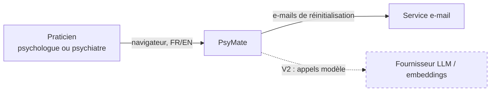

Un seul type d'utilisateur en V1. Le fournisseur de modèles est le seul système externe ajouté par la V2.

### C4 niveau 2 : conteneurs

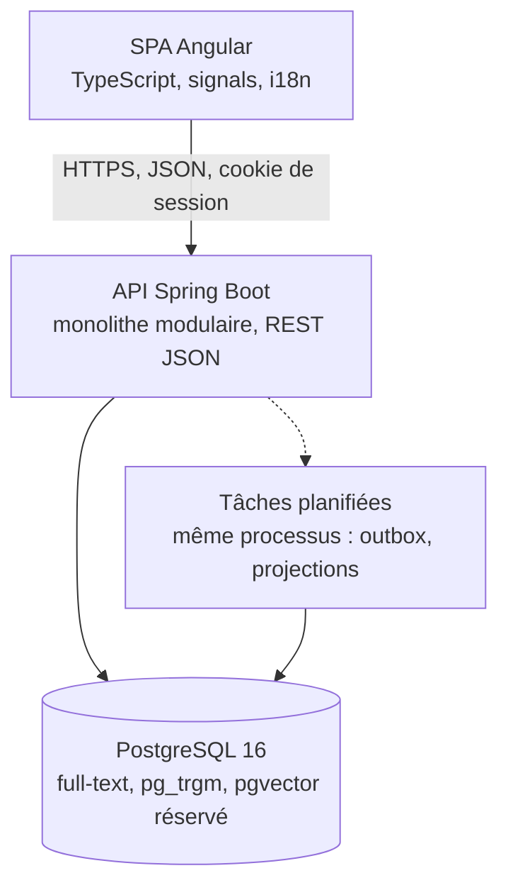

Les tâches planifiées tournent dans le même processus Spring (Modulith republie l'outbox) : pas de worker séparé en V1.

### C4 niveau 3 : composants du backend

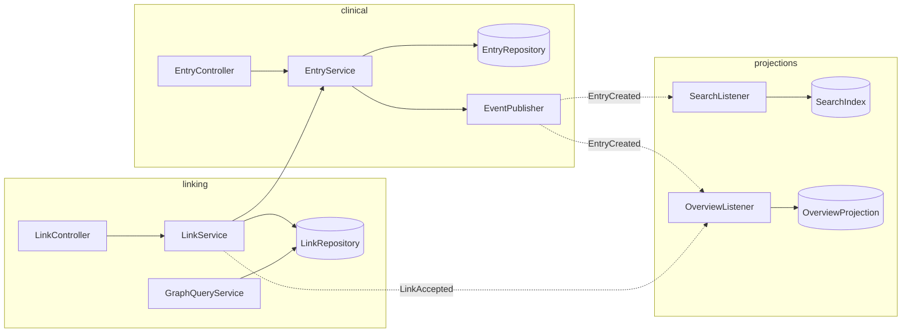

`LinkService` appelle `EntryFacade` pour vérifier que les deux entrées appartiennent au même patient du praticien courant. Les autres dépendances synchrones entre modules métier : `clinical → patients` (`PatientFacade.touchClinicalRev`, garde de propriété), `linking → patients` (garde), `linking → clinical` (`EntryFacade.adjustLinkCount`), `clinical.export → identity` (`EncryptedStorageFacade`, `SuspendedAccountAuthenticator`), et pour les fusions du vocabulaire (G Q42) `clinical → vocabulary` et `patients → vocabulary` (`MergeFacade`, lue par leurs abonnés), plus `vocabulary → clinical` par le port inversé `EmotionUsagePort` (déclaré dans `vocabulary.api`, implémenté par clinical, comme `EntryLinksPort`). `EntryFacade.adjustLinkCount` n'est pas une lecture : linking y fait écrire par clinical le compteur `entry.link_count`, dans la transaction du lien, pour que la timeline l'affiche exact ; ce choix synchrone est assumé, sans événement `LinkRemoved` en V1 (G Q41).

### Style d'API

| Critère | REST + endpoints composés (**recommandé**) | GraphQL |
| --- | --- | --- |
| Timeline paginée par fenêtre | Endpoint dédié avec curseur, simple à cacher | Possible, pagination à concevoir |
| Graphe à profondeur bornée | Endpoint dédié qui retourne nœuds + arêtes | Requêtes récursives difficiles, risque N+1 |
| Vue d'ensemble | Un endpoint qui lit la projection | Résolveurs multiples sur une projection déjà agrégée |
| Génération du client Angular | OpenAPI → `openapi-generator`, typé | Codegen GraphQL, bon aussi |
| Courbe pour un solo + agents | Faible, conventions connues | Schéma + résolveurs + sécurité par champ |

**Décision** : REST avec OpenAPI-first ; les trois vues lourdes (timeline, graphe, overview) ont chacune un endpoint composé qui retourne exactement ce que l'écran affiche. **Alternatives rejetées** : GraphQL, dont le bénéfice (requêtes flexibles) n'est pas nécessaire avec trois écrans connus. **Impact V2** : les suggestions sont une ressource REST de plus (`/suggestions`).

Endpoints principaux :

| Méthode | Chemin | Rôle |
| --- | --- | --- |
| POST | `/api/auth/signup`, `/api/auth/login`, `/api/auth/logout` | identité |
| GET/POST | `/api/patients` ; GET/PATCH/DELETE `/api/patients/{id}` | profil, archivage (DELETE = archive) |
| GET | `/api/patients/{id}/overview` | projection |
| GET | `/api/patients/{id}/timeline?from&to&types&emotions&tags&cursor&limit` | fenêtre temporelle |
| GET | `/api/patients/{id}/graph?root&depth&linkTypes` | voisinage |
| GET | `/api/patients/{id}/search?q&types&emotions&tags&from&to&page` | plein texte |
| POST | `/api/patients/{id}/entries` ; GET/PATCH `/api/entries/{id}` | PATCH crée une version |
| GET | `/api/entries/{id}/versions` | historique |
| POST | `/api/entries/{id}/links` ; PATCH/DELETE `/api/links/{id}` | lien |
| GET | `/api/vocabulary/emotions`, `/api/vocabulary/link-types`, `/api/tags` | vocabulaires |
| GET/POST | `/api/patients/{id}/suggestions` ; `/api/suggestions/{id}/decision` | V2 |

Endpoints de l'annuaire (ajoutés le 24 octobre 2026) :

| Méthode | Chemin | Rôle | Auth |
| --- | --- | --- | --- |
| GET | `/api/public/directory?q&city&professions&modalities&audiences&languages&accepting&sort&page` | Liste publique, 20 par page, facettes dans la réponse | aucune |
| GET | `/api/public/directory/{slug}` | Fiche détaillée (contact filtré selon les choix du praticien) | aucune |
| POST | `/api/public/directory/{slug}/contact` | Demande de contact (nom, e-mail, message, jeton anti-spam) | aucune, limitée en débit |
| GET/PUT | `/api/me/profile` | Édition du profil public par le praticien | session |
| POST | `/api/me/profile/photo` | Téléversement de la photo | session |
| POST | `/api/me/profile/publish`, `/unpublish` | Activer / retirer de l'annuaire | session |
| GET | `/api/vocabulary/directory` | Listes fermées : spécialités, publics, modalités, langues (G Q15) | session |

Exemple de création d'un ressenti :

```json
POST /api/patients/8f1c.../entries
{
  "type": "feeling",
  "status": "final",
  "occurred": { "from": "2026-10-20T19:00:00Z", "precision": "exact" },
  "sessionId": "3b2e...",
  "visibility": "clinical",
  "body": "Monte avant les appels du soir",
  "tags": ["travail"],
  "feeling": { "emotionCode": "anxiety", "intensity": 8 },
  "links": [ { "targetId": "a91d...", "linkType": "triggers", "direction": "incoming" } ]
}
```

Réponse `201` : l'entrée avec `version: 1`, `feeling.valence: -2`, `feeling.arousal: 3` (copiés du vocabulaire), et les liens créés en `manual` / `accepted`.

Exemple de réponse timeline (extrait) :

```json
{
  "items": [
    { "id": "c0ff...", "type": "feeling", "occurred": { "from": "2026-10-20T19:00:00Z", "to": "2026-10-20T19:00:00Z", "precision": "exact" },
      "title": "Anxiété 8/10", "emotion": { "code": "anxiety", "family": "fear" }, "intensity": 8,
      "tags": ["travail"], "linkCount": 2, "sessionId": "3b2e...", "authorType": "practitioner" },
    { "id": "a91d...", "type": "situation", "occurred": { "from": "2026-03-01T00:00:00Z", "to": null, "precision": "month", "label": "depuis mars" },
      "title": "Surcharge au travail", "ongoing": true, "linkCount": 5, "authorType": "practitioner" }
  ],
  "nextCursor": "eyJvY2N1cnJlZCI6Li4ufQ",
  "facets": { "types": { "feeling": 41, "event": 12 }, "emotions": { "anxiety": 18 } }
}
```

`authorType` est exposé dans les DTO d'entrée (timeline, recherche, détail, graphe) dès la V1, toujours à `practitioner` : le client pourra afficher la provenance patient sans changement de contrat le jour où le compagnon existe (A11).

### Bibliothèques

| Besoin | Choix | Justification |
| --- | --- | --- |
| Migrations | Flyway | SQL versionné lisible par un agent, une migration par type d'entrée |
| Mapping DTO | MapStruct | Génération à la compilation, erreurs visibles tôt |
| Tests d'intégration | Testcontainers (PostgreSQL) | Teste `pg_trgm`, `tstzrange`, CTE récursives sur un vrai Postgres |
| Frontières de modules | Spring Modulith + ArchUnit | `verify()` en CI |
| Contrat API | springdoc-openapi + openapi-generator (client Angular) | Une source de vérité, client typé regénéré |
| État Angular | Signals + `@ngrx/signals` (SignalStore) | Léger, un store par vue patient, pas de boilerplate NgRx classique |
| Graphe | Cytoscape.js (layout `cose-bilkent`) | Mature, gère des milliers de nœuds, types de nœuds et d'arêtes stylables |
| Timeline | Composant maison sur `d3-scale` + CDK virtual scroll | Les bibliothèques de timeline existantes gèrent mal les plages imprécises |
| Graphiques (tendance d'intensité) | Apache ECharts via `ngx-echarts` | Courbes, bandes, annotations, performant |
| i18n | `@angular/localize` pour l'UI, `MessageSource` côté API | Standard Angular, FR par défaut |
| Validation | Jakarta Validation + validateurs par type d'entrée | Erreurs structurées pour le formulaire |
| Limitation de débit | Bucket4j (G Q24) | Un composant `RateLimiter` partagé, valeurs par route en configuration |

## A6. Recherche et vue d'ensemble

Cibles : recherche < 300 ms au 95e centile sur 5 000 entrées, vue d'ensemble < 200 ms, timeline < 150 ms par fenêtre, graphe < 300 ms à profondeur 2. Les trois mécanismes : index GIN, projection écrite à l'avance, pagination par curseur.

### Recherche

Le `search_vector` de chaque entrée est maintenu par trigger à chaque nouvelle version, avec des poids : titre (A), émotion et tags (B), corps (C), nom de séance ou médicament (D). Configuration `french` par défaut, `english` si le praticien a choisi l'anglais, les deux fusionnées en `unaccent` + `simple` pour les noms propres.

```sql
SELECT e.id, e.type, e.occurred_from,
       ts_rank_cd(e.search_vector, q) AS rank,
       ts_headline('french', v.body, q, 'MaxFragments=2, MinWords=5, MaxWords=18') AS snippet
FROM entry e
JOIN entry_version v ON v.id = e.current_version_id,
     websearch_to_tsquery('french', unaccent(:q)) q
WHERE e.patient_id = :patient AND e.archived_at IS NULL
  AND e.search_vector @@ q
  AND (:types IS NULL OR e.type = ANY(:types))
ORDER BY rank DESC, e.occurred_from DESC
LIMIT 20 OFFSET :offset;
```

Tolérance aux fautes : si la requête ci-dessus renvoie moins de 3 résultats, une seconde requête `pg_trgm` (`similarity(v.body, :q) > 0.3` ou `word_similarity`) complète, marquée « résultats approchés ». Facettes : une requête `GROUP BY type`, `emotion_code`, `tag_id` sur le même filtre, renvoyée dans la réponse (voir exemple A5). Classement : `ts_rank_cd` puis récence ; un boost ×1,5 sur les entrées des 90 derniers jours.

Seuil pour un moteur dédié (OpenSearch, Meilisearch) : recherche transversale multi-patients avec agrégations lourdes, ou plus de 50 M d'entrées, ou besoin de synonymes cliniques riches. Aucun des trois n'est dans la cible.

### Vue d'ensemble

| Bloc | Contenu | Calcul | Rafraîchissement |
| --- | --- | --- | --- |
| Faits clés | Nom, âge, suivi depuis, nombre de séances, médicaments actifs, flags | Projection `patient_overview.payload.facts` | `PatientUpdated`, `EntryCreated` (médicament, séance) |
| Activité récente | 10 dernières entrées, toutes versions confondues | Requête live sur `entry` (index timeline) | aucune, toujours live |
| Tendance d'intensité | Courbe des `intensity` et `valence` sur 90 jours, moyenne glissante 7 jours | Projection `payload.trend` (90 points max) | `EntryCreated` / `EntryCorrected` de type `feeling` |
| Situations actives | Situations avec `occurred_to IS NULL`, triées par nombre de liens | Projection `payload.activeSituations` | `EntryCreated`, `EntryCorrected`, `LinkAccepted` |
| Émotions dominantes | Top 5 émotions sur 90 jours, avec variation vs 90 jours précédents | Projection `payload.emotions` | ressentis |
| Flags | Indicateurs manuels (risque, urgence, à surveiller) | Colonne `patient.flags` | `PatientUpdated` |
| Suggestions en attente (V2) | Compte et 3 premières | Live sur `link WHERE status='proposed'` | — |

La projection est une ligne JSONB par patient recalculée par `OverviewListener` après chaque événement concerné, en moins de 100 ms (requêtes sur index). Si `computed_at` est antérieur au dernier événement du patient (`source_rev` < révision courante), le contrôleur recalcule à la volée et réécrit : la vue ne sert jamais de donnée obsolète. La tendance alimente un graphique ECharts ; la liste d'activité est live pour qu'une saisie faite il y a deux secondes apparaisse.

### Timeline

L'API renvoie une fenêtre `[from, to]` d'au plus 200 éléments triés par `occurred_from` décroissant, avec `nextCursor` (keyset sur `(occurred_from, id)`), les facettes de la fenêtre et les situations en cours qui chevauchent la fenêtre même si elles ont commencé avant. Le client garde trois fenêtres en mémoire (précédente, courante, suivante) et utilise le défilement virtuel du CDK ; le zoom change la granularité d'affichage (jour, semaine, mois) sans nouvelle requête tant que la fenêtre couvre la plage.

Pour 10 ans d'historique (5 000 entrées), une vue « décennie » n'affiche que des agrégats par mois (`count` par type, intensité moyenne) via `GET /timeline/summary?granularity=month`, calculés par une requête `date_trunc` sur index : moins de 100 ms.

### Graphe

`GET /graph?root=&depth=2` renvoie `{ nodes: [{id, type, title, occurred, intensity?, emotion?, degree}], edges: [{id, source, target, linkType, provenance, status}] }` limité à 150 nœuds. Au-delà, le niveau de détail s'applique côté serveur : les nœuds de degré 1 d'un même type reliés au même voisin sont regroupés en un super-nœud « 12 ressentis, anxiété majoritaire », développable par un appel `expand`. Le client Cytoscape dessine les types d'entrées par forme et les types de liens par style de trait ; les liens `proposed` (V2) en pointillé.

## A7. Flux clés

Cinq séquences et deux cycles de vie ; dans chacun, la base est écrite une fois par transaction et les projections suivent par événement.

### Séquence 1 : créer un patient et ses premières entrées

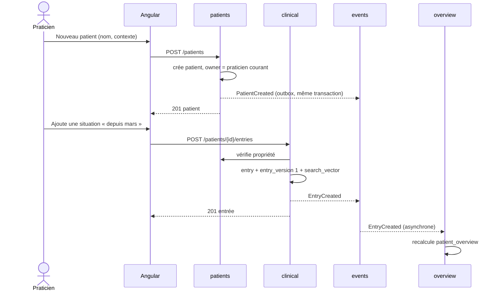

La réponse `201` revient avant la mise à jour de la projection ; l'interface affiche l'entrée depuis la réponse, et la vue d'ensemble se recharge à la prochaine ouverture.

### Séquence 2 : ajouter une entrée et la lier à une existante

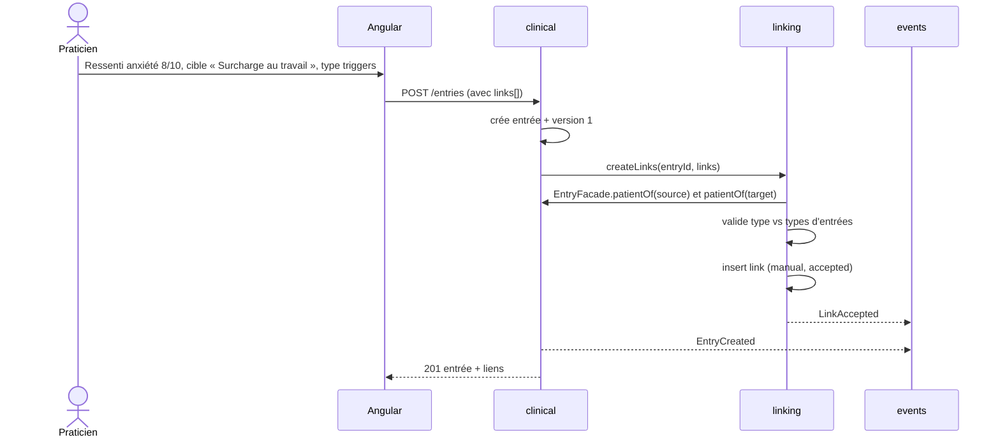

Entrée et liens sont créés dans une seule transaction ; un lien invalide (type non autorisé, cible d'un autre patient) annule toute la création avec une erreur `422` détaillée.

### Séquence 3 : ouvrir la vue d'ensemble

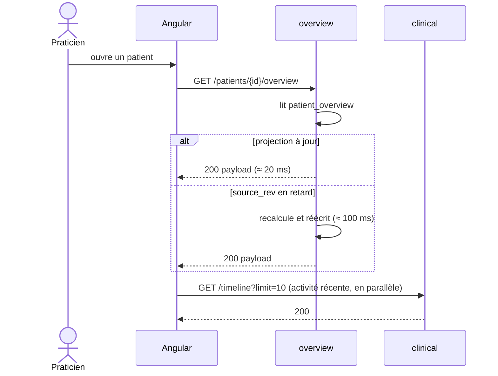

### Séquence 4 : rechercher dans l'historique

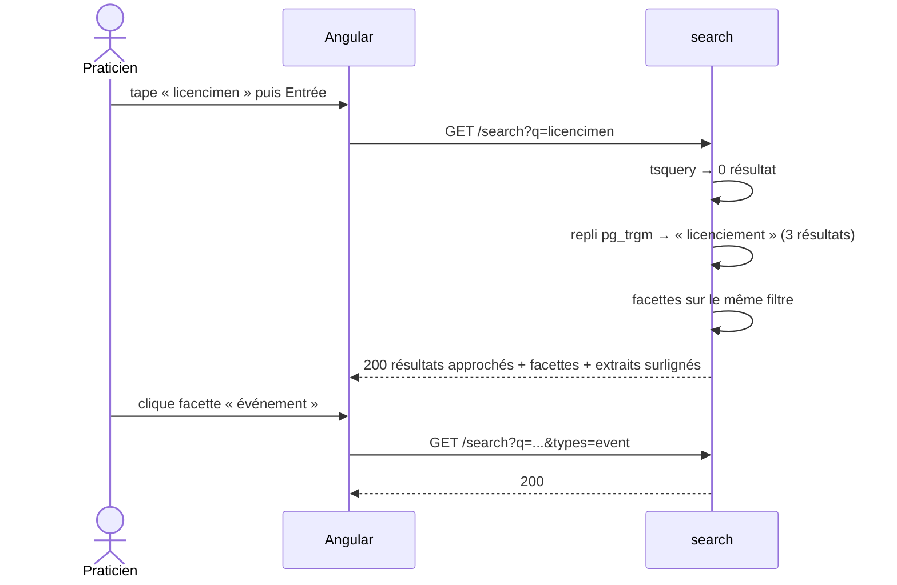

### Séquence 5 (V2) : suggestion de lien par l'IA

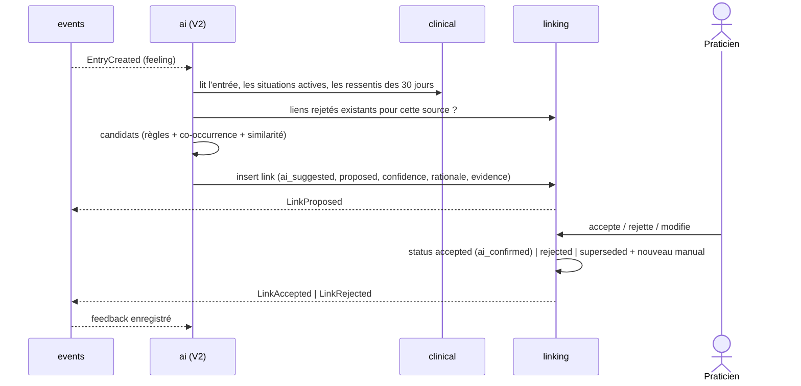

L'IA n'écrit jamais autre chose qu'un lien `proposed` ; toute autre table lui est en lecture seule.

### Cycle de vie d'un lien

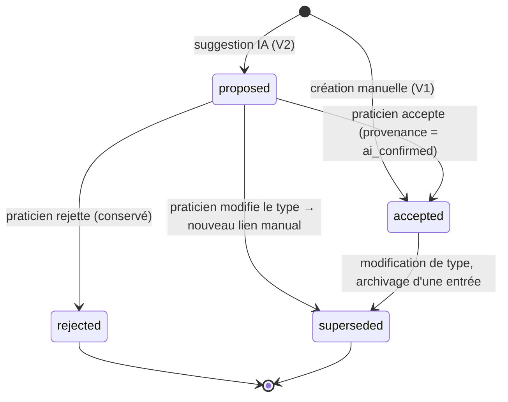

Un lien `rejected` ou `superseded` n'est jamais supprimé ; il est exclu des vues et sert de mémoire à l'IA.

### Cycle de vie d'une entrée

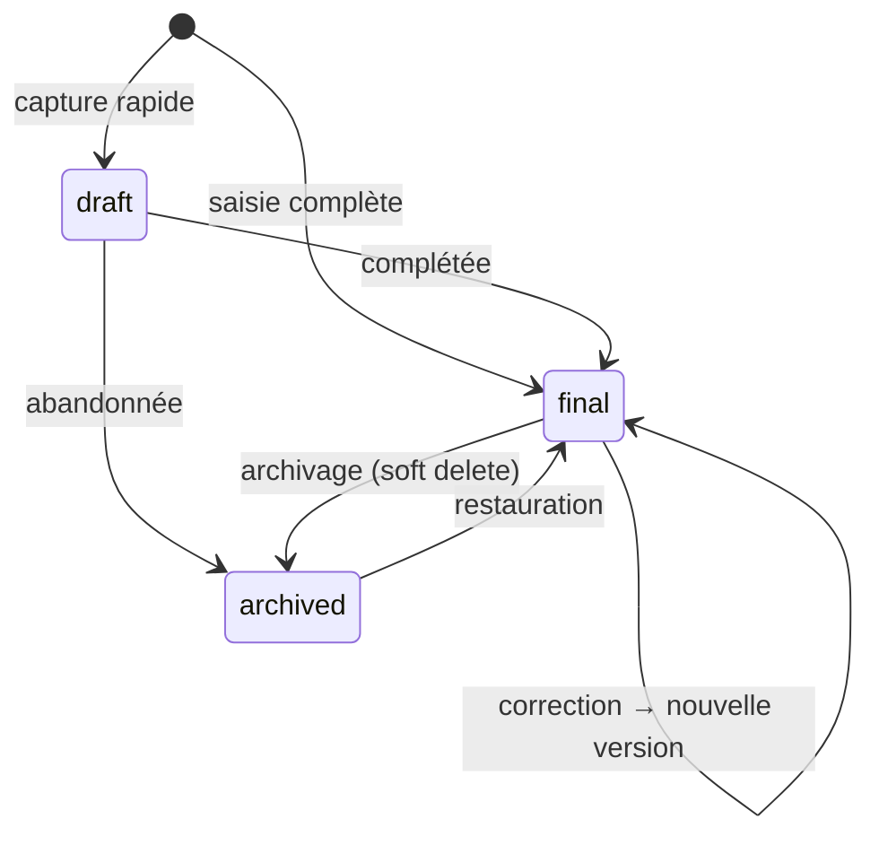

Les brouillons sont visibles dans la timeline avec un marqueur et comptés dans un rappel « 3 brouillons à compléter » sur la vue d'ensemble. Chaque transition `final → final` crée une `entry_version` et émet `EntryCorrected`.

Exception : pendant la période de grâce (A4.8), la transition `final → final` modifie l'entrée en place sans version et n'émet pas `EntryCorrected`, puisque rien d'externe ne dépend encore de l'entrée.

## A8. Architecture IA V2 (conception seulement)

Le module `ai` est un abonné de plus à l'outbox, qui lit le dossier et n'écrit que des liens `proposed` ; il peut être désactivé par tenant sans effet sur le reste.

### Position et flux

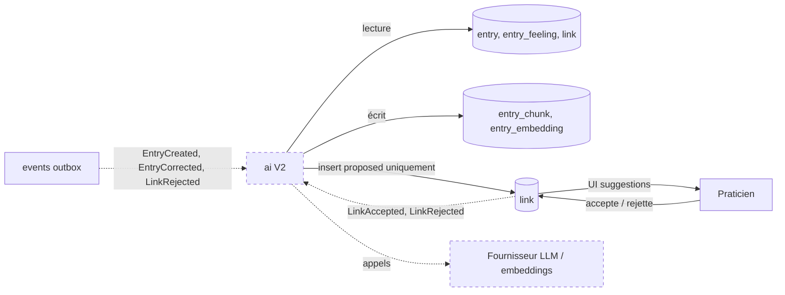

Deux chemins d'entrée : l'événement (suggestion à chaud après une saisie) et le lot planifié (rapport de motifs sur un patient, à la demande). Les deux passent par la même `SuggestionPipeline` : collecte du contexte → générateurs de candidats → filtrage des rejets antérieurs → scoring → écriture.

### Approches candidates

| Approche | Principe | Coût | Explicabilité | Qualité attendue | Rôle recommandé |
| --- | --- | --- | --- | --- | --- |
| Règles | « ressenti négatif dans les 48 h après un événement du même tag → `triggers` » | Nul (SQL) | Totale | Moyenne, précise sur les cas simples | Première couche, toujours active |
| Co-occurrence temporelle | Pour chaque paire (situation active, émotion), fréquence et intensité moyenne vs ligne de base du patient ; test de proportion | Nul | Forte (chiffres montrables) | Bonne sur ≥ 20 ressentis | Cœur du rapport de motifs |
| Similarité d'embeddings | Entrées dont le texte est proche de la nouvelle (pgvector, cosinus) | Faible (embeddings par entrée, une fois) | Moyenne (« textes proches ») | Bonne pour retrouver, faible pour qualifier le lien | Rappel de candidats, jamais seule |
| LLM avec récupération et citations | Prompt : entrée + 10 voisins pertinents ; sortie : type de lien, justification, entrées citées | Élevé par appel ; à limiter aux candidats des couches précédentes | Bonne si citations obligatoires | La meilleure pour qualifier et expliquer | Qualification finale et questions en langage naturel |

**Recommandation** : cascade. Règles et co-occurrence produisent et scorent les candidats ; les embeddings élargissent le rappel ; le LLM qualifie seulement les candidats au-dessus d'un seuil et rédige la justification avec citations. Ainsi la plupart des suggestions coûtent zéro appel et chaque suggestion coûteuse a une base statistique montrable.

### Écriture et garde-fous

- Toute suggestion est un `link` avec `provenance = ai_suggested`, `status = proposed`, `confidence` entre 0 et 1, `rationale` lisible, `evidence = [{entry_id, version, span}]`.
- Jamais de création d'entrée, jamais de modification de texte, jamais de `status = accepted`.
- Une suggestion identique (même source, cible, type) à un lien `rejected` n'est pas réécrite ; une variante (autre type) l'est avec `confidence` pénalisée.
- Plafond : 5 suggestions en attente par entrée, 30 par patient ; au-delà, les moins confiantes sont `superseded`.
- Les entrées `private` sont exclues du contexte envoyé à tout fournisseur externe.

### Boucle de feedback et évaluation

Chaque décision alimente `ai_feedback (link_id, decision, reason, decided_at, latency_to_decision)`. Métriques suivies par version de pipeline : taux d'acceptation, taux d'acceptation avec modification de type, délai de décision, part de suggestions ignorées plus de 30 jours. Un jeu d'évaluation hors ligne est constitué des liens manuels V1 : on rejoue la pipeline sur les entrées antérieures à chaque lien manuel et on mesure si elle l'aurait proposé (rappel) et combien de propositions fausses elle aurait émises (précision). Seuil de mise en production d'une version : précision ≥ 0,6 sur ce jeu, sinon les suggestions restent en mode « ombre » (écrites avec `status = superseded`, visibles seulement par le développeur).

### Décisions V1 prises uniquement pour la V2, et leur coût

| Décision V1 | Coût en V1 | Sans elle, en V2 |
| --- | --- | --- |
| `provenance`, `status`, `confidence`, `rationale`, `evidence` sur `link` | 5 colonnes, 2 contraintes, un filtre `status = 'accepted'` dans les requêtes de graphe | Migration de `link` + réécriture de toutes les requêtes de graphe |
| Conservation des liens rejetés | Une ligne de plus par rejet (V2 seulement, zéro en V1) | Aucune mémoire des refus, re-suggestions irritantes |
| `valence`, `arousal` copiés sur `entry_feeling` | 2 colonnes, une jointure à la saisie | Recalcul rétroactif possible mais fragile si le vocabulaire a changé |
| `occurred_precision` et `occurred_range` | 2 colonnes, 1 index GiST | Corrélations fausses sur des dates approximatives |
| `body` en colonne texte, `payload` JSONB séparé | Aucun | Extraction du texte depuis le JSON pour les embeddings |
| Outbox et 4 événements de domaine | 1 table, 4 classes, annotations Modulith | Scan périodique de toute la base ou couplage direct des modules à l'IA |
| `entry_chunk`, `entry_embedding`, `ai_feedback` vides, extension `vector` | 3 migrations | 3 migrations plus tard : coût identique, mais pris maintenant pour forcer la conception |
| `visibility` | 1 colonne, 1 filtre | Impossible d'exclure les notes privées de l'IA sans reclasser à la main |
| `author_type`, `submission_id` et tables réservées du compagnon (A11) | 2 colonnes à leur défaut, 2 tables vides, 1 contrainte, `authorType` dans les DTO | Migration de `entry` et de toutes les vues ; impossible de distinguer après coup ce qui vient du patient |

Coût total estimé en V1 : environ 2 jours de développement sur l'ensemble du projet.

## A9. Décisions et risques

### ADR

| ADR | Contexte | Options | Décision | Conséquences |
| --- | --- | --- | --- | --- |
| ADR-01 Monolithe modulaire Spring Modulith | Un développeur, des agents, besoin de frontières nettes | Microservices ; couches classiques ; Modulith | Modulith, un module par contexte, `verify()` en CI | Un déployable ; extraction possible plus tard ; chaque agent travaille dans un dossier |
| ADR-02 Modèle hybride d'entrées | Six types, vues transversales, corrélations V2 | JSONB pur ; table par type ; hybride | `entry` commune + table de détail par type | Une migration par type ; requêtes transversales simples ; champs V2 typés |
| ADR-03 Liens comme arêtes de première classe | Relations n-n, provenance IA, historique | FK dans les entrées ; table de jointure simple ; arêtes riches | Table `link` avec type, provenance, statut, confiance, preuves | L'IA écrit dans la même table ; le graphe est une requête sur `link` |
| ADR-04 Append-only + archivage | Donnée clinique, zéro perte | Update en place + audit ; append-only ; event sourcing complet | `entry_version` par correction, `archived_at` | Historique natif ; stockage ×1,3 estimé ; pas de purge V1 |
| ADR-05 Temps à deux axes avec précision | Dates floues fréquentes en clinique | Date simple ; texte libre ; plage + précision | `occurred_from/to`, `precision`, `label`, `range` GiST | Saisie un peu plus riche ; corrélations V2 fiables |
| ADR-06 Vocabulaire d'émotions global, extensible et versionné | Corrélations impossibles sur du texte libre | Libre ; fermé ; hybride tags | Global Plutchik étendu + émotions personnalisées par praticien, tracées « custom » avec famille obligatoire, valence et activation nullables en V1 ; versions | Validation clinique requise ; stabilité des analyses |
| ADR-07 PostgreSQL pour tout | Un seul moteur à exploiter | Postgres seul ; + Elasticsearch ; + Neo4j | Postgres : full-text, trgm, CTE, pgvector réservé | Seuils de bascule mesurés (A4.4, A6) ; AGE comme première marche |
| ADR-08 REST OpenAPI-first | Trois vues lourdes connues | REST ; GraphQL | REST avec endpoints composés, client Angular généré | Contrat unique ; agents guidés par le YAML |
| ADR-09 Propriété au niveau application avec `tenant_id` | Pas de partage V1, partage V2 | Filtre par `owner_id` seul ; RLS Postgres ; `tenant` + `patient_access` | `tenant_id` partout + garde `PatientOwnershipGuard` ; table `patient_access` vide | Partage V2 = lignes dans `patient_access`, aucune migration ; RLS possible plus tard |
| ADR-10 Séance = entrée et conteneur obligatoire | Saisie pendant et après la séance | Conteneur obligatoire ; entrée ordinaire ; pas de séance | Entrée `session` + `session_id` obligatoire sur les autres ; séance d'accueil créée avec le patient | Séance présélectionnée pour limiter la friction ; regroupement garanti ; brouillons rattachés automatiquement |

### Registre des risques

| # | Risque | Type | Probabilité | Impact | Mitigation |
| --- | --- | --- | --- | --- | --- |
| R1 | Le vocabulaire d'émotions ne convient pas aux cliniciens | Produit | Moyenne | Élevé | Validation avec les praticiens pilotes une fois l'application utilisable (G Q10) ; vocabulaire versionné ; émotions personnalisées tracées, promues au global si plusieurs praticiens créent la même |
| R2 | Saisie trop lente pendant la séance, abandon | Produit | Moyenne | Élevé | Mode capture en < 20 s mesuré en test utilisateur ; raccourcis clavier ; brouillons |
| R3 | Un agent casse une frontière de module ou oublie la table de détail | Technique | Élevée | Moyen | `verify()` Modulith, ArchUnit, test « chaque type a sa table et son validateur » |
| R4 | Requêtes de graphe lentes sur patients très liés | Technique | Faible | Moyen | Profondeur ≤ 3, LOD serveur, seed de charge, seuil AGE |
| R5 | Projection vue d'ensemble désynchronisée | Technique | Moyenne | Moyen | `source_rev` + recalcul à la volée ; test d'idempotence des listeners |
| R6 | Dates imprécises mal interprétées (fuseau, « été ») | Données | Moyenne | Moyen | Stockage UTC, libellé d'origine conservé, tests sur 6 précisions |
| R7 | Bêta à 50 praticiens avec données réelles avant durcissement | Produit / technique | Élevée | Élevé | Milestone durcissement (auth, limites, journaux) avant ouverture ; déploiement progressif 5 → 20 → 50 par invitation informelle, inscription ouverte (G Q21) |
| R8 | Full-text français insuffisant (accents, abréviations cliniques) | Technique | Moyenne | Faible | `unaccent`, dictionnaire de synonymes maison, repli trgm |
| R9 | Suggestions IA V2 perçues comme des diagnostics | Produit | Moyenne | Élevé | Statut `proposed` visible, formulation « observation », citations obligatoires (document B) |
| R10 | Volume de versions et d'outbox qui gonfle | Technique | Faible | Faible | Purge de l'outbox après traitement, compression des `payload` anciens en V2 |

## A10. Préférences, vérification des praticiens et administration (ajouté le 25 octobre 2026)

Trois ajouts décidés le 25 octobre 2026, tous portés par le module `identity` : les **préférences par compte**, la **vérification des praticiens** (dépôt de justificatifs, validation par un administrateur) et le **rôle administrateur**. Aucun des trois ne touche les modules cliniques ; l'administration n'a par construction aucun accès aux dossiers patients.

### Hypothèses ajoutées

| # | Sujet | Hypothèse | Conséquence sur la conception |
| --- | --- | --- | --- |
| H12 | Préférences | Les réglages d'affichage et de vocabulaire sont mémorisés **par praticien, pour tous ses patients et tous ses appareils** ; chaque bascule présente dans l'interface (vue d'ensemble simple/complète, fenêtre 30 j / 90 j / 1 an, regroupement de la timeline…) écrit la même clé que la page Préférences | Colonne `practitioner.preferences JSONB`, endpoints `GET/PATCH /api/me/preferences`, un `PreferencesStore` unique côté Angular ; `localStorage` n'est qu'un cache de démarrage |
| H13 | Vérification | Tout praticien dépose au moins un justificatif de qualification (diplôme, attestation ADELI/RPPS, certification de coaching, pièce d'identité) ; un administrateur de la plateforme le vérifie et approuve, demande un complément ou refuse. **L'accès à l'outil clinique est ouvert dès l'e-mail confirmé** ; l'annuaire public, le badge « Profil vérifié » et le formulaire de contact public restent bloqués jusqu'à l'approbation ; un refus suspend le compte | Colonne `verification_status`, tables `verification_document` et `verification_decision`, stockage chiffré des fichiers avec purge, rôle `admin`, module `identity.admin` isolé. Alternative notée : bloquer tout accès avant validation (plus sûr, mais casse la découverte produit en bêta) — à réévaluer si l'inscription ouverte (G Q21) amène trop de comptes non qualifiés |

Langage ubiquitaire — **Administrateur** : compte de la plateforme (rôle `admin`, 2FA obligatoire), distinct d'un praticien, chargé de la vérification des dossiers et de la modération de l'annuaire ; ne voit jamais un patient. **Justificatif** : document déposé par un praticien pour prouver sa qualification. **Dossier professionnel** : l'ensemble des justificatifs et informations professionnelles d'un praticien, avec son état de vérification.

### Exigences ajoutées

| ID | Exigence | Priorité | Version |
| --- | --- | --- | --- |
| F28 | Le praticien renseigne à l'inscription son téléphone et l'adresse de son cabinet (ou déclare exercer uniquement en visio) | Must | V1 |
| F29 | Après confirmation de l'e-mail, le praticien dépose un ou plusieurs justificatifs typés (diplôme, attestation d'inscription, certification, carte professionnelle, pièce d'identité) et soumet son dossier ; règle de complétude (G Q14) : diplôme **et** pièce d'identité obligatoires pour toutes les professions, attestation ADELI/RPPS recommandée pour psychologues et psychiatres | Must | V1 |
| F30 | Un administrateur consulte la file des dossiers, visionne les justificatifs, coche une liste de contrôle et décide : approuver, demander un complément (message obligatoire), refuser et suspendre (message obligatoire) ; chaque décision est journalisée et notifiée par e-mail | Must | V1 |
| F31 | Tant que le dossier n'est pas approuvé : outil clinique accessible, annuaire / badge / contact public bloqués, bandeau d'état visible ; un compte refusé ne peut plus se connecter | Must | V1 |
| F32 | Le praticien règle ses préférences (vue d'ensemble, fenêtre, timeline, thème, langue, désignation patient/client, type médicament visible, visibilité par défaut, durée de séance) ; enregistrement immédiat, synchronisé entre appareils | Must | V1 |
| F33 | Double authentification TOTP activable par le praticien, obligatoire pour les administrateurs ; verrouillage après 5 échecs ; journal de sécurité | Should (praticien) / Must (admin) | V1 |

### Cas d'usage ajoutés

| ID | Nom | Acteur | Déclencheur | Préconditions | Flux principal | Flux alternatifs | Postconditions | Ver. |
| --- | --- | --- | --- | --- | --- | --- | --- | --- |
| UC-16 | Déposer son dossier professionnel | Praticien | Premier login après confirmation, ou Mon compte › Dossier professionnel | `verification_status ∈ {docs_pending, needs_more}` | 1. Complète profession, n° pro, téléphone, adresse 2. Ajoute des justificatifs (type, intitulé, établissement, année, fichier) 3. Soumet | A1 Dossier incomplet pour la profession → bouton désactivé avec la liste des manques. A2 Fichier trop lourd ou type interdit → `413` / `415`. A3 « Plus tard » → va aux patients, bandeau conservé | `status = under_review`, admins notifiés | V1 |
| UC-17 | Valider un praticien | Administrateur | Ouvre la file de validation | Rôle `admin`, 2FA | 1. Sélectionne le dossier le plus ancien 2. Visionne chaque justificatif (URL signée 5 min), le marque conforme ou non 3. Coche la liste de contrôle 4. Approuve | A1 Pièce manquante → « Demander un complément » avec message ; `status = needs_more`. A2 Fraude ou profession non prouvée → « Refuser et suspendre » avec motif ; sessions révoquées. A3 Checklist incomplète → confirmation inline et note interne obligatoire | `verification_decision` écrite (append-only), e-mail au praticien, badge et annuaire débloqués si approuvé | V1 |
| UC-18 | Régler ses préférences | Praticien | Mon compte › Préférences, ou une bascule dans l'interface | Connecté | 1. Change un réglage 2. Appliqué immédiatement 3. `PATCH /api/me/preferences` en arrière-plan | A1 Erreur réseau → valeur serveur restaurée, message. A2 Clé inconnue (ancien client) → ignorée | `practitioner.preferences` mis à jour, valable sur tous les appareils | V1 |
| UC-19 | Activer la double authentification | Praticien / Admin | Compte et sécurité | Connecté | 1. Scanne le QR TOTP 2. Saisit un code 3. Télécharge 10 codes de secours | A1 Code faux → nouvel essai, pas d'activation. A2 Perte de l'appareil → code de secours, puis réinitialisation | `totp_secret` chiffré, `security_event` « 2fa_enabled » | V1 |

### A10.1 Contexte Identity étendu

Le contexte **Identity** gagne trois sous-domaines : `preferences` (lecture/écriture d'un document JSON plat), `verification` (dossier professionnel et décisions) et `admin` (file de validation, décisions, journal, liste des comptes et suspension manuelle, recours, vocabulaire de l'annuaire : tâches M1-14 et M1-14b). Le module `identity.admin` **ne peut dépendre que** de `identity` et `events` ; une dépendance vers `patients`, `clinical`, `linking`, `overview` ou `search` fait échouer `ApplicationModules.verify()` et une règle ArchUnit dédiée. Le module `directory` lit `verification_status` via `PractitionerFacade` pour refuser la publication d'un profil non approuvé.

Événements ajoutés : `PractitionerRegistered`, `VerificationSubmitted`, `PractitionerApproved`, `PractitionerRejected`, `PractitionerSuspended`, `PreferencesChanged` (`PractitionerRejected` et `PractitionerSuspended` sont consommés par `directory` pour dépublier automatiquement un profil refusé ou suspendu).

### A10.2 Schéma

```sql
ALTER TABLE practitioner
  ADD COLUMN role text NOT NULL DEFAULT 'practitioner' CHECK (role IN ('practitioner','admin')),
  ADD COLUMN phone text,
  ADD COLUMN address_street text, ADD COLUMN address_postal_code text, ADD COLUMN address_city text,
  ADD COLUMN remote_only boolean NOT NULL DEFAULT false,
  ADD COLUMN professional_number text,              -- ADELI / RPPS, facultatif à l'inscription
  ADD COLUMN verification_status text NOT NULL DEFAULT 'email_pending'
    CHECK (verification_status IN ('email_pending','docs_pending','under_review','approved','needs_more','rejected')),
  ADD COLUMN verified_at timestamptz, ADD COLUMN verified_by uuid REFERENCES practitioner(id),
  ADD COLUMN preferences jsonb NOT NULL DEFAULT '{}'::jsonb,   -- clés plates : overview.view, overview.window, timeline.groupBy, theme, locale, vocabulary.subjectLabel, entryTypes.medicationVisible, entries.defaultVisibility, sessions.defaultDurationMin (défaut 60, G)
  ADD COLUMN totp_secret_enc bytea,                 -- chiffré applicativement ; NULL = 2FA inactive
  ADD COLUMN failed_logins smallint NOT NULL DEFAULT 0, ADD COLUMN locked_until timestamptz;

CREATE TABLE verification_document (
  id               uuid PRIMARY KEY,
  practitioner_id  uuid NOT NULL REFERENCES practitioner(id),
  type             text NOT NULL CHECK (type IN ('diploma','registration','certification','professional_card','identity','other')),
  title            text NOT NULL, issuer text, year smallint,
  storage_key      text NOT NULL,                   -- objet chiffré (S3-compatible, SSE), hors base
  mime             text NOT NULL, size_bytes int NOT NULL,
  uploaded_at      timestamptz NOT NULL DEFAULT now(),
  reviewed_status  text NOT NULL DEFAULT 'pending' CHECK (reviewed_status IN ('pending','conform','non_conform')),
  reviewed_at      timestamptz, reviewed_by uuid REFERENCES practitioner(id),
  purge_after      timestamptz                      -- décision + 90 jours ; le fichier est supprimé, la ligne reste
);
CREATE INDEX ix_verif_doc_practitioner ON verification_document(practitioner_id);

CREATE TABLE verification_decision (                 -- append-only
  id                      uuid PRIMARY KEY,
  practitioner_id         uuid NOT NULL REFERENCES practitioner(id),
  admin_id                uuid NOT NULL REFERENCES practitioner(id),
  decision                text NOT NULL CHECK (decision IN ('approved','needs_more','rejected')),
  internal_note           text,                      -- jamais transmise
  message_to_practitioner text,                      -- obligatoire si needs_more ou rejected (contrainte applicative)
  checklist               jsonb NOT NULL DEFAULT '{}'::jsonb,
  decided_at              timestamptz NOT NULL DEFAULT now()
);

CREATE TABLE document_access_log (                   -- chaque ouverture d'un justificatif par un admin
  id uuid PRIMARY KEY, document_id uuid NOT NULL REFERENCES verification_document(id),
  admin_id uuid NOT NULL REFERENCES practitioner(id), accessed_at timestamptz NOT NULL DEFAULT now()
);

CREATE TABLE security_event (                        -- connexions, verrouillages, 2FA, décisions admin
  id uuid PRIMARY KEY, practitioner_id uuid REFERENCES practitioner(id),
  kind text NOT NULL, ip inet, user_agent text, details jsonb, occurred_at timestamptz NOT NULL DEFAULT now()
);
CREATE INDEX ix_security_event_practitioner ON security_event(practitioner_id, occurred_at DESC);
```

Règles : les préférences sont fusionnées par `PATCH` (RFC 7396), les clés inconnues sont ignorées et jamais rejetées (compatibilité des anciens clients) ; les valeurs par défaut dépendent de la profession (`coach` → `vocabulary.subjectLabel = client`, `entryTypes.medicationVisible = false` ; `psychiatrist` → `medicationVisible = true`). Les fichiers de justificatifs sont scannés (antivirus), limités à 10 Mo, PDF/JPG/PNG vérifiés par signature, débarrassés des métadonnées EXIF, servis par URL signée de 5 minutes, purgés 90 jours après la décision. Un praticien ne lit jamais le document d'un autre (`403`). Le journal administrateur n'est pas une table à part : c'est `security_event` lu à travers la vue `admin_journal_v` (G Q29). Le stockage des fichiers en bêta (S3, MinIO, hébergeur HDS) est décidé avec l'étude hébergement (G Q17) ; en dev, disque local chiffré.

### A10.3 Machine d'états de la vérification

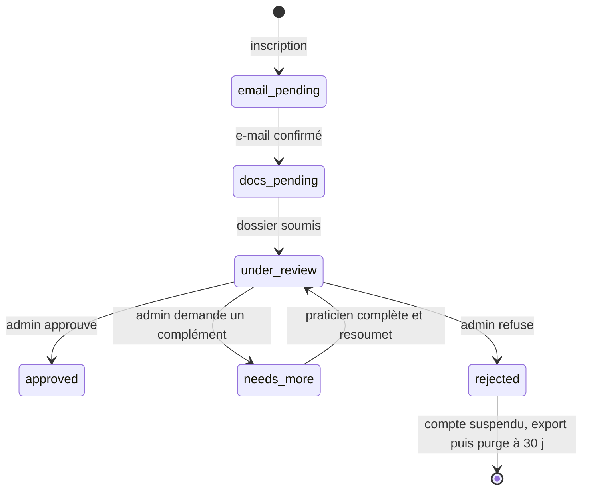

| État | Outil clinique | Annuaire / profil public | Badge « vérifié » | Connexion |
| --- | --- | --- | --- | --- |
| `email_pending` | — | — | — | refusée (`403 email_unconfirmed`) |
| `docs_pending`, `under_review`, `needs_more` | **oui** (bandeau d'état) | non | non | oui |
| `approved` | oui | oui | oui | oui |
| `rejected` | non | non | non | refusée (`403 suspended`), sessions révoquées ; recours possible (`practitioner_appeal`, M1-14b, G Q28) et export du compte (`export_job`, M6-05, G Q18) |

### A10.4 Endpoints ajoutés

| Méthode | Chemin | Rôle | Auth |
| --- | --- | --- | --- |
| POST | `/api/auth/register` (remplace `/signup`) | Inscription avec profession, téléphone, adresse ; ouverte à tous (G Q21) | aucune |
| POST | `/api/auth/confirm-email`, `/api/auth/password-reset/request`, `/confirm` | Confirmation et réinitialisation | aucune |
| POST | `/api/auth/login` (`202 {otpRequired}` puis `200`) | Connexion, 2FA ; session 12 h, 30 jours avec « rester connecté » (G Q6) | aucune |
| POST | `/api/me/2fa/enable`, `/verify`, `/disable`, GET `/api/me/2fa/recovery-codes` | Double authentification | session |
| GET / PATCH | `/api/me/preferences` | Préférences (merge JSON) | session |
| GET | `/api/me/verification` ; POST `/documents` ; DELETE `/documents/{id}` ; POST `/submit` ; PATCH `/api/me/professional-info` | Dossier professionnel | session |
| GET | `/api/admin/verifications?status&sort&cursor` ; GET `/{id}` ; PATCH `/{id}/documents/{docId}` ; POST `/{id}/decision` | Validation des praticiens | session + rôle `admin` + 2FA |
| GET | `/api/admin/practitioners` ; POST `/{id}/suspend`, `/{id}/reactivate` ; GET `/api/admin/journal` ; GET `/api/admin/appeals`, POST `/{id}/decision` ; GET/POST/PATCH `/api/admin/vocabulary/directory` | Comptes, suspension, journal, recours, vocabulaire de l'annuaire (M1-14b) | admin |
| POST | `/api/me/appeal` ; POST `/api/me/export`, GET `/api/me/export/{jobId}` | Recours et export d'un compte refusé ou suspendu (G Q18, Q28) | session, y compris compte suspendu |

### ADR ajoutés

| ADR | Contexte | Options | Décision | Conséquences |
| --- | --- | --- | --- | --- |
| ADR-11 Préférences par compte en JSONB | Bascules présentes sur plusieurs écrans, multi-appareils | `localStorage` seul ; table clé/valeur ; colonne JSONB | Colonne `practitioner.preferences` JSONB, `PATCH` merge, clés plates versionnées par le code | Une source de vérité ; ajout d'une clé = aucune migration ; `localStorage` = cache |
| ADR-12 Vérification par un administrateur, accès clinique ouvert avant validation | Inscription ouverte (G Q21), données réelles, exigence de prouver la qualification | Tout bloquer avant validation ; aucune vérification ; vérification a posteriori avec blocage de l'annuaire | Vérification humaine obligatoire ; outil clinique ouvert dès l'e-mail confirmé ; annuaire, badge et contact public bloqués jusqu'à l'approbation ; refus = suspension | Module `identity.admin` isolé des modules cliniques (ArchUnit) ; stockage chiffré + purge des justificatifs ; à durcir (blocage total) si l'inscription ouverte amène trop de comptes non qualifiés |

### Risques ajoutés

| # | Risque | Type | Probabilité | Impact | Mitigation |
| --- | --- | --- | --- | --- | --- |
| R11 | Un praticien non qualifié saisit des données de patients avant d'être refusé | Produit / juridique | Moyenne (inscription ouverte, G Q21) | Élevé | Confirmation d'e-mail et limites de taux à l'inscription ; délai de validation ≤ 2 jours ouvrés avec rappel quotidien aux admins ; export puis purge à 30 jours après refus ; option de blocage total documentée (ADR-12) |
| R12 | Fuite ou conservation excessive des justificatifs (diplômes, pièces d'identité) | Sécurité / RGPD | Moyenne | Élevé | Stockage chiffré hors base, URL signées 5 min, journal d'accès, purge automatique à 90 jours, accès admin avec 2FA obligatoire |

## A11. Points d'ancrage réservés pour le compagnon patient (25 octobre 2026, non développé en V1)

Idée notée le 25 octobre 2026 et **remise à plus tard** : une application mobile (React Native ; comparaison avec Capacitor + Angular à faire le moment venu) avec laquelle un patient note ses ressentis et ses événements entre deux séances, les garde sur son téléphone, et les **envoie en un seul lot, d'un geste, avant la séance**. Le praticien trouve ce lot à l'ouverture de la séance. Les exercices prescrits (respiration, journal…) sont des rappels purs sur le téléphone ; rien ne remonte. Aucune étude, aucune tâche ni jalon n'existe pour cela ; cette section réserve uniquement ce que la V1 doit poser dans les données pour que l'idée reste possible sans migration de `entry` ni refonte des vues. L'étude complète (document D) se fera après M4, quand le dossier, les liens et la vue d'ensemble seront stables.

### Principes fixés en discussion (à reprendre tels quels dans l'étude)

- **Le patient garde la main** : rien ne part du téléphone sans le bouton « Envoyer » ; il relit, supprime, puis envoie. Pas de synchronisation continue, pas de temps réel.
- **Aucune illusion de veille** : l'application dit qu'il s'agit d'un journal lu en séance et affiche les numéros d'urgence (3114, 15) en permanence.
- **Le téléphone est le seul dépositaire jusqu'à l'envoi** : stockage local chiffré et verrou (code ou biométrie). Une sauvegarde chiffrée de bout en bout, clé jamais connue du serveur, est une option ultérieure.
- **Pas de compte patient** : appairage par un code court à usage unique généré par le praticien depuis la fiche patient (QR facultatif, expiration 48 h), révocable d'un clic.
- **Pseudonymisation par défaut** : le compagnon ne demande ni nom, ni e-mail, ni téléphone ; le serveur ne connaît du patient que ce qu'il connaît déjà (`display_name` choisi par le praticien). Cela ne change pas la qualification de donnée de santé des lots reçus, qui relève de l'étude hébergement.
- **Rattachement différé** : les entrées d'un lot restent « en attente » (`session_id NULL`) et sont rattachées **en bloc à la séance que le praticien ouvre**, jamais à un rendez-vous futur qui peut bouger.
- **Exercices = rappels** : aucune donnée d'exercice sur le serveur en première version ; un simple décompte par exercice pourra plus tard voyager dans le lot, le modèle ne l'interdit pas.

### Hypothèse et glossaire réservés

| # | Sujet | Hypothèse | Conséquence sur la conception |
| --- | --- | --- | --- |
| H14 | Compagnon patient (réservé) | Des entrées peuvent être écrites par le patient lui-même, par lots, et doivent rester distinguables de celles du praticien pour toujours | `entry.author_type`, `entry.submission_id`, tables `patient_submission` et `patient_device` vides, module `companion` réservé |

**Compagnon** : application mobile du patient, appairée à un dossier. **Lot (submission)** : ensemble d'entrées envoyées par le patient en une fois, avec la période couverte. **Appareil appairé** : téléphone lié à un patient par un code, porteur d'un jeton propre, révocable.

### Schéma réservé (à inclure dans la migration V1, colonnes à leur défaut, tables vides)

```sql
CREATE TABLE patient_device (                        -- réservé compagnon ; vide en V1
  id              uuid PRIMARY KEY,
  tenant_id       uuid NOT NULL,
  patient_id      uuid NOT NULL REFERENCES patient(id),
  platform        text CHECK (platform IN ('ios','android')),
  pairing_code_hash text,                            -- code court à usage unique, haché ; NULL une fois consommé
  pairing_expires_at timestamptz,
  token_hash      text,                              -- jeton d'appareil, haché ; jamais le jeton en clair
  push_token_enc  bytea,                             -- chiffré applicativement ; NULL si notifications refusées
  paired_at       timestamptz,
  last_seen_at    timestamptz,
  revoked_at      timestamptz,
  created_by      uuid NOT NULL                      -- praticien qui a généré le code
);
CREATE INDEX ix_patient_device_patient ON patient_device(patient_id) WHERE revoked_at IS NULL;

CREATE TABLE patient_submission (                    -- réservé compagnon ; vide en V1
  id              uuid PRIMARY KEY,
  tenant_id       uuid NOT NULL,
  patient_id      uuid NOT NULL REFERENCES patient(id),
  device_id       uuid NOT NULL REFERENCES patient_device(id),
  submitted_at    timestamptz NOT NULL DEFAULT now(),
  period_from     timestamptz NOT NULL,              -- première entrée du lot
  period_to       timestamptz NOT NULL,              -- dernière entrée du lot
  item_count      int NOT NULL,
  status          text NOT NULL DEFAULT 'pending'
                  CHECK (status IN ('pending','attached','dismissed')),
  session_id      uuid REFERENCES entry(id),         -- séance de rattachement, posée à l'ouverture de la séance
  attached_at     timestamptz,
  attached_by     uuid
);
CREATE INDEX ix_submission_patient_pending ON patient_submission(patient_id, submitted_at DESC)
  WHERE status = 'pending';

ALTER TABLE entry
  ADD COLUMN author_type text NOT NULL DEFAULT 'practitioner'
    CHECK (author_type IN ('practitioner','patient')),
  ADD COLUMN submission_id uuid REFERENCES patient_submission(id),
  ADD CONSTRAINT ck_entry_session_required
    CHECK (session_id IS NOT NULL OR type = 'session' OR author_type = 'patient');
CREATE INDEX ix_entry_submission ON entry(submission_id) WHERE submission_id IS NOT NULL;
```

Règles attachées à ces colonnes, valables dès la V1 même si elles ne s'exercent pas :

| Règle | Détail |
| --- | --- |
| Valeurs V1 | `author_type = 'practitioner'` et `submission_id IS NULL` sur toute entrée ; les deux tables restent vides ; aucun code ne les écrit |
| Exception à la séance obligatoire | Seule une entrée `author_type = 'patient'` peut avoir `session_id NULL`, et seulement tant que son lot est `pending` ; le rattachement du lot pose `session_id` sur toutes ses entrées dans une transaction (`SubmissionAttached`) |
| Provenance | Une entrée patient n'est jamais convertie en entrée praticien ; `author_type` est immuable. Une correction par le praticien crée une version avec `author_id` praticien, l'entrée reste `author_type = 'patient'` |
| Versions | `entry_version.author_id` est `NULL` pour une version écrite par le patient |
| Lot rejeté | `dismissed` → les entrées du lot sont archivées (`archived_at`), jamais supprimées |
| Visibilité | Une entrée patient est toujours `clinical` ; la valeur `private` est réservée au praticien |
| Types autorisés | Un lot ne contient que des `feeling` et des `event` (et plus tard `situation`) ; jamais de `note`, `session` ni `medication` |
| Vues | Timeline, recherche, graphe et vue d'ensemble exposent `authorType` dans leurs DTO dès la V1 ; l'IA V2 lit `author_type` comme un signal (un ressenti rapporté par le patient n'a pas le même statut qu'un ressenti observé par le praticien) |

### Module, événements et endpoints réservés

- Module `com.psymate.companion`, au même titre que `ai` : créé vide dans `M0-02` pour que la règle de dépendances existe (`patients`, `clinical`, `events` ; jamais `identity.admin` ni `directory`). Il expose `SubmissionReceived` et `SubmissionAttached` ; il n'écrit que des entrées `author_type = 'patient'` et des lots. **Aucun contrôleur en V1.**
- Endpoints réservés (non implémentés) : côté praticien `POST /api/patients/{id}/pairing-codes`, `DELETE /api/patients/{id}/devices/{deviceId}`, `GET /api/patients/{id}/submissions`, `POST /api/submissions/{id}/attach`, `POST /api/submissions/{id}/dismiss` ; côté appareil, préfixe `/api/companion/**` authentifié par jeton d'appareil (jamais par session praticien), limité en débit, avec `POST /api/companion/pair` et `POST /api/companion/submissions`.
- Le payload d'un lot reprend le format de création d'entrée de A5 (`type`, `occurred`, `body`, `feeling`), sans `sessionId`, sans `visibility`, sans `links`.

### ADR réservé

| ADR | Contexte | Options | Décision | Conséquences |
| --- | --- | --- | --- | --- |
| ADR-13 (réservé) Entrées patient par lots, rattachées à l'ouverture de la séance | Un compagnon mobile pourrait un jour déposer des entrées | Envoi en temps réel ; rattachement au prochain rendez-vous ; stockage local + lot envoyé par le patient, rattaché à la séance ouverte | La troisième option, inscrite dans le schéma V1 (`author_type`, `submission_id`, lots `pending → attached`) sans aucun code | Zéro migration de `entry` le jour venu ; l'exception à ADR-10 est bornée au statut `pending` d'un lot ; décision à confirmer dans l'étude D |

### Risque réservé

| # | Risque | Type | Probabilité | Impact | Mitigation |
| --- | --- | --- | --- | --- | --- |
| R13 (réservé) | Les colonnes et tables réservées sont ignorées ou mal remplies par un agent (par ex. `author_type` absent d'un DTO, `submission_id` jamais exposé) | Technique | Moyenne | Faible en V1, élevé en V2 | Vérification dans M7-05 : colonnes à leur défaut partout, tables vides, `authorType` présent dans les DTO d'entrée, contrainte `ck_entry_session_required` en place |

## Plus tard (hors périmètre de cette étude)

À traiter dans une étude séparée après le backend V1 (G Q16, préparée par le document de passation M7-06) : chiffrement au repos et en transit, gestion des clés, hébergement de données de santé et conformité RGPD (y compris mineurs et consentement des représentants légaux, G Q19), modèle de menaces, choix d'hébergeur et déploiement, sauvegardes et objectifs RPO/RTO, journalisation d'audit réglementaire, fournisseur SMTP pour `noreply@psymate.com` (G Q4), stockage des justificatifs et des exports en bêta (G Q17).

Hors V1 (G Q25) : l'agenda synchronisé Google des fiches 15 et 15b ; aucune étude, aucun module.

À traiter dans une étude D, après M4 : le compagnon patient (A11), y compris la comparaison React Native / Capacitor, l'appairage, le bouton « Envoyer », les rappels, les impacts HDS et dispositif médical.
