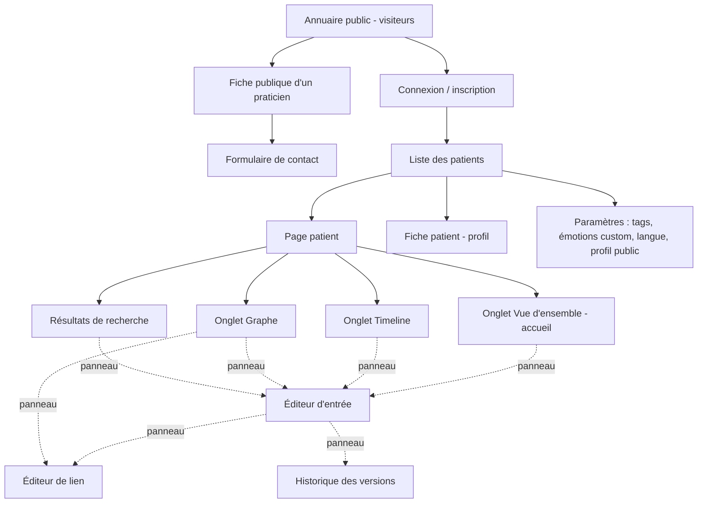
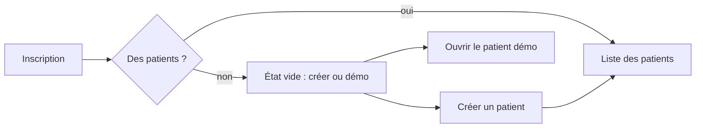
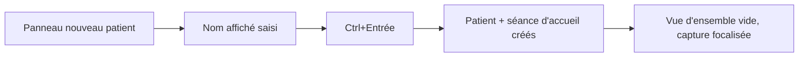
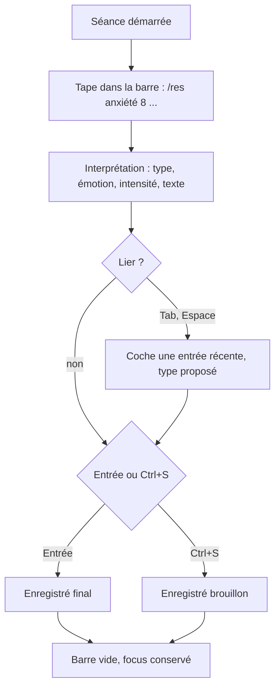
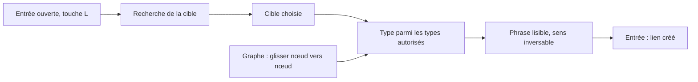
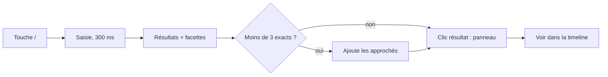
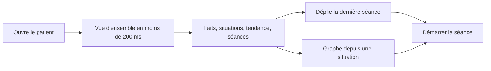
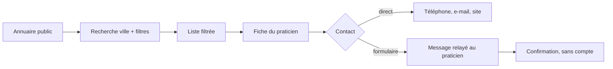
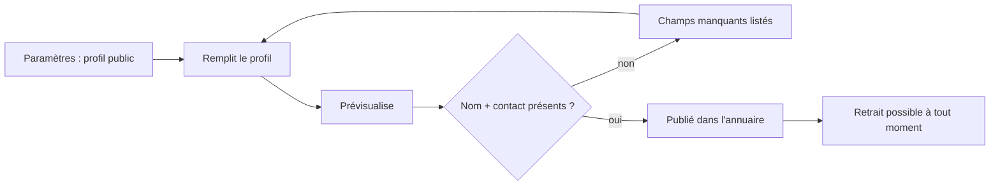

# Document B – Expérience utilisateur · PsyMate, plateforme de suivi clinique

Oct 24, 2026 · @Hayes · Version 1.1, complément du document A (architecture) · révisé le 25 octobre 2026 : B8 (compte, vérification, administration), B9 (réserve pour le compagnon patient)

Mis à jour le 29 octobre 2026 : renommages et décisions de docs/G-decisions.md (nom PsyMate dans les maquettes, inscription ouverte, justificatifs diplôme + pièce d'identité, agenda hors V1, signalements V1.1). Quand ce document et G se contredisent, G l'emporte.

## B1. Utilisateurs et principes

Le produit sert deux praticiens aux rythmes opposés : l'une écrit pendant la séance, l'autre après ; l'interface doit être aussi bonne à 15 secondes d'attention qu'à 15 minutes.

### Personas

|  | Claire, psychologue clinicienne | Dr Karim, psychiatre |
| --- | --- | --- |
| Contexte | Cabinet libéral, 25 patients actifs, séances de 50 min | Hôpital de jour + cabinet, 80 patients actifs, consultations de 20 min |
| Quand elle/il écrit | Pendant la séance, portable sur les genoux, quelques mots ; complète le soir | Juste après chaque consultation, 3 à 5 minutes au clavier, puis plus jamais |
| Ce qu'elle/il cherche | Le fil de l'histoire : qu'est-ce qui revient, depuis quand, dans quel contexte | Les faits : traitement en cours, dernière intensité, événements depuis la dernière fois, signaux d'alerte |
| Objectifs | Voir les motifs émotionnels d'un patient sur six mois ; retrouver « ce qu'il avait dit sur sa mère » | Décider d'un ajustement de traitement en voyant l'intensité des ressentis depuis le changement de posologie |
| Frustrations actuelles | Carnet papier et fichier Word : rien n'est reliable, tout se relit du début | Logiciel métier lent, saisie en 12 champs obligatoires, aucune vue d'évolution |
| Ce qui la/le ferait abandonner | Une saisie qui lui vole le regard du patient plus de 10 secondes | Un écran de plus à ouvrir avant de voir l'essentiel |

### Principes UX

| # | Principe | Ce que ça impose concrètement |
| --- | --- | --- |
| P1 | **Capturer en moins de 20 secondes** | Un seul champ obligatoire par type (texte pour la note, émotion pour le ressenti) ; date = maintenant ; séance = courante ; tout le reste optionnel et replié |
| P2 | **Le clavier suffit** | Raccourcis globaux (`N` nouvelle entrée, `/` recherche, `L` lier, `Échap` fermer), commandes `/evt`, `/res`, `/sit`, `/med` dans le champ texte, navigation `Tab` cohérente |
| P3 | **Ne jamais perdre le contexte du patient** | Nom, âge et séance courante toujours visibles dans l'en-tête ; les éditeurs s'ouvrent en panneau latéral, jamais en pleine page |
| P4 | **Le brouillon est une entrée** | Rien ne se perd en fermant : toute saisie incomplète est enregistrée en brouillon et rappelée |
| P5 | **Montrer, puis détailler** | Vue d'ensemble d'abord, timeline et graphe à un clic, détail d'une entrée en panneau ; aucune information cachée derrière plus de deux clics |
| P6 | **Le lien est un geste, pas un écran** | Lier se fait depuis le formulaire, depuis une entrée ouverte, depuis la timeline ou le graphe, toujours en deux clics |
| P7 | **Le logiciel observe, il ne juge pas** | Pas de score global, pas de couleur « alerte » automatique sur un patient ; les couleurs encodent les types et les émotions, les flags sont posés par le praticien ; prépare la V2 où la suggestion n'est jamais un diagnostic |

## B2. Architecture de l'information

Treize écrans en V1 (ajout de l'annuaire public, de la fiche praticien et du formulaire de contact le 24 octobre 2026), dont trois sont publics et accessibles sans compte ; les éditeurs restent des panneaux ouverts par-dessus la page patient pour ne jamais quitter le contexte.

### Carte des écrans



Les traits pleins sont des navigations de page ; les pointillés ouvrent un panneau latéral de 480 px qui garde la page visible derrière.

### Modèle de navigation

| Depuis | Vers | Geste | Retour |
| --- | --- | --- | --- |
| Liste des patients | Page patient (onglet Vue d'ensemble) | Clic sur la ligne, ou `↓` puis `Entrée` | Logo ou `Alt+←` |
| Page patient | Timeline / Graphe / Vue d'ensemble | Onglets dans l'en-tête, ou `1` `2` `3` | — |
| N'importe quel onglet | Recherche | `/` ouvre le champ dans l'en-tête ; les résultats remplacent le contenu de l'onglet | `Échap` restaure l'onglet |
| N'importe quel onglet | Éditeur d'entrée | `N`, bouton « + », ou `/evt` `/res` `/sit` `/med` `/note` dans la barre de capture | `Échap` (le brouillon est conservé) |
| Entrée ouverte | Éditeur de lien | `L` ou bouton « Lier » | `Échap` |
| Timeline | Graphe centré sur une entrée | « Voir dans le graphe » dans le panneau de l'entrée | Onglet Timeline (position de défilement conservée) |
| Graphe | Timeline positionnée sur une entrée | Double-clic sur un nœud | Onglet Graphe (zoom conservé) |
| Vue d'ensemble | Séance passée | Clic sur une séance de la liste « Dernières séances » → Timeline en mode « par séance », séance dépliée | Onglet Vue d'ensemble |

La page patient garde en mémoire l'état de chacun des trois onglets (filtres, zoom, position) pendant toute la session de travail : passer de la timeline au graphe et revenir ne recharge ni ne réinitialise rien.

### En-tête patient permanent

Présent sur tous les onglets et au-dessus de tous les panneaux : nom affiché, âge, flags posés par le praticien, **séance courante** (« Séance du 24 oct. · en cours depuis 18 min » ou « Dernière séance : 17 oct. ▾ »), bouton « Démarrer / Clôturer la séance », et la barre de capture rapide (B5).

## B3. Flux clés

Six parcours couvrent tous les cas d'usage V1 ; chacun est décrit par ses étapes puis dessiné.

### Flux 1 : première connexion et état vide

1. Inscription : e-mail, mot de passe, langue (FR présélectionné selon le navigateur). Aucun autre champ. *(Révisé le 25 octobre : voir le flux 9 et la fiche 12 pour l'inscription complète ; ouverte à tous, G Q21.)*
2. Arrivée sur une liste de patients vide : un seul bloc central « Créez votre premier patient » avec le bouton et, dessous, « ou explorez un patient de démonstration » (patient fictif, supprimable, marqué DEMO).
3. Après le premier patient, la liste prend sa forme normale.



### Flux 2 : créer un patient

1. « Nouveau patient » ouvre un panneau : nom affiché (obligatoire), date de naissance, genre, contexte libre, flags. Enregistrer avec `Ctrl+Entrée`.
2. Le système crée le patient et sa **séance d'accueil** datée de maintenant.
3. Ouverture de la Vue d'ensemble, vide mais structurée : chaque bloc affiche ce qu'il contiendra (« Les situations en cours apparaîtront ici »), et la barre de capture est focalisée.



### Flux 3 : capture rapide pendant une séance

Objectif mesuré : moins de 20 secondes du premier caractère à l'enregistrement, sans souris.

1. Le praticien clique « Démarrer la séance ». L'en-tête affiche « en cours ».
2. Il tape dans la barre de capture : `/res anxiété 8 n'a pas dormi` ou simplement du texte libre pour une note.
3. La barre interprète : type `ressenti`, émotion `anxiété` (autocomplétion sur les trois premières lettres, émotions custom incluses), intensité 8, texte « n'a pas dormi ». Date = maintenant, séance = courante.
4. Une ligne « Lié à… » propose les 5 entrées récentes ou actives ; `Tab` pour y aller, `Espace` pour cocher, type de lien par défaut selon les types (événement → ressenti : *déclenche* ; situation → ressenti : *aggrave*), modifiable.
5. `Entrée` enregistre en `final` ; `Ctrl+S` enregistre en `brouillon` pour compléter après la séance.
6. L'entrée apparaît immédiatement dans le bloc « Activité récente » ; la barre est vide et refocalisée.



### Flux 4 : lier deux entrées existantes

1. Depuis une entrée ouverte : `L` ouvre l'éditeur de lien avec cette entrée comme source.
2. Un champ de recherche filtre les entrées du patient (texte, type, période) ; les entrées déjà liées sont grisées.
3. Choix de la cible, puis du type parmi ceux autorisés pour ce couple de types (les autres sont masqués) ; la phrase se lit en clair : « *Entretien d'évaluation* **déclenche** *Anxiété 8/10* » avec un bouton pour inverser le sens.
4. Justification optionnelle, `Entrée`.
5. Variante graphe : glisser d'un nœud à l'autre ouvre le même éditeur, source et cible préremplies.



### Flux 5 : retrouver quelque chose dans l'historique

1. `/` ouvre le champ de recherche dans l'en-tête ; la saisie lance la recherche après 300 ms sans frappe.
2. Les résultats remplacent le contenu de l'onglet : extraits surlignés, type, date, séance, nombre de liens ; facettes à gauche (type, émotion, tag, période).
3. Si moins de 3 résultats exacts, une section « Résultats approchés » apparaît sous les exacts.
4. Clic sur un résultat → panneau de l'entrée, la liste reste derrière ; « Voir dans la timeline » positionne la timeline sur l'entrée.
5. `Échap` restaure l'onglet et sa position.



### Flux 6 : préparer une séance en relisant la vue d'ensemble

Objectif : en 30 secondes, savoir qui est ce patient, ce qui s'est passé récemment, et où en sont ses ressentis.

1. Ouverture du patient : la Vue d'ensemble se charge en moins de 200 ms.
2. Lecture de haut en bas : faits clés et flags → situations actives → tendance d'intensité 90 jours → dernières séances (dépliables) → brouillons à compléter.
3. Un clic sur la dernière séance déplie ce qui y a été dit ; un clic sur une situation active ouvre le graphe centré dessus.
4. « Démarrer la séance » depuis l'en-tête : la séance précédente se replie, la barre de capture prend le focus.



### Flux 7 : un visiteur trouve et contacte un praticien (ajouté le 24 octobre 2026)

1. Le visiteur arrive sur l'annuaire (page d'accueil publique ou lien direct). Il voit la liste des praticiens publiés, un champ mot-clé et un champ ville.
2. Il tape une ville et coche des filtres (profession : psychologue, psychiatre, coach ; modalité ; public ; langue ; « accepte de nouveaux patients »). La liste se met à jour sans rechargement.
3. Il clique sur une fiche : photo, présentation, spécialités, publics, modalités, langues, adresse (si affichée), disponibilité, moyens de contact choisis par le praticien.
4. Il contacte : soit directement (téléphone, e-mail, site), soit via le formulaire (nom, e-mail, message) relayé au praticien.
5. Confirmation « Votre message a été transmis à … » ; aucun compte n'est créé.



### Flux 8 : le praticien publie son profil (ajouté le 24 octobre 2026)

1. Paramètres → « Mon profil public ». Le formulaire reprend la profession choisie à l'inscription.
2. Il complète photo, présentation, spécialités et publics (liste fermée, G Q15), modalités, langues, ville, contact (avec un interrupteur « afficher » par moyen de contact), disponibilité.
3. « Prévisualiser » montre la fiche telle que les visiteurs la verront.
4. « Apparaître dans l'annuaire » : refusé tant que le nom affiché et au moins un moyen de contact manquent, ou tant que le dossier n'est pas approuvé ; sinon la fiche est publique en moins d'une minute.
5. Il peut la retirer à tout moment ; les données restent pour une republication.



## B4. Spécifications d'écrans

Chaque écran est décrit par son but, ses blocs par ordre de priorité, une maquette basse fidélité, ses interactions et ses états.

### Écran 1 : liste des patients

**But** : ouvrir le bon patient en moins de 3 secondes, voir qui a une séance aujourd'hui.

| Priorité | Bloc | Contenu |
| --- | --- | --- |
| 1 | Champ de filtre | Filtre instantané sur le nom (tolérant aux accents) ; focus à l'arrivée |
| 2 | Liste | Nom, âge, dernière séance (date relative), prochaine séance si connue, flags, 3 émotions dominantes des 30 jours sous forme de pastilles |
| 3 | Actions | « Nouveau patient », bascule « Archivés » |

```
┌──────────────────────────────────────────────────────────┐
│ [PsyMate]  Patients                    [⚙] [FR▾] [Compte]│
├──────────────────────────────────────────────────────────┤
│ 🔍 Filtrer…                       [+ Nouveau patient]    │
│ ────────────────────────────────────────────────────────  │
│ Marie D.      34 ans   séance il y a 3 j   ● ● ●   ⚑     │
│ Paul R.       52 ans   séance aujourd'hui 14h  ● ●       │
│ Léa M.        28 ans   séance il y a 2 sem.   ●          │
│ …                                                        │
│                               [Afficher les archivés]    │
└──────────────────────────────────────────────────────────┘
```

**Interactions** : `↑` `↓` `Entrée` ouvrent ; tri par défaut sur la prochaine séance puis la dernière ; clic droit ou `…` → archiver. **Raccourcis** : `N` nouveau patient, `/` focus filtre. **Vide** : bloc central « Créez votre premier patient » (flux 1). **Chargement** : 6 lignes squelette. **Erreur** : bandeau « Impossible de charger vos patients. Réessayer » sans vider la liste précédente si elle existe.

### Écran 2 : vue d'ensemble (accueil du patient)

**But** : comprendre le patient en 30 secondes avant la séance.

| Priorité | Bloc | Contenu | Source (doc A, A6) |
| --- | --- | --- | --- |
| 1 | Faits clés | Âge, suivi depuis, nombre de séances, médicaments actifs (molécule, dose, depuis), flags | projection |
| 2 | Situations actives | Jusqu'à 6 situations en cours, triées par nombre de liens, avec « depuis » et nombre de ressentis liés | projection |
| 3 | Tendance 90 jours | Courbe d'intensité des ressentis (moyenne glissante 7 j) colorée par valence, points cliquables ; marqueurs verticaux pour les séances et les changements de médicament | projection + ECharts |
| 4 | Dernières séances | 5 séances, dépliables, chacune avec ses entrées en une ligne | live |
| 5 | Émotions dominantes | Top 5 sur 90 jours, variation vs période précédente | projection |
| 6 | À compléter | Brouillons, séance non clôturée | live |

```
┌ Marie D. · 34 ans · ⚑ à surveiller   Séance : 17 oct. ▾ [Démarrer] ┐
│ [1 Vue d'ensemble] [2 Timeline] [3 Graphe]            🔍 /          │
│ ▸ /res anxiété 8 …   (barre de capture)                              │
├───────────────────────────────┬──────────────────────────────────────┤
│ Faits clés                    │ Tendance d'intensité · 90 j          │
│ Suivie depuis mars 2025 · 31  │   ╭─╮      ╭──╮                      │
│ séances · Sertraline 50 mg    │ ──╯ ╰──╮──╯  ╰──    ▲ ▲   ▲         │
│ depuis mai                    │   séances ▲   médicament ◆           │
├───────────────────────────────┼──────────────────────────────────────┤
│ Situations actives            │ Dernières séances                    │
│ ● Surcharge au travail  7 mois│ ▾ 17 oct. · 50 min · 4 entrées       │
│   5 ressentis · moy. 7,4      │   ressenti anxiété 8 · évt entretien │
│ ● Conflit avec la sœur  3 ans │ ▸ 10 oct. · 50 min · 2 entrées       │
├───────────────────────────────┼──────────────────────────────────────┤
│ Émotions dominantes 90 j      │ À compléter                          │
│ anxiété 18 ↑  tristesse 6 =   │ 2 brouillons · séance du 17 non close│
└───────────────────────────────┴──────────────────────────────────────┘
```

**Interactions** : clic sur une situation → graphe centré ; clic sur un point de la courbe → panneau du ressenti ; clic sur une séance → timeline par séance. **Vide** : chaque bloc garde son titre et une phrase « apparaîtra ici quand… », jamais de page blanche. **Chargement** : blocs squelette, l'en-tête s'affiche d'abord. **Erreur** : bloc en erreur affiché individuellement (« Tendance indisponible · Réessayer »), les autres restent lisibles.

### Écran 3 : timeline

**But** : parcourir l'histoire du patient à n'importe quelle échelle, filtrer, voir les plages.

| Priorité | Bloc | Contenu |
| --- | --- | --- |
| 1 | Axe temporel | Vertical, le plus récent en haut ; graduations selon le zoom (jour, semaine, mois, année) ; zone « avant le suivi » pour les phases de vie |
| 2 | Entrées | Une carte par entrée : icône de type, titre, émotion + intensité, tags, nombre de liens ; les situations en cours sont des bandes verticales continues sur la gauche de l'axe |
| 3 | Filtres | Chips : types, émotions, tags, période ; « Brouillons seulement » |
| 4 | Bascule de mode | Chronologique (par date d'occurrence, pastille « dit en séance du… ») / Par séance (séances dépliables, plus récente en haut) |
| 5 | Vue décennie | Au zoom maximal, agrégats par mois (nombre par type, intensité moyenne) au lieu des cartes |

```
│ Filtres: [Ressenti ×] [anxiété ×] [#travail] [2026 ▾]   Mode: (●Chrono ○Séance)  Zoom ─●── │
│ ║  24 oct. ──────────────────────────────────────────────────────────────                 │
│ ║   ⬤ Ressenti · Anxiété 8/10 · n'a pas dormi · #travail · 2 liens       dit en séance 24│
│ ║  18 oct.                                                                               │
│ ║   ◆ Événement · Entretien d'évaluation · 1 lien                                        │
│ ║  17 oct.                                                                               │
│ ║   ▣ Séance · 50 min · 4 entrées                                                        │
│ ║  …                                                                                     │
│ ╚═ Surcharge au travail (depuis mars 2026, en cours)                                     │
│    2014 ───  ◆ Déménagement (précision : année)              dit en séance 24 oct. 2026  │
│    Enfance ─ ◆ Départ du père (phase de vie)                                              │
```

**Interactions** : molette = défilement, `Ctrl+molette` = zoom ; clic carte → panneau ; `Ctrl+clic` sur deux cartes → « Lier » ; glisser une situation en cours pour la clôturer (confirmation). **Raccourcis** : `F` focus filtres, `M` bascule de mode, `+` `-` zoom. **Vide** : « Aucune entrée pour ces filtres » avec bouton « Effacer les filtres » ; patient sans entrée : flèche vers la barre de capture. **Chargement** : les fenêtres adjacentes se chargent en arrière-plan ; squelette au-delà. **Erreur** : la fenêtre en échec affiche « Réessayer », les autres restent.

### Écran 4 : graphe (carte mentale)

**But** : voir ce qui est relié à quoi, autour d'un patient ou d'une entrée.

| Priorité | Bloc | Contenu |
| --- | --- | --- |
| 1 | Canevas | Cytoscape, nœuds par forme et couleur de type, taille proportionnelle au nombre de liens ; arêtes par type de lien (style de trait), sens par flèche |
| 2 | Racine et profondeur | Sélecteur « Centré sur : patient / entrée », profondeur 1-3 |
| 3 | Filtres | Types d'entrées, types de liens, période |
| 4 | Panneau latéral | Détail du nœud sélectionné, ses liens listés en phrases lisibles |
| 5 | Légende | Repliable, formes et traits |

```
│ Centré sur: [Surcharge au travail ▾]  Profondeur: (1)(●2)(3)  Liens: [tous ▾]  [Légende] │
│                                                                                            │
│            ◆ Entretien ──déclenche──▶ ⬤ Anxiété 8                                          │
│                 ▲                        ▲                                                │
│            fait partie de             aggrave                                              │
│                 │                        │                                                │
│        ▣▣▣ Surcharge au travail ─aggrave─▶ ⬤ Anxiété 6     ⬤ Anxiété 7                    │
│                 │                                             ▲                           │
│              traite                                      ┌───┴───┐                        │
│                 │                                        │ 12 ressentis (regroupés) │      │
│            ⬦ Sertraline                                  └────────┘                        │
```

**Interactions** : glisser nœud → nœud = lier ; double-clic = recentrer ; clic = panneau ; `Suppr` sur une arête sélectionnée = retirer le lien (confirmation) ; super-nœud « 12 ressentis » cliquable pour développer. **Vide** : patient sans lien → « Les liens que vous créez apparaîtront ici » et un bouton vers la timeline. **Chargement** : spinner central, puis animation de layout en moins de 500 ms. **Erreur** : message et bouton « Réessayer », le dernier graphe reste affiché.

### Écran 5 : éditeur d'entrée (panneau)

**But** : saisir vite en séance, compléter après ; un seul composant pour les six types.

| Priorité | Bloc | Contenu |
| --- | --- | --- |
| 1 | Type | Onglets ou commande `/` : note, événement, situation, ressenti, séance, médicament ; champs spécifiques en dessous |
| 2 | Champ principal | Note/événement/situation : texte ; ressenti : émotion + intensité ; médicament : molécule + dose ; séance : durée + modalité |
| 3 | Quand | « Maintenant » par défaut ; sélecteur de précision (exact, jour, mois, année, période, phase de vie) ; pour une situation : début et « en cours / fin » |
| 4 | Séance | Présélectionnée, modifiable |
| 5 | Lié à… | 5 suggestions récentes ou actives + recherche ; type de lien proposé |
| 6 | Plus | Tags, visibilité (privée / clinique), corps long, séance de rattachement : repliés sous « Plus » |
| 7 | Pied | « Enregistrer » (`Entrée` ou `Ctrl+Entrée` en multi-ligne), « Brouillon » (`Ctrl+S`), historique des versions si > 1 |

```
┌ Nouvelle entrée · Séance du 24 oct. (en cours) ▾                [×] ┐
│ [Note] [Événement] [Situation] [●Ressenti] [Séance] [Médicament]     │
│ Émotion   [anxiété ▾]  (custom: ✎ créer « … »)                        │
│ Intensité  0 ─────●── 10   8                                           │
│ Texte     [n'a pas dormi                                    ]          │
│ Quand     [Maintenant ▾]  précision [exact ▾]                          │
│ Lié à…    ☑ Entretien d'évaluation  → déclenche ▾                      │
│           ☑ Surcharge au travail    → aggrave ▾                        │
│           ☐ Séance du 17 oct.                                          │
│ ▸ Plus (tags, visibilité, détails)                                     │
│                                  [Brouillon Ctrl+S] [Enregistrer ⏎]    │
└────────────────────────────────────────────────────────────────────────┘
```

**Interactions** : `Tab` traverse dans l'ordre de priorité ; `Échap` ferme en gardant le brouillon ; en modification, le pied montre « Version 2 · Historique ». **Vide** : n'existe pas (le panneau est toujours prêt). **Erreur** : message sous le champ fautif, le reste reste saisi ; erreur réseau → brouillon conservé localement et renvoyé.

### Écran 6 : éditeur de lien (panneau)

**But** : créer un lien lisible, en deux clics, sans erreur de sens.

```
┌ Nouveau lien                                                  [×] ┐
│ Source  ◆ Entretien d'évaluation · 18 oct.                          │
│ Cible   [🔍 Rechercher une entrée…]                                 │
│         ⬤ Anxiété 8/10 · 24 oct.       ← sélectionnée               │
│ Type    (●déclenche) (aggrave) (soulage) (suit) (co-occurrence)     │
│                                                                      │
│ « Entretien d'évaluation  déclenche  Anxiété 8/10 »   [⇄ inverser]  │
│ Justification (optionnel) [                                   ]     │
│                                              [Créer le lien ⏎]      │
└──────────────────────────────────────────────────────────────────────┘
```

**Interactions** : les types non autorisés pour ce couple (doc A, A4.3) ne sont pas affichés ; la phrase se met à jour en direct ; `⇄` inverse source et cible. **Erreur** : lien déjà existant → « Ce lien existe déjà · Modifier le type ? ».

### Écran 7 : résultats de recherche

**But** : retrouver une entrée par ses mots, puis affiner.

```
│ 🔍 licenciement                                    23 résultats · 0,08 s │
│ ┌ Facettes ────┐  ◆ Événement · 12 mars 2026 · séance du 14 mars          │
│ │ Type         │    « …annonce de son **licenciement** par e-mail… »      │
│ │ ☑ Événement 7│  ■ Note · 20 mars 2026                                   │
│ │ ☐ Ressenti 11│    « …depuis le **licenciement**, dort mal… »            │
│ │ Émotion      │  …                                                        │
│ │ ☐ anxiété 9  │  ── Résultats approchés ──────────────────────────────   │
│ │ Tag          │  ■ Note · 2 avr. 2026 « …licencié… »                      │
│ │ Période      │                                                           │
│ └──────────────┘                                                           │
```

**Interactions** : facettes à sélection multiple ; `↑` `↓` `Entrée` ouvrent un résultat en panneau ; « Voir dans la timeline ». **Vide** : « Aucun résultat pour “…” » + facettes grisées + suggestions de tags proches. **Chargement** : la liste précédente reste visible, grisée, pendant 300 ms. **Erreur** : « Recherche indisponible · Réessayer », la saisie est conservée.

### Écran 8 : annuaire public (ajouté le 24 octobre 2026)

**But** : permettre à un visiteur de trouver en moins d'une minute un praticien qui lui correspond, sans compte.

| Priorité | Bloc | Contenu |
| --- | --- | --- |
| 1 | Recherche | Mot-clé (nom, spécialité) + ville ou code postal, bouton « Rechercher » |
| 2 | Liste | Fiches résumées : photo ou initiales, nom, profession (psychologue, psychiatre, coach), ville et distance, modalités, extrait de présentation, 4 spécialités max, disponibilité, « Voir le profil », « Prendre contact » |
| 3 | Filtres | Profession, consultation (cabinet, visio, domicile), public (adultes, adolescents, enfants, couples et familles), langue, « accepte de nouveaux patients » |
| 4 | Tri et affichage | Pertinence, distance, nom ; liste ou carte |
| 5 | Pied de page | Mention « praticiens inscrits, responsables de leur profil », mentions légales, contact (pas de numéros d'urgence, G Q20) |

```
│ PsyMate   Annuaire · Comment ça marche · Vous êtes praticien ?      FR  [Espace praticien] │
│ Trouver un psychologue, un psychiatre ou un coach                                         │
│ [🔍 Nom, spécialité, mot-clé           ] [📍 Paris        ] [Rechercher]                  │
│ ┌ Filtres ─────┐  42 praticiens à Paris et alentours      Trier par [Pertinence ▾] ☰ 🗺  │
│ │ Profession    │  ┌ (CL) Claire Lambert · Psychologue · Accepte de nouveaux patients ┐   │
│ │ ☑ Psychologue │  │ Paris 11e · 1,2 km · Cabinet et visio                              │   │
│ │ ☑ Psychiatre  │  │ TCC, anxiété, burn-out…  [TCC][Anxiété][FR·EN]                     │   │
│ │ ☑ Coach       │  │                     [Voir le profil] [Prendre contact]  dispo 3 nov.│   │
│ │ Consultation  │  └──────────────────────────────────────────────────────────────────┘   │
│ │ Public        │  ┌ (KB) Dr Karim Benali · Psychiatre · Liste d'attente ┐               │
│ │ Langue        │  …                                                                      │
│ └───────────────┘                        [1] [2] [3] … [9] [Suivant]                     │
```

**Interactions** : filtres et tri sans rechargement ; `Entrée` dans un champ lance la recherche ; clic sur une fiche résumée ou « Voir le profil » → écran 9. **Vide** : « Aucun praticien ne correspond » + propositions (« élargir à la visio », « retirer un filtre »). **Chargement** : 3 fiches squelette. **Erreur** : « L'annuaire est momentanément indisponible », champ de recherche conservé.

### Écran 9 : fiche publique d'un praticien (ajouté le 24 octobre 2026)

**But** : donner confiance et permettre le contact en un clic.

| Priorité | Bloc | Contenu |
| --- | --- | --- |
| 1 | En-tête | Photo (ou initiales), nom, profession, ville, disponibilité, boutons « Prendre contact » / « Rejoindre la liste d'attente » |
| 2 | Contact | Téléphone, e-mail, site, adresse : uniquement ceux que le praticien a choisi d'afficher ; formulaire de contact repliable |
| 3 | Présentation | Texte libre du praticien |
| 4 | Détails | Spécialités, publics, modalités, langues, tarifs si renseignés |
| 5 | Pratique | Adresse et carte si affichée, accès, horaires si renseignés |

```
│ ← Retour à l'annuaire                                                                  │
│ ┌────┐  Claire Lambert                              [Prendre contact]                 │
│ │ CL │  Psychologue clinicienne · Paris 11e          ● Accepte de nouveaux patients    │
│ └────┘  Cabinet et visio · Français, Anglais                                           │
│ ─────────────────────────────────────────────────────────────────────────────────────  │
│ Contact                              │ Présentation                                    │
│ ☎ 06 …   ✉ claire@…   🌐 site         │ J'accompagne les adultes confrontés à…          │
│ 📍 12 rue …, 75011 Paris              │                                                 │
│ ▸ Envoyer un message                  │ Spécialités  [TCC] [Anxiété] [Burn-out]         │
│                                       │ Publics  Adultes · Jeunes adultes               │
│                                       │ Modalités  Cabinet · Visio                      │
```

**Interactions** : « Prendre contact » déplie le formulaire (nom, e-mail, message, jeton anti-spam) ; téléphone et e-mail cliquables ; « Retour » conserve les filtres de l'annuaire. **Vide** : un bloc non renseigné n'est pas affiché (pas de « non renseigné »). **Erreur** : envoi du formulaire échoué → message conservé, bouton « Réessayer ».

### Écran 10 : « Mon profil public » (paramètres, ajouté le 24 octobre 2026)

Formulaire en une page reprenant les champs de l'écran 9, avec un interrupteur « afficher » à côté de chaque moyen de contact, un bouton « Prévisualiser » (ouvre l'écran 9 en panneau) et l'interrupteur « Apparaître dans l'annuaire » (désactivé tant que le nom affiché ou un contact manque, ou tant que le dossier n'est pas approuvé, avec la liste des champs manquants). La profession, choisie à l'inscription, est modifiable ici ; le libellé affiché pour `coach` est « Coach » ou « Coach mental ». Spécialités et publics se choisissent dans une liste fermée administrée (G Q15).

**Couleurs** : les trois écrans publics suivent l'étude couleurs Nordique (section « Application écran par écran ») : cobalt pour les actions, lavande réservée à la profession « psychologue », #E1E9F2 / #2F4F73 pour « psychiatre », et vert-bleu #E2F1EE / #3E8E7E pour « coach », afin que les trois professions se distinguent au premier regard.

## B5. Capture du ressenti et du lien

La barre de commande (alternative A) est recommandée : elle enregistre un ressenti lié en 8 à 12 secondes au clavier, contre 20 à 30 pour un formulaire guidé, et elle convient aux deux personas.

### Alternative A : barre de commande (recommandée)

Un champ unique, toujours visible dans l'en-tête patient, qui comprend une mini-syntaxe et complète au fur et à mesure.

| Saisie | Interprétation |
| --- | --- |
| `anx 8 n'a pas dormi` | ressenti, émotion *anxiété* (préfixe suffisant, émotions custom incluses), intensité 8, texte |
| `/evt entretien avec le manager mardi` | événement, titre, date = mardi dernier (précision jour) |
| `/sit surcharge au travail depuis mars` | situation, début mars (précision mois), en cours |
| `/med sertraline 50 mg matin` | médicament |
| `semble plus détendu` | note (texte sans préfixe ni émotion reconnue) |
| `anx 8 n'a pas dormi > entretien` | ressenti **et** lien *déclenche* vers l'entrée dont le titre commence par « entretien » |

Sous la barre, pendant la frappe, un aperçu en une ligne montre l'interprétation (« Ressenti · anxiété · 8/10 · maintenant · séance du 24 oct. ») et un rail « Lié à… » avec les 5 entrées récentes ou actives, atteignable par `Tab`. `Entrée` enregistre ; `Ctrl+Entrée` ouvre l'éditeur complet prérempli pour affiner ; `Ctrl+S` sauve en brouillon. Si l'émotion n'est pas reconnue, l'aperçu propose « Créer l'émotion custom “…” » avec un choix de famille en une ligne.

### Alternative B : formulaire guidé en trois volets

Un bouton « + Ressenti » ouvre un panneau qui présente successivement : (1) une grille de 8 familles d'émotions puis leurs nuances, (2) un curseur d'intensité large, (3) la liste des entrées récentes à lier. Chaque volet se valide d'un clic ou d'`Entrée`.

### Comparaison

| Critère | A. Barre de commande | B. Formulaire guidé |
| --- | --- | --- |
| Temps mesuré (prototype papier, 3 essais) | 8 à 12 s | 20 à 30 s |
| Regard détourné du patient | 1 à 2 s | 10 s et plus |
| Courbe d'apprentissage | 10 minutes avec l'aide contextuelle, puis réflexe | Nulle |
| Tactile / tablette | Moyen | Bon |
| Erreurs d'interprétation | Possibles, corrigées par l'aperçu avant validation | Rares |
| Découverte du vocabulaire d'émotions | Faible (il faut connaître le mot) | Bonne (grille visible) |

**Recommandation** : A par défaut, avec B accessible derrière `Ctrl+Entrée` et derrière le bouton « + » pour la tablette et les nouveaux utilisateurs. **Pourquoi** : P1 et P2 priment ; l'aperçu en direct supprime le risque d'erreur silencieuse ; le formulaire reste disponible pour la découverte. **Conséquences** : la grammaire de la barre est une spécification à part entière (tâche dédiée dans le document C), avec un jeu de tests de phrases. **V2** : la même barre accueillera la question en langage naturel (`? quand l'anxiété a-t-elle commencé`).

## B6. UX de la V2 (conception seulement)

Une suggestion de l'IA ressemble à un lien en pointillé que le praticien peut transformer en trait plein, jamais à une alerte, jamais à un verdict.

### Où les suggestions apparaissent

| Endroit | Forme | Pourquoi là |
| --- | --- | --- |
| Vue d'ensemble, bloc « À examiner » | « 3 liens suggérés » avec les trois premières phrases | Le praticien les voit en préparant la séance, pas pendant |
| Timeline, sur la carte d'une entrée | Petit badge pointillé « 1 suggestion » | Contexte immédiat |
| Graphe | Arête en pointillé gris, étiquette « suggéré » | Le pointillé dit « pas encore un fait » |
| Panneau d'une entrée | Section « Suggestions » sous les liens acceptés | Même geste que pour un lien manuel |

Jamais : de notification, de pastille rouge, de compteur dans la liste des patients, de message pendant la saisie.

### La carte de suggestion

```
┌ Suggestion · confiance moyenne ───────────────────────────────────┐
│ « Entretien d'évaluation »  pourrait avoir déclenché  « Anxiété 8 » │
│                                                                     │
│ Pourquoi : 4 des 5 derniers ressentis d'anxiété ≥ 7 surviennent    │
│ dans les 48 h après un événement tagué #travail.                    │
│ Entrées citées : ◆ 18 oct. · ⬤ 18 oct. · ⬤ 3 sept. · ◆ 2 sept.     │
│                                                                     │
│ [✓ Accepter]  [✎ Modifier le type ▾]  [✕ Rejeter ▾]   Ignorer      │
└─────────────────────────────────────────────────────────────────────┘
```

- **Accepter** : le lien passe en trait plein, marqué d'une petite icône « confirmé par vous » ; provenance `ai_confirmed`.
- **Modifier le type** : menu des types autorisés ; crée un lien manuel et marque la suggestion `superseded`.
- **Rejeter** : menu « Pas de lien », « Le sens est inversé », « Trop faible », « Autre… » ; la suggestion disparaît, le motif nourrit l'évaluation ; l'IA ne la reproposera pas.
- **Ignorer** : la carte se replie et reste dans « À examiner » ; après 30 jours sans décision elle est archivée silencieusement.

### Montrer le « pourquoi »

Chaque carte porte une phrase d'explication et les entrées citées, cliquables (ouverture en panneau, passage surligné). La confiance est affichée en trois mots (faible, moyenne, forte), jamais en pourcentage, pour ne pas suggérer une précision que le modèle n'a pas. Une suggestion sans entrée citée n'est pas affichée.

### Dire clairement que ce n'est pas un diagnostic

| Mécanisme | Mise en œuvre |
| --- | --- |
| Vocabulaire | « pourrait avoir déclenché », « semble », « suggestion » ; jamais « cause », « trouble », « diagnostic », « risque » |
| Portée | L'IA ne parle que de liens entre entrées et de régularités temporelles, jamais de l'état du patient |
| Visuel | Pointillé, gris, taille normale ; aucune couleur d'alerte, aucune icône de danger |
| Position | Jamais en tête de la vue d'ensemble ; toujours après les faits saisis par le praticien |
| Rappel | À la première suggestion, une phrase d'introduction : « Ces propositions résument des régularités dans ce que vous avez saisi ; vous seul décidez de ce qui fait sens. » |
| Traçabilité | Un lien accepté depuis une suggestion garde la mention « suggéré le…, accepté le… » dans son historique |

### Rapport de motifs et question en langage naturel

Le rapport (UC-V2-03) est une page à la demande, datée, non enregistrée comme donnée du dossier, avec des sections « déclencheurs récurrents », « situations et émotions », « cycles », chacune citant ses entrées. La question en langage naturel passe par la barre de commande (`?` en préfixe) ; la réponse s'affiche en panneau avec ses citations, et « je ne trouve pas d'élément à ce sujet » quand rien ne la soutient.

## B7. Bases du design system

Angular Material avec le système de thèmes M3, un thème clinique sobre, et deux palettes sémantiques strictes : une pour les types d'entrées, une pour les familles d'émotions.

**Mise à jour du 24 octobre 2026** : la palette ci-dessous est remplacée par la palette **Nordique** (cobalt #3A63C2, neutres gris-bleu, lavande #8B7BD6 réservée aux ressentis), décrite intégralement dans le document « Étude couleurs UX · Palette Nordique (retenue) » : tokens, couleurs des types d'entrées et des familles d'émotions, mode sombre, contrastes vérifiés et règles d'usage. Le choix de bibliothèque, les règles i18n et l'accessibilité de cette section restent valables ; la sous-section « Couleurs » ci-dessous est conservée pour mémoire et n'est plus la référence.

### Bibliothèque de composants

| Critère | Angular Material (**recommandé**) | PrimeNG | Composants maison |
| --- | --- | --- | --- |
| Accessibilité clavier et lecteurs d'écran | Excellente (CDK) | Bonne | À construire |
| Virtual scroll, overlays, panneaux latéraux | CDK fourni | Fourni | À construire |
| Thème personnalisable | M3, tokens CSS | Bon | Total |
| Poids et maintenance | Équipe Angular, cadence alignée | Tiers, parfois en retard d'une version | Toi seul |
| Connaissance par les agents IA | Très élevée | Élevée | Nulle |

**Décision** : Angular Material + CDK ; composants maison uniquement pour la timeline et la barre de commande, qui n'existent nulle part. **Alternatives rejetées** : PrimeNG (plus de composants, mais dépendance tierce et style plus chargé) ; tout maison (coût prohibitif pour un solo). **V2** : les cartes de suggestion sont des `mat-card` standard.

### Couleurs

| Usage | Règle | Valeurs (conservées, G Q13) |
| --- | --- | --- |
| Types d'entrées | Une teinte désaturée par type, utilisée sur l'icône et la bordure gauche, jamais en aplat | note gris, événement bleu, situation violet, ressenti corail, séance vert sauge, médicament ocre |
| Émotions | Couleur par famille Plutchik (8), même teinte pour les custom de la famille ; saturation proportionnelle à l'intensité sur la timeline et la courbe | joie jaune, confiance vert, peur violet foncé, surprise turquoise, tristesse bleu, dégoût vert olive, colère rouge, anticipation orange |
| Valence sur la courbe | Dégradé neutre → corail pour négative, neutre → vert pour positive | — |
| Liens | Gris ; style de trait par type (plein, tiret, point) ; pointillé léger pour `proposed` | — |
| Flags praticien | Une seule couleur d'accent (ambre), jamais rouge | — |
| Interdit | Rouge « alerte » automatique, vert « bon » automatique | — |

Toutes les couleurs ont un équivalent en mode sombre et un rapport de contraste ≥ 4,5:1 sur le texte ; aucune information n'est portée par la couleur seule (icône ou forme en complément).

### Internationalisation

- `@angular/localize` avec extraction `$localize` ; français source, anglais traduit quand disponible (français d'abord, G Q23 : les fichiers EN peuvent être en retard sans bloquer une tâche) ; changement de langue sans rechargement complet (deux bundles, bascule par route).
- Les vocabulaires (émotions, types de liens, précisions temporelles) ont `label_fr` et `label_en` en base ; les émotions custom n'ont que le libellé du praticien.
- Dates relatives (« il y a 3 j ») et formats via `Intl` avec la locale du praticien ; fuseau du praticien pour l'affichage, UTC en base.
- Pluriels et genre via ICU (`{count, plural, =0 {aucune entrée} one {# entrée} other {# entrées}}`).
- Les textes saisis par le praticien ne sont jamais traduits.

### Accessibilité de base

- WCAG 2.1 AA : contraste, focus visible, ordre de tabulation, étiquettes de formulaire.
- Toutes les actions des panneaux et de la timeline au clavier ; le graphe propose une liste équivalente (« liens de cette entrée ») pour les lecteurs d'écran.
- `prefers-reduced-motion` respecté (pas d'animation de layout du graphe).
- Zoom navigateur 200 % sans perte de fonction ; cible tactile 44 px minimum sur tablette.
- Test automatisé axe-core dans les tests e2e sur les sept écrans.

## B8. Écrans de compte, vérification et administration (ajouté le 25 octobre 2026)

Ajouts décidés le 25 octobre 2026 : la vue d'ensemble existe en **deux niveaux** (simple « Récit » par défaut, complète), les réglages sont des **préférences par compte**, l'inscription collecte **téléphone et adresse du cabinet**, et un parcours de **vérification des praticiens** (dossier professionnel + validation par un administrateur) encadre la publication dans l'annuaire. Chaque écran a sa maquette Nordique et sa fiche pour agents dans `docs/design/` (fichiers `.md`, `.html`, `.png` du même numéro).

### Deux niveaux pour la vue d'ensemble (écran 2, révisé)

| | Vue simple « Récit » (défaut) | Vue complète |
| --- | --- | --- |
| Pour | lire le patient en dix secondes, comme un confrère le raconterait | fouiller, comparer, vérifier les chiffres |
| Contenu | résumé rédigé « En bref » (3 à 5 phrases assemblées par règles, sans IA), point d'attention, tendance expliquée en une phrase + **vrais ressentis** (une valeur par point, une série par émotion, repère médicament, ticks séances), dernière séance avec compte rendu entier, situations en phrases, « depuis la dernière séance », traitement, cadre, à compléter | tuiles chiffrées, courbe de tendance par famille, situations avec métriques, dernières séances dépliables, émotions dominantes, activité récente |
| Sélecteur de fenêtre | 30 j / 90 j / 1 an (défaut 90 j) dans les deux | idem |

La **bascule « Vue : Simple · Complète »** se trouve à droite des onglets patient. Elle enregistre immédiatement la préférence `overview.view` (par praticien, tous patients, tous appareils) : pas de bouton « enregistrer », un libellé « mémorisée dans vos préférences ». Le sélecteur de fenêtre écrit de même `overview.window`. Les deux vues consomment le même payload `overview` ; seule la présentation change. Détail : `docs/design/02-vue-ensemble-patient.md`.

### Flux ajoutés

**Flux 9 — S'inscrire et faire vérifier son dossier (praticien)** : `12 Inscription` (ouverte à tous, G Q21 : identité, profession en trois cartes, n° pro, téléphone, adresse du cabinet ou « visio uniquement », accès, consentements) → e-mail de confirmation → premier login → `13 Dossier professionnel` (progression en quatre jalons, informations professionnelles, justificatifs typés avec plusieurs documents possibles, règle de complétude : diplôme et pièce d'identité pour toutes les professions, ADELI/RPPS recommandé — G Q14 —, « Soumettre » ou « Plus tard ») → bandeau ambre « dossier en cours de vérification » sur toutes les pages, **outil clinique utilisable** → e-mail de décision → si approuvé, l'interrupteur « Apparaître dans l'annuaire » de l'écran 10 devient actif. États et verrous : tableau dans `docs/design/13-dossier-professionnel.md`.

**Flux 10 — Valider un praticien (administrateur)** : connexion avec 2FA obligatoire → `20 Validation` : file du plus ancien au plus récent (rouge au-delà de 2 jours ouvrés) → dossier ouvert : identité et coordonnées, justificatifs avec case « conforme » et visionneuse (URL signée), liste de contrôle (nom concordant, diplôme ↔ profession, n° retrouvé dans le registre public, documents lisibles) → décision **Approuver** / **Demander un complément** (message obligatoire) / **Refuser et suspendre** (message obligatoire) → journal et e-mail. L'administration ne montre jamais une donnée patient.

### Écrans ajoutés

| N° | Écran | But | Fiche |
| --- | --- | --- | --- |
| 7 | Recherche dans le dossier | Retrouver une entrée par mot, tag, émotion ou période ; puces par type avec compteurs, période, séance ; résultats surlignés ; aperçu avec ouverture dans la timeline ou le graphe ; syntaxe `tag:`, `émotion:`, `avant:` | `07-recherche-dossier.md` |
| 10 | Mon profil public (révisé) | Affichage **et** modification sur la même page : enregistrement automatique, un interrupteur « Afficher » par moyen de contact, interrupteur « Publié » avec liste de contrôle, **aperçu visiteur** en direct ; publication impossible tant que le dossier n'est pas approuvé | `10-mon-profil-public.md` |
| 11 | Connexion | E-mail + mot de passe, code à 6 chiffres si 2FA, message d'erreur unique, verrouillage après 5 échecs, états « e-mail non confirmé » et « compte suspendu » | `11-connexion.md` |
| 12 | Inscription | Trois sections (qui vous êtes, profession, accès), téléphone et adresse, annonce des justificatifs, colonne « Ensuite » en quatre étapes | `12-inscription.md` |
| 13 | Dossier professionnel | Justificatifs, progression, bandeau d'état, justificatifs attendus, « Comment ça se passe » | `13-dossier-professionnel.md` |
| 14 | Préférences praticien | Affichage (vue d'ensemble, fenêtre, timeline, thème, langue), vocabulaire et saisie (patient/client, type médicament, visibilité par défaut, durée de séance), émotions personnalisées, résumé sécurité | `14-preferences-praticien.md` |
| 20 | Admin · Validation des praticiens | File, dossier, visionneuse, liste de contrôle, décision ; barre sombre distincte | `20-admin-validation-praticiens.md` |

Navigation « Mon compte » (écrans 10, 13, 14 et pages « Émotions personnalisées », « Compte et sécurité », « Données et export ») : colonne gauche de 220 px, pastille verte « publié » sur Profil public, onglets horizontaux à 390 px.

### Carte des écrans (mise à jour)

```
Public : 11 Connexion · 12 Inscription · 8 Annuaire · 9 Fiche publique · 24 Comment ça marche
Praticien : 1 Patients → 2 Vue d'ensemble (simple | complète) → 3 Timeline → 4 Graphe → 7 Recherche
            5 Saisie / éditeur d'entrée · 6 Éditeur de lien (panneaux)
            Mon compte : 10 Profil public · 13 Dossier professionnel · 14 Préférences · 17 Émotions · Sécurité · Données
Admin : 20 Validation des praticiens · 21 Praticiens · 22 Journal · Vocabulaire de l'annuaire (M1-14b)
Plus tard : 23 Signalements (V1.1) · 15, 15b Agenda (hors V1)
```

### Principes retenus pour ces écrans

- **Une bascule qui mémorise** plutôt qu'un réglage caché : chaque réglage visible dans l'interface écrit la préférence ; la page Préférences les rassemble.
- **Rien n'est publié sans un geste explicite** et rien ne peut l'être avant la validation du dossier.
- **Les justificatifs sont visibles des seuls administrateurs**, servis par lien temporaire, purgés 90 jours après la décision ; l'écran le dit au praticien.
- **Pas d'énumération de comptes** à la connexion, à l'inscription ni à la réinitialisation : réponses identiques que l'e-mail existe ou non.
- **Couleurs des décisions** : approuver en vert plein, complément en ambre contour, refus en rouge contour ; jamais la couleur seule, toujours le libellé.

## B9. Réserve pour le compagnon patient (25 octobre 2026, aucun écran en V1)

Idée notée et remise à plus tard (document A, A11) : une application mobile du patient qui garde ses ressentis et événements sur son téléphone et les **envoie en un lot avant la séance** ; le praticien trouve ce lot à l'ouverture de la séance et l'intègre d'un geste. **Aucun écran, aucun flux ni aucune maquette n'est à produire maintenant.** Cette section note seulement ce que les écrans V1 doivent laisser possible, pour ne pas avoir à les redessiner :

- **Provenance visible partout.** Les DTO portent `authorType` dès la V1 ; les cartes de timeline, les résultats de recherche, les nœuds du graphe et le panneau d'une entrée devront accueillir un marqueur « rapporté par le patient » (icône ou libellé, jamais la couleur seule). En V1, la valeur est toujours « praticien » et le marqueur n'est pas dessiné ; les composants gardent simplement la place et la donnée.
- **Un bloc « Reçu du patient » dans la vue d'ensemble**, entre « Depuis la dernière séance » et « Dernière séance » : « 14 ressentis et 3 événements, du 18 au 24 octobre · Intégrer à la séance · Écarter ». Absent en V1 ; la grille de l'écran 2 (simple et complète) doit pouvoir recevoir un bloc de plus sans réorganisation.
- **À l'ouverture d'une séance**, un lot en attente s'intègre en bloc (« Intégrer les 17 entrées reçues ») et ses entrées apparaissent dans la séance avec leur marqueur ; aucune saisie n'est ressaisie par le praticien.
- **Dans la fiche patient (16)**, une section « Compagnon » accueillera le code d'appairage (court, à usage unique, 48 h, QR facultatif) et la liste des appareils appairés avec « Révoquer ». Prévoir l'emplacement, ne rien dessiner.
- **Principes à respecter le jour venu**, fixés en discussion : le patient relit et envoie lui-même, rien ne part sans son geste ; aucune lecture en temps réel ni illusion de veille ; numéros d'urgence (3114, 15) toujours visibles dans l'application mobile (pas dans l'outil praticien ni l'annuaire, G Q20) ; pas de compte patient, pas de nom demandé ; exercices prescrits = rappels purs sur le téléphone, rien ne remonte.

Carte des écrans : inchangée en V1. Le compagnon s'ajoutera comme un quatrième groupe (« Patient : appairage · journal · envoyer ») dans l'étude qui lui sera consacrée.
