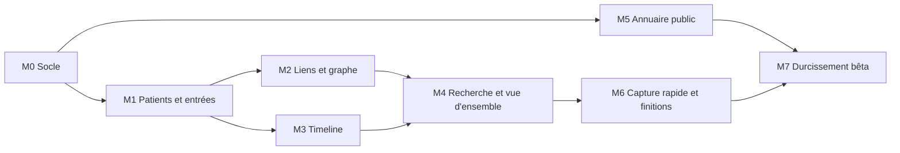

# Document C – Plan d'implémentation · PsyMate, plateforme de suivi clinique

Oct 24, 2026 · @Hayes · Version 1.2 · Complément des documents A (architecture) et B (UX) · révisé le 25 octobre 2026 : C6 (identité étendue, vue d'ensemble, admin), C7 (réserve pour le compagnon patient) · révisé le 27 octobre 2026 : versions épinglées (Spring Boot 4.1, Spring Modulith 2, Angular 22) ; l'ordonnancement détaillé du backend est dans `D-orchestration-backend.md`

Mis à jour le 29 octobre 2026 : renommages et décisions de docs/G-decisions.md (PsyMate, com.psymate, psymate-api / psymate-web ; tâche M1-14b ajoutée ; M6-05 étendue ; vocabulaire de l'annuaire fermé). Quand ce document et G se contredisent, G l'emporte.

## Décisions d'outillage (fixées le 24 octobre 2026, versions révisées le 27 octobre 2026)

Ce plan suppose les choix ci-dessous ; ils ne sont pas rediscutés dans les sections suivantes.

| Sujet | Décision | Conséquence pour le plan |
| --- | --- | --- |
| Dépôts | Deux dépôts GitHub privés sur le compte `mrscams` : `psymate-api` (Spring Boot) et `psymate-web` (Angular) ; pas de licence open source (G Q2) | Une fonctionnalité bout en bout = deux tâches, reliées par le contrat d'API |
| Build backend | **Maven** avec wrapper (`./mvnw`), Java 21 (Temurin), **Spring Boot 4.1** (ligne 4.x : Spring Framework 7, Jakarta EE 11, Jackson 3, JSpecify), **Spring Modulith 2.1.2** (ligne 2.1 = celle alignée sur Boot 4.1 ; importée par le BOM `spring-modulith-bom`) ; package racine `com.psymate` (G Q1) | Trois commandes à connaître : `./mvnw verify`, `./mvnw spring-boot:run`, `./mvnw test -Dtest=…` ; utiliser les noms de starters et de slices de test de la ligne 4 (plusieurs ont été renommés lors de la modularisation de Boot 4 : vérifier dans la documentation 4.1, jamais de mémoire) |
| Build frontend | Node 22, pnpm, Angular CLI (**Angular 22**, Material 22 en M3) | `pnpm install`, `pnpm start`, `pnpm test`, `pnpm e2e` ; zoneless et Signal Forms sont stables en 22 et sont la base des formulaires (éditeur d'entrée, barre de commande) |
| Versions | Épinglées le 27 octobre 2026 à la version **stable** de chaque ligne : Spring Boot 4.1.x, Spring Modulith 2.1.2, Angular 22.x. Spring Boot 3.5 est hors support OSS depuis le 30 juin 2026 ; Angular 20 sort du support fin novembre 2026 ; Angular passe à une majeure par an (v23 en juin 2027, support deux ans) : aucune montée majeure forcée pendant M0–M7 | On ne démarre jamais un dépôt sur une ligne hors support ; une montée de version mineure est une tâche dédiée (branche, PR, CI verte), jamais glissée dans une tâche fonctionnelle ; springdoc-openapi et openapi-generator sont pris dans leurs versions compatibles Boot 4 / Jackson 3 et figés dans `pom.xml` / `package.json` |
| Contrat d'API | OpenAPI généré par springdoc dans `psymate-api`, commité dans `contract/openapi.yaml`, versionné par tag ; `psymate-web` le récupère à un tag et régénère son client | Toute tâche qui change l'API commence par le contrat ; le YAML est l'unique « message » entre les deux dépôts |
| Base de données | PostgreSQL 16 via Docker Compose (image `pgvector/pgvector:pg16`), base `psymate`, utilisateur `psymate`, rôle applicatif `psymate_app` (G Q9), aucune base externe avant la bêta | Docker Desktop obligatoire ; Testcontainers pour les tests d'intégration |
| Services locaux | Postgres, Mailpit (e-mails, expéditeur `test@gmail.com` en local, G Q4), script de seed | `make up`, `make down`, `make seed` |
| Agents | Claude Code (terminal ou IDE) dans chaque dépôt, avec `CLAUDE.md`, `.claude/settings.json`, hooks ; sous-agents par défaut, worktrees pour deux jalons en parallèle, équipes pour un jalon transversal | Un agent = un module Spring ou une fonctionnalité Angular ; jamais deux agents sur les mêmes fichiers |
| CI | GitHub Actions sur chaque PR : build, tests, `ApplicationModules.verify()`, ArchUnit, lint, test de contraste des tokens | Une PR rouge ne se fusionne pas, quel que soit l'auteur |
| Hors périmètre | Hébergement, chiffrement, RGPD, sauvegardes : étude séparée après le backend V1 (G Q16 ; voir « Plus tard » du document A). Agenda Google (fiches 15, 15b) : hors V1 (G Q25) | Le jalon M7 prévoit la place de ces sujets sans les traiter |

## C1. Jalons

Huit jalons de la repo vide à la bêta de 50 praticiens ; chacun se termine par une démonstration que tu peux faire à un praticien pilote. Efforts en jours pour un développeur seul assisté d'agents, hors étude hébergement.



M2 et M3 ne dépendent que de M1 et peuvent avancer en parallèle (deux worktrees) ; M5 ne dépend que de M0 et peut être confié à une équipe d'agents pendant que tu travailles M1-M4.

| Jalon | Objectif | Démontrable à la fin | Effort |
| --- | --- | --- | --- |
| **M0 Socle** | Deux dépôts, Maven et pnpm, Docker Compose, CI verte, Modulith avec modules vides, Flyway V1, identité (inscription, connexion, tenant), i18n FR/EN, contrat OpenAPI généré et consommé, `CLAUDE.md` et hooks | Un praticien s'inscrit, se connecte, voit une page vide en français ou en anglais ; `./mvnw verify` et `pnpm test` passent en CI | 4 j |
| **M1 Patients et entrées** | Profil patient, séance d'accueil automatique, six types d'entrées avec tables de détail, versions et règle de grâce, vocabulaire d'émotions (globales + custom), tags, éditeur d'entrée (panneau), liste des patients | Créer un patient, démarrer une séance, saisir une note, un événement, une situation, un ressenti, un médicament ; corriger une entrée et voir l'historique | 8 j |
| **M2 Liens et graphe** | Table `link`, types de liens, validation par types d'entrées, éditeur de lien, requête de voisinage, vue graphe Cytoscape avec niveau de détail | Lier un ressenti à un événement et à une situation, voir le graphe centré sur la situation, retirer un lien | 6 j |
| **M3 Timeline** | Endpoint fenêtré avec curseur, composant timeline (zoom, plages, situations en cours, modes chronologique et par séance), filtres, vue décennie agrégée | Parcourir 10 ans d'historique fictif sans ralentissement, filtrer par émotion, basculer par séance | 6 j |
| **M4 Recherche et vue d'ensemble** | Full-text + trigrammes, facettes, surlignage ; outbox et événements de domaine ; projection `patient_overview` et ses blocs ; courbe d'intensité | Ouvrir un patient en moins de 200 ms, chercher « licencimen » et trouver « licenciement », voir la tendance et les situations actives | 6 j |
| **M5 Annuaire public** | Profession, `practitioner_profile`, écran « Mon profil public », pages publiques (annuaire, fiche, contact), anti-spam, Mailpit | Un visiteur sans compte trouve une psychologue à Paris, ouvre sa fiche et lui envoie un message | 5 j |
| **M6 Capture rapide et finitions** | Barre de commande (grammaire, aperçu, rail « lié à »), raccourcis clavier globaux, états vides / chargement / erreur de tous les écrans, mode sombre, export PDF (Could) | Saisir un ressenti lié en moins de 12 secondes au clavier ; chaque écran a ses trois états | 5 j |
| **M7 Durcissement bêta** | Seed de 100 patients × 2 000 entrées et tests de charge, limitation de débit, journaux d'audit applicatifs, onboarding (patient démo), page d'aide, tests e2e complets, accessibilité axe-core, hooks de préparation V2 vérifiés (outbox, pgvector, chunks) | Déploiement progressif 5 → 20 → 50 praticiens, inscription ouverte (G Q21), hébergement traité dans l'étude séparée | 5 j |

**Total indicatif : 45 jours**, soit environ trois mois à mi-temps ou deux mois à plein temps avec des agents. Les jalons M2/M3 et M5 en parallèle peuvent ramener le calendrier à sept semaines pleines.

## C2. Tâches prêtes pour un agent

Chaque tâche tient dans une session d'agent (une à trois heures), touche un seul module ou une seule fonctionnalité, et se termine par des tests verts. Les colonnes « Dépôt » et « Module » disent à quel agent la confier ; deux tâches du même module ne tournent jamais en parallèle. Le texte « Lire » renvoie aux sections des documents A et B à fournir dans le prompt. L'ordre de lancement, les vagues et les couloirs parallèles côté backend sont détaillés dans `D-orchestration-backend.md`.

### M0 Socle

| ID | Titre | Dépôt / module | Lire | Quoi construire | Critères d'acceptation | Tests | Dépend de |
| --- | --- | --- | --- | --- | --- | --- | --- |
| M0-01 | Initialiser `psymate-api` | api / racine | C3, G Q1, Q9 | Projet **Spring Boot 4.1** Maven (`com.psymate:psymate-api`), Java 21, wrapper, **Spring Modulith 2.1.2** (BOM), Flyway, springdoc (version compatible Boot 4 / Jackson 3), Testcontainers, Spotless ; `Makefile` ; `docker-compose.yml` (pgvector/pg16 avec base `psymate`, utilisateur `psymate`, rôle `psymate_app` créé par l'init du conteneur ; Mailpit) ; CI GitHub Actions. Starters et slices de test aux noms de la ligne 4 (vérifiés dans la doc, pas de mémoire) | `./mvnw verify` vert en local et en CI ; `make up` démarre Postgres et Mailpit ; `GET /actuator/health` répond `UP` ; `pom.xml` n'a aucune dépendance de la ligne Boot 3 / Jackson 2 | Test de contexte Spring ; test Testcontainers minimal | — |
| M0-02 | Modules Modulith vides et règles de dépendance | api / tous | A3, A5, A11 | Neuf packages (`identity`, `patients`, `vocabulary`, `clinical`, `linking`, `search`, `overview`, `events`, `directory`) avec `package-info.java` et dépendances autorisées ; package `shared` ; packages **vides et réservés** `ai` et `companion` avec leur `package-info.java` (A11 : `companion` ne peut dépendre que de `patients`, `clinical`, `events`) ; test `ApplicationModules.verify()` ; règles ArchUnit (pas d'accès aux repositories d'un autre module) | Une dépendance interdite ajoutée volontairement fait échouer le build ; `companion` et `ai` existent sans aucune classe | `ModularityTests` | M0-01 |
| M0-03 | Migrations de base | api / tous | A4 dictionnaire, A11 schéma réservé, E | `V1__init.sql` : extensions (`pg_trgm`, `unaccent`, `vector`), `tenant`, `practitioner` (avec `profession`), `patient`, `entry_type`, `emotion`, `link_type`, tables vides V2 (`entry_embedding`, `entry_chunk`, `ai_feedback`, `outbox_event`), tables vides réservées au compagnon (`patient_device`, `patient_submission`, A11) ; `REVOKE UPDATE, DELETE` sur les tables append-only pour le rôle `psymate_app` (G Q9) | Flyway applique V1 sur un Postgres vierge ; toutes les tables du dictionnaire existent avec leurs index ; `patient_device` et `patient_submission` existent et sont vides | Test Flyway sur Testcontainers | M0-01 |
| M0-04 | Identité : inscription, connexion, tenant | api / identity | A2 UC-01, A4.7, ADR-09 | Spring Security session + cookie (12 h, 30 jours avec « rester connecté », G Q6), `POST /api/auth/signup`, `/login`, `/logout`, création du `tenant`, choix de la profession, hachage Argon2, `CurrentPractitioner` ; réinitialisation de mot de passe par e-mail (Mailpit) | Inscription puis connexion renvoient un cookie ; accès sans session → 401 ; e-mail de réinitialisation visible dans Mailpit | Intégration Testcontainers + Mailpit | M0-02, M0-03 |
| M0-05 | Contrat OpenAPI et publication | api / racine | C3 | springdoc génère `contract/openapi.yaml` au build (`./mvnw verify` échoue si le fichier commité diffère) ; script de tag | Le YAML est à jour dans la PR ; un tag `contract-v0.1.0` existe | Test de cohérence du contrat | M0-04 |
| M0-06 | Initialiser `psymate-web` | web / racine | B7, étude couleurs | **Angular 22** standalone, zoneless, pnpm, Angular Material 22 (M3) avec le thème Nordique (tokens de l'étude couleurs), `@angular/localize` FR/EN (français d'abord, G Q23), ESLint + règle `no-hardcoded-color`, Prettier, Vitest, Playwright, CI | `pnpm test`, `pnpm lint`, `pnpm build` verts ; bascule FR/EN ; test de contraste des tokens vert | Test unitaire d'un composant ; test de contraste | — |
| M0-07 | Client généré et écrans d'identité | web / auth | B3 flux 1 | Script `pnpm contract:pull` (tag) + openapi-generator ; écrans inscription, connexion, mot de passe oublié ; garde de route ; intercepteur 401 | Parcours complet contre l'API locale ; e2e « inscription → liste vide » | e2e Playwright | M0-05, M0-06 |
| M0-08 | `CLAUDE.md`, `.claude/settings.json`, hooks, agents | api et web | C4 | Fichiers décrits en C4 dans les deux dépôts ; hook post-édition (format) ; hook fin de tâche (tests) ; agents `reviewer`, `backend-module-dev`, `frontend-feature-dev` | Une session d'agent de test lit le fichier, lance `make test` sans demander de permission et refuse une dépendance interdite | Revue manuelle | M0-02, M0-06 |

### M1 Patients et entrées

| ID | Titre | Dépôt / module | Lire | Quoi construire | Critères d'acceptation | Tests | Dépend de |
| --- | --- | --- | --- | --- | --- | --- | --- |
| M1-01 | Patients : CRUD, propriété, archivage | api / patients | A2 UC-02, ADR-09 | Entité, `PatientFacade`, `PatientOwnershipGuard`, endpoints `/api/patients`, archivage = `DELETE` → `archived_at`, `PatientCreated` ; tags, versions et drapeaux de patient (G Q7) | Un praticien ne lit jamais le patient d'un autre (403) ; archiver masque sans supprimer | Intégration : propriété, archivage | M0-04 |
| M1-02 | Vocabulaires : émotions globales et custom, types, tags | api / vocabulary | A4.5, A4.6, G Q8, Q11 | Seed des 29 émotions (famille, libellés FR/EN, valence/arousal nuls ; `shame` en famille `disgust`), `link_type`, `entry_type` ; CRUD tags par praticien (normalisation, fusion) ; création d'émotion custom (famille obligatoire, unicité par praticien) ; fusion d'émotions custom en V1 | `GET /api/vocabulary/emotions` renvoie globales + custom du praticien ; un tag égal à une émotion est refusé | Intégration vocabulaire ; unité normalisation | M0-03 |
| M1-03 | Entrées : modèle hybride, versions, séance obligatoire | api / clinical | A4.1, A4.2, A4.8, A11 règles, UC-03, UC-05 | `entry`, `entry_version`, tables de détail (feeling, medication, session), `TimeSpan` et précisions, `session_id` obligatoire sauf pour une séance, séance d'accueil créée avec le patient, correction → version, règle de grâce (`versioning.grace-period`), `EntryCreated` / `EntryCorrected` / `EntryArchived` ; colonnes réservées `author_type` (défaut `practitioner`, jamais modifiée) et `submission_id` (toujours `NULL`) avec la contrainte `ck_entry_session_required` (A11), portées par l'entité mais **sans aucune logique** | Les six types se créent et se corrigent ; une entrée sans séance est refusée ; une correction après 1 h 15 (75 min, G Q31) crée une version, avant non ; valence/arousal copiés si présents ; toute entrée créée porte `author_type = 'practitioner'` et `submission_id IS NULL` | Intégration par type ; test de la règle de grâce ; test des six précisions temporelles ; test des valeurs par défaut des colonnes réservées | M1-01, M1-02 |
| M1-04 | Séances : démarrer, clôturer, compléter | api / clinical | UC-04, F11 | Séance = entrée `session` ; « séance courante » (ouverte, sinon dernière) ; clôture avec durée (défaut : préférence `sessions.defaultDurationMin`, 60) et compte rendu ; ajout d'entrées à une séance passée | Une entrée saisie pendant une séance ouverte reçoit son `session_id` sans le préciser ; une séance clôturée accepte des ajouts | Intégration | M1-03 |
| M1-05 | Endpoints entrées et contrat | api / clinical | A5 exemples JSON, A11 | `POST /api/patients/{id}/entries`, `GET/PATCH /api/entries/{id}`, `GET /api/entries/{id}/versions`, validation Jakarta par type, erreurs 422 structurées ; `authorType` présent en lecture dans tout DTO d'entrée (détail, timeline, recherche, graphe), **absent des requêtes de création et de modification** ; contrat regénéré et tagué | Payload de l'exemple A5 accepté ; erreurs lisibles champ par champ ; `authorType: "practitioner"` dans chaque réponse ; un `authorType` envoyé en création est ignoré ou refusé (`422`) | Intégration ; test du contrat | M1-03, M1-04 |
| M1-06 | Liste des patients | web / patients | B4 écran 1, B3 flux 2 | Écran 1 complet (filtre, tri, archivés, raccourcis `N` `/`), panneau « Nouveau patient », états vide/chargement/erreur, patient démo | e2e : créer un patient, le retrouver, l'archiver | Unité + e2e | M0-07, M1-01 |
| M1-07 | Page patient et en-tête permanent | web / patient-shell | B2 | Route `/patients/:id`, en-tête (nom, âge, flags, séance courante, Démarrer/Clôturer), onglets `1` `2` `3`, mémorisation de l'état des onglets, SignalStore patient | Changer d'onglet et revenir conserve l'état | Unité | M1-06 |
| M1-08 | Éditeur d'entrée (panneau) | web / entries | B4 écran 5, B5 | Panneau six types, champs minimaux par type, sélecteur de précision, séance présélectionnée, curseur d'intensité, « Plus » replié, brouillon `Ctrl+S`, historique des versions, création d'émotion custom en ligne | e2e : saisir un ressenti 8/10 en moins de 20 s au clavier ; corriger et voir « 2 versions » | Unité + e2e | M1-05, M1-07 |
| M1-09 | Paramètres : tags et émotions custom, langue | web / settings | UC-11 | Écran paramètres : gestion des tags (renommer, fusionner), émotions custom, langue | Fusionner deux tags réétiquette les entrées | e2e | M1-02, M1-07 |

### M2 Liens et graphe

| ID | Titre | Dépôt / module | Lire | Quoi construire | Critères d'acceptation | Tests | Dépend de |
| --- | --- | --- | --- | --- | --- | --- | --- |
| M2-01 | Liens : table, règles, cycle de vie | api / linking | A4.3, A7 états | `link` complet (provenance, statut, confiance, preuves), validation `allowed_source_types` / `allowed_target_types`, même patient obligatoire, index unique partiel, `superseded` au changement de type et à l'archivage d'une entrée, `LinkAccepted` / `LinkRejected` | Lien invalide → 422 ; doublon actif impossible ; modifier le type crée un nouveau lien et marque l'ancien | Intégration ; unité des règles | M1-05 |
| M2-02 | Création d'entrée avec liens en une transaction | api / clinical + linking | A7 séquence 2 | `links[]` dans `POST /entries` ; tout ou rien | Un lien invalide annule l'entrée | Intégration transactionnelle | M2-01 |
| M2-03 | Requête de voisinage et niveau de détail | api / linking | A4.4, A6 graphe | CTE récursive profondeur ≤ 3, `GET /api/patients/{id}/graph`, limite 150 nœuds, regroupement en super-nœuds, endpoint `expand` | Patient seed de 2 000 entrées / 1 500 liens : réponse < 300 ms à profondeur 2 | Intégration + test de performance sur seed | M2-01 |
| M2-04 | Éditeur de lien | web / links | B4 écran 6, B3 flux 4 | Panneau : recherche de cible, types autorisés seulement, phrase lisible, inversion, justification ; touche `L` | e2e : lier deux entrées depuis une entrée ouverte | Unité + e2e | M2-01, M1-08 |
| M2-05 | Rail « Lié à… » dans l'éditeur d'entrée | web / entries | B5 | Cinq entrées récentes/actives, type proposé selon les types, `Tab` + `Espace` | e2e : ressenti lié à un événement en une saisie | e2e | M2-02, M2-04 |
| M2-06 | Vue graphe | web / graph | B4 écran 4 | Cytoscape + `cose-bilkent`, formes et couleurs par type (tokens), styles de trait par type de lien, racine et profondeur, filtres, panneau de détail, glisser pour lier, double-clic recentrer, super-nœuds | Graphe de 150 nœuds fluide ; glisser-déposer crée un lien | Unité + e2e | M2-03, M2-04 |

### M3 Timeline

| ID | Titre | Dépôt / module | Lire | Quoi construire | Critères d'acceptation | Tests | Dépend de |
| --- | --- | --- | --- | --- | --- | --- | --- |
| M3-01 | Endpoint timeline fenêtré | api / clinical | A6 timeline | `GET /timeline` avec fenêtre, curseur keyset, filtres, situations en cours chevauchantes, facettes ; `GET /timeline/summary?granularity=month` | 200 éléments < 150 ms ; résumé décennie < 100 ms sur le seed | Intégration + performance | M1-05 |
| M3-02 | Composant timeline | web / timeline | B4 écran 3 | Axe vertical, cartes par type (tokens), bandes de situations, zoom (`Ctrl+molette`, `+` `-`), virtual scroll CDK, trois fenêtres en mémoire, zone « avant le suivi », pastille « dit en séance du… » | Défilement fluide sur 5 000 entrées ; zoom sans requête tant que la fenêtre couvre | Unité + e2e | M3-01, M1-07 |
| M3-03 | Filtres et mode par séance | web / timeline | B4 écran 3, F11 | Chips de filtres, « Brouillons seulement », bascule `M` chronologique / par séance, séances dépliables | e2e : filtrer anxiété, basculer par séance, déplier la dernière | e2e | M3-02 |
| M3-04 | Vue décennie agrégée | web / timeline | A6 | Au zoom maximal, agrégats mensuels (comptes par type, intensité moyenne) | Bascule automatique au-delà d'une plage de 3 ans | Unité | M3-01, M3-02 |

### M4 Recherche et vue d'ensemble

| ID | Titre | Dépôt / module | Lire | Quoi construire | Critères d'acceptation | Tests | Dépend de |
| --- | --- | --- | --- | --- | --- | --- | --- |
| M4-01 | Outbox et événements de domaine | api / events | A4.9, A7 | Spring Modulith event publication registry, table `outbox_event`, republication, abonnés idempotents | Un événement non traité survit à un redémarrage et est rejoué | Intégration | M1-03 |
| M4-02 | Index de recherche et requêtes | api / search | A6 recherche | Trigger `search_vector` pondéré (`french` + `unaccent`), index GIN et trigrammes, `GET /search` avec classement, boost récence, repli trigrammes, facettes, extraits surlignés | « licencimen » trouve « licenciement » ; 5 000 entrées < 300 ms | Intégration + performance | M4-01 |
| M4-03 | Projection vue d'ensemble | api / overview | A6 vue d'ensemble, exemple de calcul | `patient_overview` JSONB, `OverviewListener` sur `EntryCreated` / `EntryCorrected` / `LinkAccepted` / `PatientUpdated`, blocs (faits clés, situations actives, tendance 90 j, émotions dominantes), `source_rev` et recalcul à la volée | Ouverture < 200 ms ; projection jamais obsolète (test de course) | Intégration ; idempotence du listener | M4-01, M2-01 |
| M4-04 | Écran recherche | web / search | B4 écran 7, B3 flux 5 | `/` dans l'en-tête, résultats avec facettes et surlignage ambre, section approchés, panneau, « Voir dans la timeline », `Échap` restaure | e2e : recherche avec faute, facette, ouverture | Unité + e2e | M4-02, M3-02 |
| M4-05 | Écran vue d'ensemble | web / overview | B4 écran 2, B3 flux 6 | Six blocs, courbe ECharts (intensité, marqueurs séances et médicaments), navigation vers graphe et timeline, états par bloc | e2e : ouvrir un patient, cliquer une situation → graphe centré | Unité + e2e | M4-03, M2-06, M3-02 |

### M5 Annuaire public

| ID | Titre | Dépôt / module | Lire | Quoi construire | Critères d'acceptation | Tests | Dépend de |
| --- | --- | --- | --- | --- | --- | --- | --- |
| M5-01 | Profil public : modèle et édition | api / directory | A4.10, UC-13, G Q15 | `practitioner_profile`, table `directory_vocabulary` (liste fermée de spécialités et publics, seed initial), `GET /api/vocabulary/directory`, `GET/PUT /api/me/profile` (spécialités et publics validés contre la liste, pas de saisie libre), photo (stockage local en dev, redimensionnée, métadonnées retirées), publish/unpublish avec règles (nom + un contact), `ProfilePublished` / `ProfileUnpublished` | Publication refusée sans contact ; spécialité hors liste → 422 ; retrait immédiat | Intégration | M0-04 |
| M5-02 | Annuaire public : recherche et fiche | api / directory | UC-14, UC-15 | `/api/public/directory` (filtres, facettes, tri distance via `geo`, pagination), `/api/public/directory/{slug}` (contact filtré), exclusion de l'authentification, limitation de débit (Bucket4j, G Q24) | Sans session : 200 ; les champs non affichés par le praticien n'apparaissent pas | Intégration ; test « jamais de données patient dans ce module » (ArchUnit) | M5-01 |
| M5-03 | Formulaire de contact | api / directory | F26 | `POST …/contact` avec jeton anti-spam (honeypot + délai minimal), e-mail relayé via Mailpit, pas de persistance en dossier | Message reçu dans Mailpit ; spam évident refusé silencieusement | Intégration | M5-02 |
| M5-04 | Écran « Mon profil public » | web / profile | B4 écran 10, B3 flux 8 | Formulaire, interrupteurs « afficher » par contact, prévisualisation, publication avec champs manquants | e2e : publier, voir la fiche, retirer | Unité + e2e | M5-01, M1-09 |
| M5-05 | Pages publiques | web / public | B4 écrans 8-9, B3 flux 7, étude couleurs § application | Routes publiques sans garde, annuaire (recherche, filtres, tri, liste/carte), fiche, formulaire ; pré-rendu des pages publiques (SSR ou prerender) pour F27 ; pas de pied de page « numéros d'urgence » (G Q20) | e2e sans connexion : trouver, ouvrir, contacter ; Lighthouse accessibilité ≥ 90 | Unité + e2e | M5-02, M5-03 |

### M6 Capture rapide et finitions

| ID | Titre | Dépôt / module | Lire | Quoi construire | Critères d'acceptation | Tests | Dépend de |
| --- | --- | --- | --- | --- | --- | --- | --- |
| M6-01 | Grammaire de la barre de commande | web / capture | B5 | Parseur pur (TypeScript, sans DOM) : préfixes `/evt` `/sit` `/med` `/note`, détection d'émotion par préfixe (globales + custom), intensité, dates relatives et précision, `> cible` | Jeu de 40 phrases de test couvrant chaque règle | Unité (table de cas) | M1-02 |
| M6-02 | Barre de commande et aperçu | web / capture | B5, B4 écran 5 | Champ dans l'en-tête, aperçu interprété, rail « lié à », `Entrée` / `Ctrl+Entrée` / `Ctrl+S`, création d'émotion custom proposée | e2e : ressenti lié en moins de 12 s mesuré | e2e chronométré | M6-01, M2-05 |
| M6-03 | Raccourcis globaux et états des écrans | web / shell | B2, B4 | `N` `/` `L` `1` `2` `3` `Échap`, états vide/chargement/erreur manquants, messages i18n | Chaque écran a ses trois états en revue visuelle | e2e de chaque état | M4-05 |
| M6-04 | Mode sombre et contraste doux | web / theme | Étude couleurs § 6 | `data-theme` dark et soft, préférence système, réglage par praticien | Tous les écrans lisibles en sombre ; test de contraste vert sur les deux thèmes | Test de contraste étendu | M0-06 |
| M6-05 | Export PDF du dossier et export du compte refusé | api / clinical | F14, G Q18, E7 O12, design 27 | Export Markdown/PDF d'un patient (thème clair), entrées privées exclues ; export asynchrone de tous les patients d'un compte refusé ou suspendu : table `export_job` (migration `V11__export_job.sql`), zip chiffré, lien valable 7 jours, purge des exports expirés | PDF ouvrable, ordre chronologique ; un compte suspendu lance et télécharge son export, lien `410` après 7 jours | Intégration | M3-01 |

### M7 Durcissement bêta

| ID | Titre | Dépôt / module | Lire | Quoi construire | Critères d'acceptation | Tests | Dépend de |
| --- | --- | --- | --- | --- | --- | --- | --- |
| M7-01 | Seed réaliste et tests de charge | api / racine | C3 seed, G Q22 | Générateur : 100 patients, 2 000 entrées chacun sur 10 ans, 1 500 liens, émotions distribuées ; patient DEMO (18 mois, 20 séances, relu ensuite) ; scénarios de charge (timeline, recherche, overview, graphe) | Toutes les cibles de latence de A6 tenues sur ce seed | Tests de performance en CI nocturne | M4-05, M2-06 |
| M7-02 | Limitation de débit, journaux, erreurs | api / shared | A9 R7, G Q24, Q29 | Rate limiting par session et par IP (public) avec Bucket4j, valeurs existantes conservées ; journal d'audit applicatif (qui a lu/modifié quel patient) dans `security_event` ; pages d'erreur et codes cohérents | Un scan de l'annuaire est ralenti ; chaque accès à un patient est journalisé | Intégration | M5-02 |
| M7-03 | Onboarding et patient démo | web / onboarding | B3 flux 1 | État vide, patient DEMO supprimable, page d'aide des raccourcis, premier message sur les suggestions (préparé pour V2) | Un nouveau praticien saisit sa première entrée en moins de 3 minutes (test utilisateur) | e2e | M6-02 |
| M7-04 | Accessibilité et e2e complets | web / racine | B7 accessibilité | axe-core sur les 13 écrans, navigation clavier complète, liste équivalente du graphe, zoom 200 % | Zéro violation axe « serious » ; parcours clavier e2e | e2e | M6-03 |
| M7-05 | Vérification des hooks V2 et des réserves | api / events | A4.9, A8, A11 | Test que chaque événement attendu est bien dans l'outbox, que `entry_embedding` / `entry_chunk` / `ai_feedback` existent et sont vides, que `visibility=private` est exclu des exports ; test des réserves du compagnon (A11, R13) : `patient_device` et `patient_submission` existent et sont vides, toute ligne de `entry` a `author_type = 'practitioner'` et `submission_id IS NULL`, la contrainte `ck_entry_session_required` existe, `authorType` est présent dans les schémas de réponse du contrat OpenAPI, les packages `ai` et `companion` sont vides | Rapport de conformité V2 vert, section « réserves compagnon » incluse | Intégration | M4-01 |
| M7-06 | Place pour l'étude hébergement | — | A « Plus tard », G Q16, Q17, Q19 | Liste des décisions attendues (chiffrement, sauvegardes, hébergeur santé, RGPD, mineurs, fournisseur SMTP, stockage des justificatifs et exports en bêta) et des points d'entrée dans le code (configuration externalisée, secrets, journaux) ; aucune implémentation | Document de passation prêt pour l'étude séparée | — | M7-02 |

**Traçabilité** : UC-01 → M0-04/07 ; UC-02 → M1-01/06 ; UC-03 → M1-03/05/08 ; UC-04 → M1-04 ; UC-05 → M1-03/08 ; UC-06 → M2-01/04/05 ; UC-07 → M3-\* ; UC-08 → M2-03/06 ; UC-09 → M4-03/05 ; UC-10 → M4-02/04 ; UC-11 → M1-02/09 ; UC-12 → M1-08 ; UC-13 → M5-01/04 ; UC-14 → M5-02/05 ; UC-15 → M5-02/03/05 ; UC-V2-\* → hooks M4-01, M7-05 (conception seulement).

## C3. Dépôts et projet

Deux dépôts, un contrat entre les deux, et une seule commande pour chaque action courante : c'est ce qui permet à un agent de travailler sans deviner.

### `psymate-api` (Spring Boot, Maven)

```
psymate-api/
  pom.xml                      Spring Boot 4.1, Java 21, Spring Modulith 2.1.2 (BOM), Flyway, springdoc (ligne Boot 4), MapStruct, Testcontainers, Spotless
  mvnw, mvnw.cmd, .mvn/        wrapper : jamais de Maven installé à la main
  Makefile                     up, down, seed, test, run, contract, admin
  docker-compose.yml           postgres (pgvector/pgvector:pg16, base psymate, rôle psymate_app), mailpit
  contract/openapi.yaml        contrat généré et commité ; tagué contract-vX.Y.Z
  CLAUDE.md                    règles pour les agents (C4)
  .claude/settings.json        permissions, hooks, env
  .claude/agents/              backend-module-dev.md, reviewer.md
  src/main/java/com/psymate/
    App.java
    shared/                    TenantId, PatientId, erreurs, i18n des messages
    identity/  patients/  vocabulary/  clinical/  linking/
    search/    overview/  events/      directory/
    ai/        companion/     réservés : package-info.java seulement, aucune classe
      package-info.java api/ controller/ dto/ service/ repository/ model/ config/   (par rôle, G Q33 ; appliqué module par module, C8)
  src/main/resources/
    application.yml            profils local, test ; app.name=PsyMate ; versioning.grace-period=75m (G Q31)
    db/migration/              V1__init.sql, V2__…  (une migration = un sujet, jamais modifiée après fusion)
    messages_fr.properties, messages_en.properties
  src/test/java/com/psymate/
    ModularityTests.java       ApplicationModules.verify()
    ArchitectureTests.java     ArchUnit : repositories inaccessibles hors module, directory sans accès patient, gardes JPA, dossiers par rôle (C8)
    <module>/…IT.java          Testcontainers
  tools/seed/                  générateur de données de démonstration
  .github/workflows/ci.yml     verify + contract check
```

### `psymate-web` (Angular)

```
psymate-web/
  package.json                 Angular 22, Material 22, @ngrx/signals, cytoscape, echarts, openapi-generator, vitest, playwright
  Makefile ou scripts pnpm     start, test, e2e, lint, contract:pull, build
  CLAUDE.md, .claude/          idem backend
  openapi/openapi.yaml         copie du contrat au tag épinglé (fichier CONTRACT_TAG)
  src/app/
    core/                      auth, intercepteurs, gardes, i18n, thème (tokens Nordique), raccourcis globaux
    api/                       client généré (ne jamais éditer)
    shared/ui/                 chips de type, pastille d'émotion, curseur d'intensité, panneau latéral
    features/
      auth/  patients/  patient-shell/  entries/  links/  timeline/  graph/
      search/  overview/  capture/  settings/  profile/  public/
    theme/tokens.css           variables de l'étude couleurs ; test de contraste
  src/locale/                  messages.fr.xlf, messages.en.xlf
  e2e/                         Playwright : un dossier par flux de B3
  .github/workflows/ci.yml     lint + test + build + e2e (API lancée en service Docker)
```

### Conventions

| Sujet | Règle |
| --- | --- |
| Nommage backend | Packages en minuscules par module ; classes `EntryService`, `EntryRepository`, `EntryController`, DTO `EntryDto` / `CreateEntryRequest` ; événements au passé `EntryCreated` |
| Nommage frontend | Dossiers par fonctionnalité ; composants `entry-editor.component.ts` ; stores `patient.store.ts` ; un composant standalone par fichier |
| API | REST, JSON camelCase, erreurs RFC 9457 (`application/problem+json`) avec `errors[]` par champ ; pagination par curseur ; dates ISO 8601 UTC |
| Contrat | springdoc génère `contract/openapi.yaml` ; la CI échoue si le fichier commité diffère ; chaque changement d'API = bump de version + tag `contract-vX.Y.Z` ; le frontend épingle le tag dans `CONTRACT_TAG` et régénère avec `pnpm contract:pull` |
| Migrations | Flyway, SQL pur, une migration par sujet, immuable après fusion ; un nouveau type d'entrée = une migration + une ligne dans `entry_type` |
| Tests backend | Unitaires (domaine, règles), intégration Testcontainers par module (`*IT.java`), `ModularityTests`, `ArchitectureTests`, performance sur seed (nocturne) |
| Tests frontend | Vitest pour composants et parseur de la barre de commande ; Playwright pour chaque flux de B3 et chaque état d'écran ; axe-core dans les e2e |
| Qualité | Spotless (Java), Prettier + ESLint (`no-hardcoded-color`), couverture ≥ 70 % sur `domain` et `application` |
| Branches | `main` protégée ; une branche par tâche `M2-04-link-editor` ; PR avec le template (tâche, critères cochés, tests) ; squash merge |
| Versions des bibliothèques | Figées dans `pom.xml` / `package.json` (aucune plage ouverte) ; une montée de version = une PR dédiée avec le changelog lu et la CI verte ; jamais dans une PR fonctionnelle |
| i18n | Français d'abord (G Q23) : `messages_fr` et `messages.fr.xlf` complets à chaque tâche ; les fichiers EN peuvent suivre, jamais bloquants |

### Environnement local

```
docker compose up -d          # postgres:5432 (psymate/psymate), mailpit:8025
./mvnw spring-boot:run        # http://localhost:8080, Swagger sur /swagger-ui
make seed                     # 100 patients fictifs (profil local uniquement)
make admin EMAIL=hushan@gmail.com   # premier administrateur (M7-08), mot de passe affiché une fois
pnpm start                    # http://localhost:4200, proxy vers 8080
```

Variables : `SPRING_PROFILES_ACTIVE=local`, `DB_URL`, `MAIL_HOST=localhost`, `MAIL_PORT=1025`, `ADMIN_EMAIL`. Aucune base externe ; aucun secret réel en local.

### Données de démonstration

Le générateur (`tools/seed`) produit des patients cohérents et non identifiables : prénoms et initiales fictifs, 10 ans d'historique, séances toutes les une à trois semaines, situations qui s'ouvrent et se ferment, ressentis dont l'intensité suit les situations actives (pour que la vue d'ensemble et le graphe montrent des motifs), médicaments avec changements de posologie, 10 % de dates imprécises, 5 % d'entrées privées, liens manuels plausibles. Trois tailles : `small` (5 patients, dev quotidien), `medium` (100 patients, tests de performance), `demo` (1 patient DEMO très lisible pour l'onboarding, généré par M7-01 puis relu : G Q22). Les tests de performance de M7-01 tournent sur `medium`.

## C4. Travailler avec les agents

Le principe : l'agent ne doit jamais deviner. Tout ce qu'il doit savoir est dans le `CLAUDE.md` du dépôt, dans le prompt de la tâche, ou dans les documents A et B qu'on lui indique.

### Ce que contient `CLAUDE.md` (backend ; le frontend suit le même plan)

La version qui fait foi est le fichier `CLAUDE.md` du dépôt : il a évolué depuis (G Q31 à Q38). Extrait de la version d'origine, gardé pour l'historique :

```markdown
# psymate-api

## Ce que c'est
API de PsyMate, suivi clinique pour psychologues, psychiatres et coachs. Monolithe modulaire Spring Boot 4.1 (Spring Framework 7, Jackson 3) / Spring Modulith 2.1.2 / Java 21 / PostgreSQL 16. Package racine : com.psymate.
Documents de référence : docs/A-architecture.md, docs/B-ux.md, docs/C-plan.md, docs/D-orchestration-backend.md, docs/E-modele-donnees.md, docs/G-decisions.md (copies exportées).

## Commandes (utilise uniquement celles-ci)
- make up / make down : Postgres + Mailpit
- ./mvnw verify : build + tests + vérification des modules (doit être vert avant toute PR)
- ./mvnw test -Dtest=NomDuTest : un test
- ./mvnw spring-boot:run : API sur :8080
- make seed : données fictives
- make contract : regénère contract/openapi.yaml

## Architecture (règles non négociables)
- Un module Spring Modulith par contexte : identity, patients, vocabulary, clinical, linking, search, overview, events, directory.
- Un module ne lit jamais les tables ni les classes internes d'un autre ; il passe par la façade du package `api` ou par un événement.
- Dépendances autorisées : voir package-info.java de chaque module (ApplicationModules.verify() les vérifie).
- directory ne dépend que d'identity et ne touche jamais aux données patient.
- Toute entrée appartient à une séance ; toute correction crée une version (sauf règle de grâce) ; rien n'est supprimé physiquement.
- Les liens sont des lignes de `link` avec provenance et statut ; jamais de clé étrangère "lien" dans `entry`.
- Une migration Flyway fusionnée ne se modifie jamais : on en ajoute une.
- L'IA V2 n'existe pas en V1 : ne pas écrire de code IA, mais ne pas casser les hooks (outbox, tables vides).
- Le compagnon patient n'existe pas en V1 (docs/A-architecture.md A11) : `entry.author_type` vaut toujours 'practitioner', `entry.submission_id` toujours NULL, `patient_device` et `patient_submission` restent vides, le package `companion` reste vide. Ne jamais les supprimer, ne jamais les remplir, ne jamais exposer `authorType` en écriture.

## Versions
Spring Boot 4.1.x, Spring Modulith 2.1.2, Java 21 : ne jamais rétrograder, ne jamais ajouter une dépendance de la ligne Boot 3 / Jackson 2 (`com.fasterxml.jackson.*` est Jackson 2 ; Jackson 3 vit sous `tools.jackson.*`). Les noms de starters sont ceux de la ligne 4 : vérifie dans la documentation, pas de mémoire.

## Conventions
REST JSON camelCase, erreurs RFC 9457, pagination par curseur, dates UTC ISO 8601, MapStruct pour les DTO, Jakarta Validation.
Tests : unitaires pour le domaine, *IT.java Testcontainers pour chaque endpoint, jamais de mock de la base.

## Ne fais jamais
- Ajouter une dépendance Maven sans le dire dans la PR.
- Désactiver un test, baisser la couverture ou supprimer une règle ArchUnit.
- Écrire un secret, une URL de prod, ou appeler un service externe.
- Modifier le contrat OpenAPI sans bump de version.

## Fin de tâche
./mvnw verify vert, contrat à jour, PR avec le template rempli (tâche C2, critères cochés, tests ajoutés).
```

### `.claude/settings.json` (extrait)

```json
{
  "permissions": {
    "allow": ["Bash(./mvnw *)", "Bash(make *)", "Bash(docker compose *)", "Bash(git diff *)", "Bash(git log *)", "Bash(gh pr *)"],
    "deny": ["Bash(rm -rf *)", "Bash(git push --force *)", "Read(.env*)"]
  },
  "hooks": {
    "PostToolUse": [{ "matcher": "Edit|Write", "hooks": [{ "type": "command", "command": "./mvnw spotless:apply -q" }] }],
    "Stop": [{ "hooks": [{ "type": "command", "command": "./mvnw verify -q || echo 'Tests rouges : corrige avant de terminer' >&2; exit 2" }] }]
  }
}
```

Le hook `Stop` renvoie le code 2 quand les tests échouent : l'agent reçoit le message et continue au lieu de s'arrêter sur du rouge. Adapter le même schéma au frontend (`pnpm lint`, `pnpm test`).

### Agents réutilisables (`.claude/agents/`)

| Fichier | Rôle | Outils | Quand |
| --- | --- | --- | --- |
| `backend-module-dev.md` | Implémente une tâche dans un seul module ; lit A et la tâche ; termine par `./mvnw verify` | Lecture, écriture, Bash autorisé | Toute tâche `api / <module>` |
| `frontend-feature-dev.md` | Implémente un écran ou un composant ; lit B et l'étude couleurs ; termine par `pnpm test` et un e2e | idem | Toute tâche `web / <feature>` |
| `reviewer.md` | Relit un diff : frontières de modules, tests présents, critères d'acceptation, couleurs en dur, secrets ; ne modifie rien | Lecture seule, Bash `git diff` | Avant chaque fusion |
| `seed-perf.md` | Génère ou étend le seed et lance les scénarios de performance | Bash | M7 et à chaque régression de latence |

### Écrire un bon prompt de tâche

Structure : contexte (documents et sections), objectif, périmètre (fichiers et module autorisés), critères d'acceptation copiés de C2, tests attendus, interdits, livrable. Exemple pour **M2-04 Éditeur de lien** :

```text
Tâche M2-04 — Éditeur de lien (dépôt psymate-web, feature links).

Contexte : lis docs/B-ux.md section B4 « Écran 6 : éditeur de lien » et B3 « Flux 4 », et docs/A-architecture.md A4.3 (types de liens, types autorisés par couple source/cible). Le client API généré expose POST /api/entries/{id}/links et GET /api/vocabulary/link-types (avec allowedSourceTypes / allowedTargetTypes).

Objectif : un panneau latéral LinkEditorComponent ouvert depuis une entrée (touche L ou bouton « Lier ») qui crée un lien typé vers une autre entrée du même patient.

Périmètre : src/app/features/links/** uniquement, plus l'enregistrement du raccourci L dans core/shortcuts. Ne touche pas à entries/, graph/, ni au client api/.

Critères d'acceptation (C2 M2-04) :
- recherche de cible parmi les entrées du patient (texte, type, période), entrées déjà liées grisées ;
- seuls les types de liens autorisés pour le couple (type source, type cible) sont affichés ;
- la phrase « <source> <type> <cible> » se met à jour en direct ; le bouton ⇄ inverse source et cible ;
- justification optionnelle ; Entrée crée le lien ; lien existant → message « Ce lien existe déjà · Modifier le type ? » ;
- couleurs via les tokens (aucune valeur hexadécimale) ; états vide, chargement, erreur.

Tests : unitaires Vitest (filtrage des types autorisés, inversion), e2e Playwright « lier deux entrées depuis une entrée ouverte » dans e2e/flux-4-lier.

Interdits : nouvelle dépendance npm, modification du client généré, couleur en dur.

Livrable : branche M2-04-link-editor, pnpm lint/test/e2e verts, PR avec le template rempli.
```

### Boucle de revue

1. L'agent ouvre la PR ; la CI tourne (build, tests, modules, lint, contraste).
2. Lance l'agent `reviewer` sur le diff : il vérifie les frontières, les critères de C2 un par un, l'absence de couleurs en dur et de secrets, la présence des tests, et liste ce qui manque.
3. Lis toi-même trois choses : la migration (si présente), le contrat OpenAPI (diff du YAML), et le test e2e (il raconte ce que fait la fonctionnalité).
4. Essaie la fonctionnalité en local avec le seed `small`.
5. Fusionne en squash ; supprime la branche.

Ne fusionne jamais sur la seule base de « les tests passent » : un agent peut écrire des tests qui valident son propre bug. Le test e2e lu par toi est le vrai garde-fou.

### Un agent, des worktrees ou une équipe ?

| Situation | Mode | Exemple |
| --- | --- | --- |
| Une tâche de C2 | Une session Claude Code, qui peut lancer des sous-agents pour explorer, vérifier, relire | M1-03 |
| Deux tâches indépendantes de modules différents | Deux sessions dans deux worktrees (`claude --worktree`), une branche chacune | M2-03 (linking) et M3-01 (clinical, timeline) |
| Un jalon transversal backend + frontend + tests | Équipe d'agents (expérimental, `CLAUDE_CODE_EXPERIMENTAL_AGENT_TEAMS=1`) : un lead, un équipier `backend-module-dev`, un `frontend-feature-dev`, un `reviewer` ; liste de tâches partagée ; le lead synthétise | M5 Annuaire public |
| Diagnostic d'un bug de performance | Équipe de 3 équipiers avec hypothèses concurrentes | Timeline lente sur le seed `medium` |

Règles pour qu'ils ne se gênent pas : un agent = un module ou une feature, jamais deux agents sur les mêmes fichiers ; backend et frontend communiquent uniquement par le contrat OpenAPI (le backend tague, le frontend tire) ; 3 à 5 équipiers maximum ; chaque équipier reçoit un prompt complet (il ne voit pas l'historique du lead) ; les permissions sont pré-approuvées dans `settings.json` pour éviter les interruptions ; surveille et recadre, ne laisse pas une équipe tourner une heure sans regarder.

### Pièges fréquents et parades

| Piège | Symptôme | Parade |
| --- | --- | --- |
| L'agent « corrige » en traversant une frontière | Import d'un repository d'un autre module | `ModularityTests` + ArchUnit en CI ; règle explicite dans `CLAUDE.md` |
| Oubli de la table de détail d'un type | Ressenti sans `entry_feeling` | Test « chaque type a sa table et son validateur » (M1-03) |
| Migration modifiée après fusion | Flyway checksum mismatch | Règle `CLAUDE.md` ; la CI rejoue les migrations depuis V1 |
| Tests qui valident le bug | Vert, mais la fonctionnalité est fausse | Lecture humaine de l'e2e ; `reviewer` compare aux critères de C2 |
| Couleur ou texte en dur | Hex dans un composant, chaîne non traduite | ESLint `no-hardcoded-color`, extraction i18n en CI |
| Contrat désynchronisé | Le frontend appelle un champ qui n'existe plus | CI échoue si le YAML diffère ; `CONTRACT_TAG` épinglé |
| Agent qui s'arrête sur du rouge | « Les tests échouent, je m'arrête ici » | Hook `Stop` avec code 2 |
| Prompt trop court | L'agent invente le périmètre | Toujours le gabarit ci-dessus avec les sections de A/B à lire |
| Deux agents, mêmes fichiers | Conflits de fusion, écrasements | Découpage par module ; worktrees ; équipes avec fichiers distincts |
| Dépendance ajoutée en douce | Nouvelle entrée dans `pom.xml` ou `package.json` | Interdit dans `CLAUDE.md` ; le `reviewer` liste les diffs de dépendances |
| Réserve « nettoyée » par un agent | Colonne `author_type` ou table `patient_submission` supprimée comme « inutilisée », `authorType` retiré d'un DTO | Règle `CLAUDE.md` ; test M7-05 « réserves compagnon » ; le `reviewer` signale tout diff sur ces objets |
| Code de la ligne Boot 3 écrit de mémoire | Starter `spring-boot-starter-web` introuvable, import `com.fasterxml.jackson` à côté de `tools.jackson`, annotation de test périmée | Section « Versions » du `CLAUDE.md` ; l'agent lit la doc 4.1 ; le `reviewer` cherche `com.fasterxml.jackson` et les starters renommés dans le diff |
| Ancien nom ou ancien package | `clinic-api`, `fr.app`, `clinic_app` dans un diff | G Q1, Q2, Q9 : `psymate-api`, `com.psymate`, `psymate_app` ; le `reviewer` les cherche |

## C5. Définition de « fini »

### Une tâche est finie quand

- Chaque critère d'acceptation de C2 est démontré par un test automatisé ou, à défaut, par une vérification manuelle décrite dans la PR.
- `./mvnw verify` ou `pnpm lint && pnpm test && pnpm e2e` sont verts en CI.
- Le contrat OpenAPI est à jour et tagué si l'API a changé ; le frontend concerné est régénéré.
- Aucune frontière de module n'est franchie ; aucune couleur, chaîne ou secret en dur.
- La PR suit le template, le `reviewer` n'a plus de remarque bloquante, et tu as lu la migration, le diff du contrat et le test e2e.
- Le `CLAUDE.md` est mis à jour si la tâche a introduit une convention nouvelle.

### Un jalon est fini quand

- Toutes ses tâches sont fusionnées sur `main`.
- La démonstration prévue en C1 fonctionne de bout en bout sur le seed `small`, en français (et en anglais si les traductions sont à jour, G Q23), au clavier.
- Les cibles de performance concernées (A6) sont mesurées sur le seed `medium` et tenues.
- Les états vide, chargement et erreur des écrans du jalon existent.
- Un praticien pilote a vu la démonstration et ses remarques sont transformées en tâches ou explicitement écartées (à partir du moment où l'application est utilisable, G Q10).

### La bêta est prête quand

- M0 à M7 sont finis ; les 15 cas d'usage V1 (UC-01 à UC-15) passent en e2e.
- Les hooks V2 sont vérifiés (M7-05) : outbox alimentée, tables `entry_embedding`, `entry_chunk`, `ai_feedback` présentes et vides, `visibility=private` exclu des exports ; les réserves du compagnon (A11) sont en place et vides.
- Le vocabulaire d'émotions et les types de liens sont livrés avec les valeurs par défaut de E5 (G Q10, Q11, Q12) ; leur validation clinique se fait avec les premiers praticiens inscrits, les couleurs de familles aussi (étude couleurs).
- axe-core ne remonte aucune violation sérieuse sur les 13 écrans ; zoom 200 % et navigation clavier complets.
- Le document de passation pour l'étude hébergement (M7-06) est écrit : chiffrement, sauvegardes, hébergeur santé, RGPD, journaux d'audit réglementaires.
- L'onboarding permet à un nouveau praticien de saisir sa première entrée en moins de trois minutes sans aide.
- Le déploiement progressif 5 → 20 → 50 est planifié avec un canal de retour pour les praticiens et un tableau des incidents ; l'inscription est ouverte (G Q21), les premiers praticiens sont invités de manière informelle.

### Ce que ce plan ne couvre pas

Hébergement, chiffrement, conformité, sauvegardes et exploitation : étude séparée, dont M7-06 prépare l'entrée. L'IA (V2) : conçue dans A8 et B6, aucune tâche ici ; la première tâche V2 sera « lire les événements de l'outbox et proposer un lien par règle temporelle », possible sans migration grâce aux hooks de V1. Le compagnon patient : réservé dans A11 et B9, aucune tâche ici (voir C7). L'agenda Google (fiches 15, 15b) : hors V1 (G Q25), aucune tâche, aucun module. Les signalements de l'annuaire (fiche 23) : V1.1 (G Q26).

## C6. Tâches ajoutées le 25 octobre 2026 — préférences, vérification des praticiens, administration

Ces tâches découlent des ajouts A10 (document A) et B8 (document B) et des fiches `docs/design/07, 10, 11, 12, 13, 14, 20`. Elles s'insèrent dans les jalons existants sans en créer de nouveau ; l'estimation totale est d'environ **7 jours** (4 backend, 3 frontend), dont 2 parallélisables avec M5 par une équipe d'agents. Le jalon M7 gagne une condition de sortie : **aucun praticien de la bêta n'est publié dans l'annuaire sans dossier approuvé**.

### Dans M0 / M1 — identité étendue

| ID | Titre | Dépôt / module | Lire | Quoi construire | Critères d'acceptation | Tests | Dépend de |
| --- | --- | --- | --- | --- | --- | --- | --- |
| M1-10 | Inscription enrichie et confirmation d'e-mail | api / identity | A10.2, design 12, G Q21 | `POST /api/auth/register` (profession, n° pro, téléphone, adresse, `remote_only`, consentements), ouvert à tous sans code d'invitation, lien de confirmation 24 h, `verification_status` initial, anti-énumération (`201` identique), mot de passe ≥ 12 + liste compromise, valeurs par défaut des préférences selon la profession | Critères de `12-inscription.md` ; `./mvnw verify` vert ; contrat regénéré | Intégration (Testcontainers + Mailpit) | M0-04 |
| M1-11 | Connexion durcie, verrouillage, 2FA TOTP | api / identity | A10.4, design 11 | `202 otpRequired` puis `200` ; 5 échecs → `423` + `Retry-After` ; `security_event` ; `/api/me/2fa/*` avec codes de secours ; message unique en cas d'échec ; réponses `403 email_unconfirmed` / `403 suspended` | Critères de `11-connexion.md` ; test de timing (± 50 ms) | Intégration | M1-10 |
| M1-12 | Préférences par compte | api / identity | A10.2, ADR-11, design 14 | Colonne `preferences` JSONB, `GET/PATCH /api/me/preferences` (merge RFC 7396, clés inconnues ignorées), défauts par profession (`sessions.defaultDurationMin` = 60, `locale` = fr), événement `PreferencesChanged` | `PATCH` partiel conserve les autres clés ; clé inconnue → `200` ; test de défauts `coach` | Unité + intégration | M1-10 |
| M1-13 | Dossier professionnel (API) | api / identity.verification | A10.2, A10.3, design 13, G Q14 | Tables `verification_document`, `verification_decision`, `document_access_log` ; upload multipart (antivirus, signature de fichier, 10 Mo, EXIF), stockage chiffré hors base, URL signées 5 min ; `GET/POST/DELETE /api/me/verification/*` ; règle de complétude : diplôme et pièce d'identité obligatoires pour toutes les professions, ADELI/RPPS recommandé ; `submit` → `under_review` + e-mail admins ; tâche de purge à 90 jours | Critères de `13-dossier-professionnel.md` ; un praticien ne lit jamais le document d'un autre | Intégration + test de purge planifiée | M1-10 |
| M1-14 | Administration : validation (API) | api / identity.admin | A10.1, A10.4, ADR-12, design 20 | Rôle `admin` (2FA obligatoire), `/api/admin/verifications/*`, décision append-only avec message obligatoire si complément/refus, effets (`approved` → badge et annuaire ; `rejected` → suspension + révocation des sessions), SLA `overdue`, rappel quotidien ; règle ArchUnit « `identity.admin` ne dépend d'aucun module clinique » | Critères de `20-admin-validation-praticiens.md` ; la règle ArchUnit échoue si on ajoute une dépendance vers `patients` | Intégration + `ModularityTests` | M1-13 |
| M1-14b | Administration : comptes, suspension, journal, recours, vocabulaire de l'annuaire (API) | api / identity.admin (+ façade `directory.api`) | G Q15, Q27, Q28, Q29 ; design 21, 22, 27 ; E4 V10 | Migration `V10__admin_journal.sql` (vue `admin_journal_v` sur `security_event` + `verification_decision`) ; `GET /api/admin/practitioners`, `POST …/{id}/suspend`, `…/reactivate` (motif obligatoire, sessions révoquées, `PractitionerSuspended`) ; `GET /api/admin/journal` paginé, lecture seule ; recours : `POST /api/me/appeal` (compte refusé ou suspendu, un seul ouvert), `GET /api/admin/appeals`, `POST …/{id}/decision` ; `GET/POST/PATCH /api/admin/vocabulary/directory` (liste fermée des spécialités et publics, désactivation plutôt que suppression) | Critères de `21-admin-praticiens.md`, `22-admin-journal.md`, `27-compte-suspendu.md` (recours) ; un `UPDATE` sur `security_event` échoue avec le rôle `psymate_app` ; désactiver une spécialité utilisée par un profil publié → `409` ; aucun champ patient dans les réponses | Intégration + `ArchitectureTests` | M1-14, M5-01 |
| M1-15 | Écrans connexion, inscription, dossier professionnel | web / auth, account-verification | design 11, 12, 13 | Layout public, formulaires avec validation inline et autocomplétion navigateur, bloc OTP conditionnel, jauge de force, dépôt de fichiers avec glisser-déposer, progression, bandeau d'état global tant que non approuvé | Critères des trois fiches ; axe-core 0 violation ; parcours clavier e2e | Unité + e2e | M1-10, M1-13, contrat |
| M1-16 | Préférences et bascules synchronisées | web / account-preferences, shared | design 14, design 02 | `PreferencesStore` unique (chargé au login, optimiste, cache `localStorage`), page Préférences, bascule « Vue : Simple · Complète » et sélecteur de fenêtre branchés sur les mêmes clés, thème appliqué immédiatement, langue | Changer ici puis ouvrir un patient → vue appliquée ; reconnexion autre navigateur → conservé | Unité + e2e | M1-12, M4-05 |

### Dans M4 — vue d'ensemble à deux niveaux et recherche

| ID | Titre | Dépôt / module | Lire | Quoi construire | Critères d'acceptation | Tests | Dépend de |
| --- | --- | --- | --- | --- | --- | --- | --- |
| M4-06 | Résumé rédigé par règles et payload enrichi | api / overview | design 02 « Résumé assemblé par règles » | `NarrativeComposer` (fragments structurés FR, EN si possible), `feelings` en points réels, `sinceLastSession`, `recentSessions` avec compte rendu complet pour la dernière | Seed Marie D. → phrase « monte » ; seed plat → « reste stable » ; événement non commenté → phrase dédiée | Unité (table de cas) + intégration | M4-03 |
| M4-07 | Vue simple « Récit » et bascule | web / patient-overview | design 02, 02b | Composants de la vue simple, graphe à points réels (une série par émotion, repère médicament, ticks séances), bascule et sélecteur reliés aux préférences | Critères de `02-vue-ensemble-patient.md` ; snapshot vide | Unité + e2e | M4-06, M1-16 |
| M4-08 | Écran Recherche dans le dossier | web / patient-search | design 07 | Page `/patients/:id/search`, puces par type avec compteurs, période, séance, archivées, résultats surlignés, aperçu, navigation clavier, syntaxe `tag:` `émotion:` `avant:` | Critères de `07-recherche-dossier.md` | Unité + e2e | M4-02, M4-04 |

### Dans M5 — profil public révisé

| ID | Titre | Dépôt / module | Lire | Quoi construire | Critères d'acceptation | Tests | Dépend de |
| --- | --- | --- | --- | --- | --- | --- | --- |
| M5-04 (révisé) | Écran « Mon profil public » avec aperçu | web / account-profile | design 10 | Enregistrement automatique (800 ms), interrupteurs par contact, interrupteur « Publié » avec liste de contrôle et refus `409` détaillé, **aperçu visiteur** en direct, photo recadrée, puces spécialités/publics choisies dans la liste fermée (G Q15) | Critères de `10-mon-profil-public.md` ; publication refusée si `verification_status ≠ approved` | Unité + e2e | M5-01, M1-13 |
| M5-06 | Publication conditionnée à la vérification | api / directory | A10.1 | `ProfileFacade.publish` vérifie `verification_status = approved` via `PractitionerFacade` ; abonnement à `PractitionerRejected` et `PractitionerSuspended` pour dépublier ; badge « vérifié » dans la fiche publique | Profil non approuvé → `409 {missing:["verification"]}` ; refus ou suspension → fiche `404` en moins d'une minute | Intégration | M5-01, M1-14 |

### Dans M7 — administration et durcissement

| ID | Titre | Dépôt / module | Lire | Quoi construire | Critères d'acceptation | Tests | Dépend de |
| --- | --- | --- | --- | --- | --- | --- | --- |
| M7-07 | Écrans d'administration | web / admin | design 20, 21, 22 | Module lazy `/admin/**` avec garde de rôle, barre sombre, file de validation, dossier, visionneuse (URL signée), checklist, décision, pages Praticiens (suspension / réactivation) et Journal, recours, vocabulaire de l'annuaire | Critères de `20-admin-validation-praticiens.md`, `21`, `22` ; un praticien qui tape `/admin` est redirigé | Unité + e2e | M1-14, M1-14b |
| M7-08 | Compte admin de bootstrap et procédure | api / identity | A10, G Q5 | Commande `make admin EMAIL=…` (défaut `ADMIN_EMAIL`, exemple `hushan@gmail.com`) qui crée le premier administrateur (mot de passe à usage unique affiché une fois dans le terminal, 2FA forcée au premier login) ; procédure dans `docs/ops/admin.md` | Un admin existe en local après `make admin` ; sans 2FA, l'accès `/api/admin/**` est refusé | Intégration | M1-14 |

**Traçabilité ajoutée** : UC-16 → M1-13/15 ; UC-17 → M1-14, M1-14b, M7-07/08 ; UC-18 → M1-12/16 ; UC-19 → M1-11/15 ; F28–F33 → M1-10…M1-16, M5-06, M7-07.

### Agents et parallélisme

- `backend-module-dev` prend M1-10 → M1-14 dans l'ordre (même module `identity`, jamais en parallèle) ; `D-orchestration-backend.md` décrit comment découper `identity` en sous-packages pour paralléliser M1-11, M1-12 et M1-13 après M1-10. M1-14b suit M1-14 (et M7-08, même couloir) dès que M5-01 est fusionnée.
- `frontend-feature-dev` peut traiter M1-15 et M1-16 dans deux worktrees dès que le contrat `contract-v0.2.0` (identité étendue) est tagué.
- M7-07 (admin front) et M5-04 révisé (profil) sont indépendants et confiables à une équipe pendant M4.
- Le prompt type de `docs/design/README.md` s'applique tel quel ; ajouter pour les tâches admin la contrainte : « n'importe aucun service ni composant des features patient ; la règle ArchUnit et le garde de rôle sont testés ».

## C7. Réserve pour le compagnon patient (25 octobre 2026) — aucune tâche, aucun jalon

Le compagnon patient (application mobile du patient, envoi d'un lot d'entrées avant la séance) est une idée **remise après M4** et documentée uniquement par ses points d'ancrage : document A, section A11 (schéma, règles, module réservé, ADR-13, R13) et document B, section B9 (ce que les écrans V1 laissent possible). **Aucune tâche n'est créée ici.** Les seules obligations de la V1 sont déjà portées par des tâches existantes, modifiées le 25 octobre :

| Tâche | Ce qu'elle doit poser pour le compagnon |
| --- | --- |
| M0-02 | Package `companion` vide avec son `package-info.java` et ses dépendances autorisées (`patients`, `clinical`, `events`) |
| M0-03 | Tables vides `patient_device` et `patient_submission` dans `V1__init.sql` |
| M1-03 | Colonnes `entry.author_type` (défaut `practitioner`) et `entry.submission_id` (`NULL`), contrainte `ck_entry_session_required`, index partiel `ix_entry_submission` ; aucune logique |
| M1-05 | `authorType` en lecture dans tous les DTO d'entrée, jamais en écriture |
| M7-05 | Test que tout cela existe, reste vide et n'a pas été « nettoyé » |

Quand l'idée sera reprise : rédiger le document d'étude du compagnon (comparaison React Native / Capacitor + Angular, appairage par code, stockage local chiffré et bouton « Envoyer », rattachement du lot à la séance ouverte, rappels, exercices en rappels purs, numéros d'urgence, impacts HDS et dispositif médical), puis seulement créer un jalon « Compagnon » avec ses tâches. Rien de cela n'est à faire maintenant. (L'agenda Google, ancien jalon M8, est hors V1, G Q25 ; l'identifiant M8 désigne désormais la migration JPA, C8.)

## C8. Migration JPA et restructuration de l'architecture (ajouté le 2 novembre 2026)

Deux séries de tâches backend absentes des sections précédentes. **M8** (migration JPA, G Q32) est terminée ; ses lignes sont reportées pour la traçabilité. L'identifiant M8 ne désigne plus l'agenda (hors V1, G Q25). **M9** applique la revue d'architecture du 1er novembre 2026 (`docs/etudes/revue-architecture-2026-11-01.md`) et les décisions G Q33 à Q38 ; ses étapes A-01 à A-20 deviennent M9-01 à M9-20, dans le même ordre.

### M8 Migration JPA (G Q32) — terminée

| ID | Titre | Dépôt / module | Lire | Quoi construire | Critères d'acceptation | Tests | Dépend de |
| --- | --- | --- | --- | --- | --- | --- | --- |
| M8-01 | Fondation JPA | api / racine | G Q32, `docs/etudes/etude-jpa.md` | Starter Spring Data JPA (Hibernate 7.4.13), `open-in-view=false`, `ddl-auto=none` (`validate` en test), nommage snake_case, UTC, règles ArchUnit (pas d'association inter-modules, pas d'entité dans le web ni l'API, `@Immutable` sur l'append-only, `@DynamicUpdate` sur `entry_version`) | Fait, PR #40 | `JpaFoundationIT`, fixtures ArchUnit | M7 |
| M8-02 | patients en JPA | api / patients | G Q32, `docs/etudes/jpa-conversion-checklist.md` | Entités `Patient`, `PatientVersion` (`@Immutable`), `PatientFlag`, `PatientTag` ; lectures `f_unaccent` natives | Fait, PR #41 | `PatientPersistenceIT` | M8-01 |
| M8-03 | vocabulary en JPA | api / vocabulary | idem | Entités du vocabulaire ; fusions de tags natives | Fait, PR #45 | `VocabularyPersistenceIT` | M8-01 |
| M8-04 | directory en JPA | api / directory | idem | Profil, vocabulaire de l'annuaire, demandes de contact ; recherche publique native | Fait, PR #43 | `DirectoryPersistenceIT` | M8-01 |
| M8-05 | identity en JPA | api / identity | idem | 9 entités dans `identity.persistence` ; natif conservé pour `spring_session`, `auth_token`, keyset admin, vue `admin_journal_v` | Fait, PR #46 | `IdentityPersistenceIT`, `AdminPersistenceIT` | M8-01 |
| M8-06 | clinical.export en JPA | api / clinical.export | idem | Entité `ExportJob` et son repository ; lecture des entrées et verrou praticien restés en SQL (`JdbcClient`, aligné par M9-12) | Fait, PR #47 | `ExportPersistenceIT` | M8-01 |

### M9 Restructuration de l'architecture (G Q33 à Q38)

**Règles communes à toutes les tâches M9.**
- Une tâche = une PR = un module (ou seulement `docs`, `src/test` et `tools`). `./mvnw verify` vert.
- Un déplacement de classe ne change pas le contrat : `ContractIT` reste vert **sans** `make contract`. Si un renommage change un schéma OpenAPI, la tâche s'arrête et le signale.
- Pendant la restructuration d'un module (M9-07 à M9-18), aucune tâche fonctionnelle ne touche ce module (G Q36). Deux modules différents peuvent avancer en parallèle (couloirs de D5).
- Les tests suivent leurs classes dans la même PR. Chaque module restructuré entre dans la règle ArchUnit de dossiers par rôle (`ROLE_FOLDER_MODULES`, posée par M9-02) : la liste ne fait que grandir.
- « Lire » renvoie à la revue (`docs/etudes/revue-architecture-2026-11-01.md`) : §4.1 pour la convention, §4.2 et §4.3 pour l'ancien et le nouvel emplacement de chaque classe du module, §5 pour le détail de l'étape.

| ID | Titre | Dépôt / module | Lire | Quoi construire | Critères d'acceptation | Tests | Dépend de |
| --- | --- | --- | --- | --- | --- | --- | --- |
| M9-01 | Remettre les documents d'aplomb | api / docs | revue ARCH-12, ARCH-13, §5 A-01 ; G Q33–Q38 | G (Q33 à Q38, Q25, G5), CLAUDE.md, A3, A4.8, A5, C3, C8, E (fichier de schéma, suppressions autorisées), F, manuel, agent `backend-module-dev` | Plus aucun document ne contredit G Q31 à Q38 ; C8 liste M8 et M9 | Aucun (documentation) ; `./mvnw verify` vert | — |
| M9-02 | Gardes indépendantes de la structure | api / `src/test`, `tools` | revue ARCH-04, ARCH-08, ARCH-15, ARCH-17, §5 A-02 ; G Q32–Q38 | Règle « pas d'entité exposée » sur les annotations (`@RestController`, `@RestControllerAdvice`) ; garde de technologie par module (G Q32, Q38 ; exception temporaire clinical.export jusqu'à M9-12) ; « autorisé ⊆ utilisé » ; `bootstrap` ne dépend pas d'`auth` ; `shared` sans module ni SQL (exception `shared.audit` jusqu'à M9-05) ; test d'appartenance des tables (écriture : propriétaire seul, exception vocabulary jusqu'à M9-03 ; lecture : search et overview, G Q34 ; aucun `DELETE` sur une table clinique, G Q37) ; règle de dossiers par rôle avec `ROLE_FOLDER_MODULES` vide ; garde DTO (aucune classe `*Dtos` ni record public imbriqué dans `dto/`, G Q35) ; test `Documenter` qui génère le tableau des modules dans `docs/generated/` (dépendance `spring-modulith-docs` à déclarer dans la PR si absente) ; motifs `**` dans `tools/it-slices.txt` | Chaque garde a sa fixture `psymatefixture.*` qui la fait échouer ; les listes d'exceptions sont explicites ; `tools/verify-fast.sh --check` vert | Fixtures ArchUnit, `--check` | M9-01 |
| M9-03 | Fusions du vocabulaire par événements | api / vocabulary, puis clinical, patients, search (une PR de couloir chacun) | revue ARCH-01, ARCH-06, §5 A-03 | D'abord un IT qui montre l'état de `entry_feeling`, `entry_tag`, `patient_tag` et des projections après une fusion ; événements `EmotionsMerged`, `EmotionMergeReverted`, `TagsMerged` dans `vocabulary.api` ; abonnés dans clinical, patients et search qui réécrivent leurs propres tables ; suppression du port, de l'adaptateur et du wrapper `CurrentPractitioner` de vocabulary | vocabulary n'écrit plus aucune table d'un autre module ; recherche et vue d'ensemble à jour après une fusion | IT de fusion de bout en bout | M9-02 |
| M9-04 | Exception d'accès patient et `FieldProblem` unique | api / patients, puis ses 5 consommateurs | revue ARCH-05, §5 A-04 | `PatientAccessException` (sous-classe de `ProblemException`) dans `patients.api`, levée par `PatientOwnershipGuard` à la place de `ResponseStatusException` ; un seul `FieldProblem` dans `shared.problem` | Plus de traduction 403/404 recopiée dans les gestionnaires ; `api` ne dépend d'aucun type `org.springframework.web..` ni `..http..` (liste d'exceptions explicite) | IT des 5 modules consommateurs inchangés | — |
| M9-05 | Nettoyage de `shared` | api / shared, identity | revue ARCH-09, ARCH-18, §5 A-05 | `shared.audit` passe dans `identity.audit` ; `shared.web.IpAddresses` et `shared.time.Timestamps` remplacent les 6 copies | `shared` n'importe aucun module et n'utilise ni `JdbcClient` ni `EntityManager` (exception retirée de M9-02) | Unitaires des utilitaires, `AuditIT` | M9-02 |
| M9-06 | Élagage de l'API publique | api / linking, directory, clinical (une PR par module) | revue ARCH-07, ARCH-19, ARCH-24, §5 A-06 ; trancher Q2 et Q9 de la revue | Supprimer `LinkFacade`, `LinkView`, les façades de directory sans consommateur et les méthodes de test d'`EntryFacade` ; annotation `@Reserved` pour ce qui est gardé exprès ; aligner `ai` et `companion` ; mettre à jour A5 | Tout type public d'`api` est utilisé hors de son module ou porte `@Reserved` | Garde ArchUnit + fixture | M9-01 |
| M9-07 | Restructurer search | api / search | revue §4.1, §4.3 (search) | Dossiers par rôle (environ 10 fichiers) ; premier module, pour roder la règle | `ROLE_FOLDER_MODULES += search` ; contrat inchangé | Tests déplacés, verts | M9-02 |
| M9-08 | Restructurer overview | api / overview | revue §4.3 (overview) | Dossiers par rôle ; `FeelingsAssembler` → `FeelingsCalculator` | `ROLE_FOLDER_MODULES += overview` ; contrat inchangé | idem | M9-07 |
| M9-09 | Restructurer patients | api / patients | revue §4.2 (exemple complet), §4.3 | Dossiers par rôle ; entités dans `model` ; `PatientDtos` éclaté | `ROLE_FOLDER_MODULES += patients` ; contrat inchangé | idem | M9-04 |
| M9-10 | Restructurer vocabulary | api / vocabulary | revue §4.3 (vocabulary) | Dossiers par rôle | `ROLE_FOLDER_MODULES += vocabulary` ; contrat inchangé | idem | M9-03 |
| M9-11 | Restructurer directory | api / directory | revue §4.3 (directory) | Dossiers par rôle ; `VocabularyException` → `DirectoryVocabularyException`, `PublicProfileMapper` → `PublicProfileAssembler` | `ROLE_FOLDER_MODULES += directory` ; contrat inchangé | idem | M9-06 |
| M9-12 | Restructurer clinical.export | api / clinical.export | revue ARCH-21, §4.3 (clinical.export) ; trancher Q5 de la revue | Sous-domaine `export/{controller, dto, service, repository, model}` ; SQL natif restant (`JdbcClient` de `ExportJobRepository` et `ExportRepository`) en fragments `*NativeQueries` (G Q38) | Exception clinical.export retirée de la garde de technologie ; `ROLE_FOLDER_MODULES += clinical.export` | idem | M9-02 |
| M9-13 | Renommer les dossiers de clinical | api / clinical (hors export) | revue §4.3 (clinical) | `web` → `controller` + `dto`, `application` → `service`, `domain` → `model`, `persistence` → `repository` ; `EntryLinkPresenter` → `EntryLinkAssembler` ; DTO éclatés. Pur renommage, sans changement de code | `ROLE_FOLDER_MODULES += clinical` ; contrat inchangé | idem | M9-04, M9-12 |
| M9-14 | Renommer les dossiers de linking | api / linking | revue §4.3 (linking) ; trancher Q1 de la revue | Même renommage ; `LinkPresenter` → `LinkAssembler` ; `GraphGrouping` → `model` | `ROLE_FOLDER_MODULES += linking` ; contrat inchangé | idem | M9-06 |
| M9-15 | Restructurer identity.verification | api / identity.verification | revue §4.3 (identity) | Dossiers par rôle dans le sous-domaine | `ROLE_FOLDER_MODULES += identity.verification` | idem | M9-05 |
| M9-16 | Restructurer identity.admin | api / identity.admin | revue §4.3 (identity) ; trancher Q8 de la revue | Dossiers par rôle ; repositories admin renommés `*Queries` | `ROLE_FOLDER_MODULES += identity.admin` ; `identityAdminDoesNotTouchClinicalModules` conservée | idem | M9-15 |
| M9-17 | Restructurer identity.auth | api / identity.auth | revue §4.3 (identity) | Dossiers par rôle ; `IpAddresses` déjà dans `shared` (M9-05) | `ROLE_FOLDER_MODULES += identity.auth` | idem | M9-16 |
| M9-18 | Entités et repositories communs d'identity | api / identity | revue ARCH-10, §4.3 (identity) ; trancher Q3 de la revue | `identity.persistence` → `identity.model` (entités) et `identity.repository` ; décision sur les coutures | `ROLE_FOLDER_MODULES += identity` | idem | M9-17 |
| M9-19 | Supports de test et base partagée | api / `src/test` | revue ARCH-16, §5 A-19 (« Base partagée : risques et gestion ») | `com.psymate.testsupport` (Postgres, Mailpit, TOTP) ; un conteneur Postgres par JVM ; moins de variantes de contexte. En deux PR : d'abord corriger les assertions qui comptent une table entière ou une purge globale (risques B1, B3), puis brancher le conteneur partagé | `SharedDatabaseHygieneTest` et `SharedDatabaseIsolationIT` verts ; ordre aléatoire des classes en CI ; liste fermée des tests à base dédiée ; temps et mémoire mesurés avec `make verify-fast` avant et après, dans la PR | Les deux tests nommés + toute la suite | M9-07 à M9-18 (idéalement) |
| M9-20 | Conventions de mapping | api / un module par PR | revue ARCH-20, §5 A-20 ; trancher R4 de la revue | `*Mapper` réservé à MapStruct, `*Assembler` pour le mapping écrit à la main, tous deux dans `dto/` | Une classe `*Mapper` porte `@Mapper` | Garde ArchUnit + fixture | M9-07 à M9-18 du module concerné |

**Ordre de lancement.** M9-01 et M9-04 d'abord, en parallèle. Puis M9-02. Puis M9-03, M9-05 et M9-06 en parallèle (couloirs différents). Puis les restructurations : M9-07 (search) en premier, deux modules différents à la fois au plus ; M9-13 (clinical) et M9-15 à M9-18 (identity, chemin critique des tests) une à la fois. Enfin M9-19 et M9-20.

## C9. Écarts du contrat révélés par les fiches web et tâches web ajoutées (2 novembre 2026)

En écrivant les fiches `docs/design/03, 05, 08, 18, 19, 28, 29` (voir `docs/couverture-ecrans.md` §4), sept écarts entre ce que les écrans ont besoin d'afficher et ce que le contrat `contract-v0.9.0` expose ont été constatés. Ils deviennent la série **M10** côté API ; six sont nécessaires à la V1 web (M10-06 a été avancée le 3 novembre 2026), un attend la V1.1. Deux écrans n'avaient par ailleurs aucune tâche web : **M1-17** et **M6-06** sont ajoutées ci-dessous.

**Règles communes aux tâches M10.** Chaque tâche change le contrat : `make contract`, bump de `app.contract.version`, et un seul tag **`contract-v0.10.0`** posé après la fusion de M10-01 à M10-05 (D6-A4) ; M10-06, avancée, a son propre tag **`contract-v0.11.0`**. Une tâche M10 n'entre dans un module qu'après la fin de sa restructuration M9 (G Q36) : c'est la colonne « Dépend de ». Aucune migration sauf mention. Aucune donnée patient dans `directory` ni `identity.admin` (ArchUnit).

### M10 Compléments du contrat pour la V1 web

| ID | Titre | Dépôt / module | Lire | Quoi construire | Critères d'acceptation | Tests | Dépend de |
| --- | --- | --- | --- | --- | --- | --- | --- |
| M10-01 | Vocabulaire de l'annuaire en accès public | api / directory | design 08 §Écarts, G Q15, A4.10 | `GET /api/public/directory/vocabulary` : mêmes listes que `GET /api/vocabulary/directory` (spécialités et publics actifs, modalités, langues), sans session, sous la chaîne `PublicSecurityConfig` et la limite 60/min/IP (G Q24) ; `GET /api/vocabulary/directory` conservé pour les praticiens | Sans cookie : `200` avec les mêmes codes et libellés que l'endpoint praticien ; une spécialité désactivée n'apparaît pas ; `429` au-delà de la limite | `PublicDirectoryVocabularyIT` | M9-11 |
| M10-02 | Filtre et facette `specialties` dans l'annuaire public | api / directory | design 08, B4 écran 8, A4.10 | Paramètre `specialties` (codes de la liste fermée, répétable) sur `GET /api/public/directory` ; facette `specialties` avec compteurs dans la réponse, calculée sans le filtre de spécialité ; code inconnu → `422` | Filtre « anxiety » ne renvoie que les profils publiés portant ce code ; les compteurs de facette sont cohérents avec les résultats ; `q` continue de fonctionner | `PublicDirectoryIT` (cas ajoutés) | M10-01 |
| M10-03 | `GET /api/auth/me` enrichi pour le shell web | api / identity.auth | design 18 §Écarts, A10.4, G Q5 | Champs `role` (`practitioner` / `admin`), `twoFactorEnabled`, `passwordChangeRequired` dans `MeResponse` ; `passwordChangeRequired` vaut `true` pour un compte créé par `make admin` tant que le mot de passe n'a pas été changé (M7-08) | Un admin fraîchement créé lit `passwordChangeRequired=true` puis `false` après `POST /api/auth/password/change` ; un praticien avec 2FA lit `twoFactorEnabled=true` ; `role` absent des DTO d'écriture | `AuthMeIT` | M9-17 |
| M10-04 | Changement d'e-mail d'un compte confirmé | api / identity.auth | design 18, design 25, A10.4 | `POST /api/auth/email/change { newEmail, password }` accepté pour un compte `email_confirmed` ou `approved` : jeton 24 h envoyé à la **nouvelle** adresse (Mailpit), `POST /api/auth/email/confirm` bascule l'e-mail, `security_event` `email_changed`, les autres sessions sont révoquées ; anti-énumération : `202` identique si la nouvelle adresse est déjà prise (e-mail « vous avez déjà un compte ») | L'ancien e-mail reste valide jusqu'à la confirmation ; un jeton expiré → `410` ; une adresse déjà utilisée ne fuit pas | `EmailChangeIT` | M10-03 |
| M10-05 | `errors[].code` dans le module patients | api / patients | design 29 §Correspondance, C3 conventions, M9-04 | Les `422` de `patients` renvoient `errors[{field, code, message}]` avec les mêmes codes que les autres modules (`REQUIRED`, `INVALID_FORMAT`, `TOO_LONG`, `OUT_OF_RANGE`, `INVALID_VALUE`, `INVALID_DATE`), via le `FieldProblem` unique de M9-04 | Un `POST /api/patients` sans `displayName` renvoie `code: REQUIRED` ; une date de naissance future renvoie `INVALID_DATE` ; `ContractIT` vert après `make contract` | `PatientValidationIT` | M9-04, M9-09 |
| M10-06 | `GET /api/me/security` : sessions actives et dernière connexion | api / identity.auth | design 18 §Écarts, E3.2 (`spring_session`, `security_event`) | Liste des sessions actives du praticien (appareil déduit de l'User-Agent, ville déduite de l'IP tronquée si disponible, créée le, expire le, `current`), connexion précédente (dernier `login_ok` antérieur à l'ouverture de la session, depuis `security_event` ; `null` à la première connexion), `POST /api/me/sessions/{id}/revoke` (`404` si la session n'est pas au praticien, `409` si c'est la courante). **Avancée le 3 novembre 2026** (décision de l'utilisateur, avant la V1 web) ; **ville non renseignée en V1** : aucune table de géolocalisation, `city` vaut toujours `null` ; contrat `v0.11.0` | La session courante est marquée `current` ; révoquer une autre session la ferme en moins d'une minute (cookie ancien : `401`) ; aucune IP ni User-Agent brut dans la réponse ; un praticien ne voit jamais les sessions d'un autre | `MeSecurityIT` | M10-03 |

### M10 (V1.1) — à lancer après la V1 web

| ID | Titre | Dépôt / module | Lire | Quoi construire | Critères d'acceptation | Tests | Dépend de |
| --- | --- | --- | --- | --- | --- | --- | --- |
| M10-07 | Filtre par spécialité sur `GET /api/admin/practitioners` | api / identity.admin (+ façade `directory.api`) | design 28 §Écarts, design 21 | Paramètre `specialty` (code) renvoyant les comptes dont le profil publié porte cette spécialité, pour le lien « Voir les N profils concernés » du `409 VOCABULARY_IN_USE` | Le compte renvoyé par le filtre correspond au compteur `usedByPublishedProfiles` ; aucun champ patient dans la réponse | `AdminPractitionersIT` (cas ajouté), `ArchitectureTests` | M9-16 |

Deux constats sans tâche : la restauration d'une **version** d'entrée (la maquette 05 la montrait) reste hors V1, l'historique est en lecture seule ; l'export du compte garde le modèle du contrat (un job, pas de mot de passe d'archive ni de liste des exports).

### Tâches web ajoutées

| ID | Titre | Dépôt / module | Lire | Quoi construire | Critères d'acceptation | Tests | Dépend de |
| --- | --- | --- | --- | --- | --- | --- | --- |
| M1-17 | Écran Compte et sécurité, activation 2FA, première connexion admin | web / account-security | design 18, design 11, A10.4, G Q5, Q6 | Page `/mon-compte/securite` (mot de passe, 2FA : activation en 3 étapes avec QR + code + 10 codes de secours, désactivation, régénération ; « Déconnecter les autres appareils »), écran bloquant `/premiere-connexion` (changement de mot de passe puis 2FA obligatoire pour un administrateur) déclenché par `passwordChangeRequired` et par les `403 PASSWORD_CHANGE_REQUIRED` / `TWO_FACTOR_REQUIRED` | Critères de `18-compte-securite.md` ; un admin sans 2FA ne peut pas ouvrir `/admin` ; axe-core 0 violation ; parcours clavier e2e | Unité + e2e | M1-15, contrat `v0.10.0` (M10-03) |
| M6-06 | Écran Données et export | web / account-data | design 19, design 16, G Q18 | Page `/mon-compte/donnees` : export d'un patient (PDF / Markdown), export du compte (job, état, lien 7 jours, `410`), bouton « Exporter ce dossier » dans la fiche patient et l'en-tête ; un seul job visible (dernier id conservé côté client) | Critères de `19-donnees-export.md` ; une entrée privée n'est jamais dans l'export ; `409 EXPORT_IN_PROGRESS` et `410` affichés proprement | Unité + e2e | M1-16, M6-05 |

Les fiches web du 2 novembre s'appuient sur `00-composants-partages.md` (barre d'application, en-tête patient, navigation Mon compte, layout public, barre admin, panneau latéral, composant « état »), à poser une fois par M1-07 avant tout autre écran praticien.

