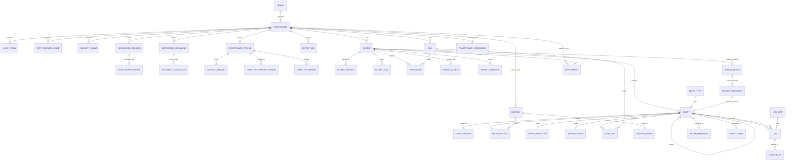

# Document E – Modèle de données · PsyMate, plateforme de suivi clinique

27 octobre 2026 · @Hayes · Version 1.1 · **Source de vérité unique pour la base PostgreSQL 16.** Rassemble et complète ce que les documents A (A4, A10, A11), C (M0-03, M1-02, M1-03…) et les fiches `docs/design/` disaient de la base, parfois en tableau, parfois en phrase, parfois pas du tout. Toute tâche qui crée ou modifie une table lit **ce document**, pas A. En cas d'écart entre A et E, E l'emporte et l'écart est listé en E8.

Mis à jour le 29 octobre 2026 : renommages et décisions de docs/G-decisions.md (rôle `psymate_app`, table `directory_vocabulary`, migration V11 `export_job`, décisions E7 tranchées, agenda hors V1). Quand ce document et G se contredisent, G l'emporte.

## E0. Comment lire ce document

- **E1** : vue d'ensemble, groupes de tables, diagramme entité-relation complet.
- **E2** : conventions (nommage, types, horodatage, archivage, multi-tenant).
- **E3** : le DDL de toutes les tables, groupe par groupe. Chaque bloc SQL est tel qu'il doit être copié dans sa migration, à l'exception des commentaires `-- E…` qui renvoient aux décisions.
- **E4** : le découpage en migrations Flyway, aligné sur les tâches de C et sur les vagues de D : quelle migration, quel numéro, quelle tâche, quel couloir.
- **E5** : les données de référence (seed) : types d'entrées, 29 émotions, types de liens et leur matrice d'autorisation.
- **E6** : les tables réservées (V2 et compagnon) et les tables conditionnelles (V1.1 et hors V1), avec leur DDL prêt mais sans numéro de migration.
- **E7** : les décisions ouvertes, toutes tranchées le 29 octobre 2026 (G).
- **E8** : les écarts entre ce document et A / C / les fiches, avec la règle retenue.
- **E9** : la liste fermée des suppressions physiques autorisées (G Q37).

Marquages : **[À valider pilotes]** = contenu clinique livré avec les valeurs par défaut (G Q10), à confirmer avec les premiers praticiens une fois l'application utilisable ; **[Décision E-n]** = choix fait ici, listé en E7 ou E8 ; **[Réservé]** = table ou colonne vide en V1, jamais remplie par du code V1.

## E1. Vue d'ensemble

### Les groupes de tables

| Groupe | Module Modulith | Tables | Rôle |
| --- | --- | --- | --- |
| Identité | `identity` | `tenant`, `practitioner`, `auth_token`, `totp_recovery_code`, `spring_session`, `spring_session_attributes`, `security_event` | Comptes, sessions, sécurité |
| Vérification et admin | `identity.verification`, `identity.admin` | `verification_document`, `verification_decision`, `document_access_log`, `practitioner_appeal`, vue `admin_journal_v` | Dossier professionnel, décisions, recours, journal |
| Patients | `patients` | `patient`, `patient_version`, `patient_flag`, `patient_tag`, `patient_access` | Dossier administratif du patient |
| Vocabulaires | `vocabulary` | `entry_type`, `emotion`, `emotion_merge`, `link_type`, `tag` | Référentiels globaux et par praticien |
| Dossier clinique | `clinical` | `entry`, `entry_version`, `entry_feeling`, `entry_medication`, `entry_session`, `entry_tag`, `export_job` | Le cœur : entrées, versions, détails ; export du compte |
| Liens | `linking` | `link` | Arêtes typées entre entrées |
| Événements | `events` | `event_publication` | Outbox Spring Modulith |
| Projections | `search`, `overview` | `patient_overview` (+ colonne `entry.search_vector` et ses triggers) | Lecture rapide |
| Annuaire | `directory` | `practitioner_profile`, `directory_vocabulary`, `contact_request` | Profil public, liste fermée des spécialités et publics, relais de contact |
| **Réservé V2** | `ai` | `entry_embedding`, `entry_chunk`, `ai_feedback` | Vides en V1 |
| **Réservé compagnon** | `companion` | `patient_device`, `patient_submission` + colonnes `entry.author_type`, `entry.submission_id` | Vides en V1 |
| **Conditionnel** | `directory`, `identity.admin` (V1.1, G Q26) ; `scheduling` (hors V1, G Q25) | `directory_profile_version`, `directory_report` ; `appointment`, `practitioner_integration` | DDL prêt, pas de migration en V1 |

Trente-neuf tables en V1, dont six réservées et vides (`entry_embedding`, `entry_chunk`, `ai_feedback`, `patient_device`, `patient_submission`, `patient_access`), plus quatre conditionnelles. Le DDL complet a été exécuté sur un PostgreSQL 16 vierge le 27 octobre 2026 (hors extension `vector`, remplacée pour le test) : il s'applique sans erreur, le seed compte 6 types, 29 émotions et 8 types de liens, et les contraintes `ck_entry_session_required`, `ux_link_active`, `ck_link_not_self`, `ck_decision_message` et les deux triggers `search_vector` se comportent comme décrit. Les tables `directory_vocabulary` et `export_job` (ajoutées le 29 octobre) n'ont pas encore été rejouées.

### Diagramme entité-relation complet



Les suffixes `_v2`, `_reserve`, `_cond` marquent les relations qui n'ont aucune ligne en V1.

## E2. Conventions

| Sujet | Règle |
| --- | --- |
| Nommage | Tables et colonnes en `snake_case` singulier (`entry`, `entry_version`). Tables de détail préfixées par la table mère. Index `ix_<table>_<colonnes>`, index uniques `ux_…`, contraintes `ck_…`, clés étrangères `fk_<table>_<colonne>`. |
| Identifiants | `uuid` partout, générés par l'application (UUID v7 recommandé pour l'ordre d'insertion), jamais de `serial`. |
| Horodatage | `timestamptz` partout, stocké en UTC. `created_at` et `updated_at` sur toute table mutable ; `updated_at` maintenu par l'application (pas de trigger). |
| Énumérations | `text` + contrainte `CHECK (… IN (…))`, jamais de type `ENUM` PostgreSQL (une valeur de plus = un `ALTER … DROP CONSTRAINT / ADD CONSTRAINT`, pas de `ALTER TYPE`). |
| Multi-tenant | `tenant_id uuid NOT NULL` sur toute table métier (patients, entrées, liens, tags). Jamais de RLS en V1 (ADR-09) : la garde est applicative (`PatientOwnershipGuard`), mais la colonne est là pour la V2. |
| Suppression | Jamais de `DELETE` sur une donnée clinique : `archived_at timestamptz`. Les seules suppressions physiques autorisées sont listées en E9 (G Q37) : tables d'association, purges planifiées, sessions, fichiers. |
| Versions | Append-only : `entry_version`, `patient_version`, `verification_decision`. Aucune de ces tables n'a d'`UPDATE` autorisé en dehors de colonnes techniques explicitement listées. |
| Rôles PostgreSQL | Base `psymate`, utilisateur propriétaire `psymate` (migrations), rôle applicatif `psymate_app` (G Q9) créé par le script d'init du conteneur Compose (jamais par Flyway) ; Flyway pose les `REVOKE UPDATE, DELETE` sur les tables append-only. |
| Texte libre | Toujours dans une colonne `text` dédiée (`body`, `message`, `reason`), jamais dans un `jsonb`, pour la recherche et les futurs embeddings. |
| JSONB | Réservé aux structures souples et peu interrogées : `practitioner.preferences`, `patient.context`, `patient.follow_up`, `entry_version.payload`, `patient_overview.payload`, `verification_decision.checklist`. Toute clé lue par SQL devient une colonne. |
| Extensions | `pgcrypto` (uuid côté SQL dans le seed), `pg_trgm`, `unaccent`, `vector`, `btree_gist` (index GiST mixte uuid + plage). Rien d'autre. |
| Encodage e-mail | `email` stocké tel que saisi ; `email_normalized` = `lower(trim(email))` pour l'unicité et la connexion. |
| Secrets | Jamais en clair : `password_hash` (Argon2id), `token_hash` (SHA-256), `totp_secret_enc`, `refresh_token_enc`, `push_token_enc` (chiffrement applicatif AES-GCM, clé hors base). |

## E3. DDL par groupe

Les blocs ci-dessous sont dans l'ordre d'exécution. Les clés étrangères vers une table créée plus tard sont ajoutées par `ALTER TABLE` au bon moment (voir E4).

### E3.1 Socle : extensions et tenants

```sql
CREATE EXTENSION IF NOT EXISTS pgcrypto;
CREATE EXTENSION IF NOT EXISTS pg_trgm;
CREATE EXTENSION IF NOT EXISTS unaccent;
CREATE EXTENSION IF NOT EXISTS vector;
CREATE EXTENSION IF NOT EXISTS btree_gist;   -- index GiST (patient_id, occurred_range)

-- unaccent() est STABLE, donc interdit dans un index ou une colonne générée.
-- Enveloppe IMMUTABLE classique : à utiliser partout à la place de unaccent().
CREATE OR REPLACE FUNCTION f_unaccent(text) RETURNS text
LANGUAGE sql IMMUTABLE PARALLEL SAFE STRICT AS
$$ SELECT public.unaccent('public.unaccent', $1) $$;

CREATE TABLE tenant (
  id          uuid PRIMARY KEY,
  name        text NOT NULL,
  created_at  timestamptz NOT NULL DEFAULT now()
);
```

Un tenant par praticien en V1 (créé à l'inscription). Le partage V2 passera par `patient_access`, pas par la fusion de tenants (ADR-09).

### E3.2 Identité

```sql
CREATE TABLE practitioner (
  id                    uuid PRIMARY KEY,
  tenant_id             uuid NOT NULL REFERENCES tenant(id),
  email                 text NOT NULL,
  email_normalized      text NOT NULL,
  email_confirmed_at    timestamptz,
  password_hash         text NOT NULL,
  first_name            text NOT NULL,
  last_name             text NOT NULL,
  display_name          text NOT NULL,                 -- « Dr Maya Kaddour », « Claire Lambert »
  locale                text NOT NULL DEFAULT 'fr' CHECK (locale IN ('fr','en')),
  profession            text NOT NULL CHECK (profession IN ('psychologist','psychiatrist','coach')),
  role                  text NOT NULL DEFAULT 'practitioner' CHECK (role IN ('practitioner','admin')),
  -- A10.2 : coordonnées professionnelles (inscription enrichie)
  phone                 text,
  professional_number   text,                          -- ADELI / RPPS, facultatif
  address_street        text,
  address_postal_code   text,
  address_city          text,
  remote_only           boolean NOT NULL DEFAULT false,
  -- A10.3 : machine d'états de la vérification (étendue, décision E-3)
  verification_status   text NOT NULL DEFAULT 'email_pending'
                        CHECK (verification_status IN
                          ('email_pending','docs_pending','under_review','approved',
                           'needs_more','rejected','suspended','closed')),
  verified_at           timestamptz,
  verified_by           uuid REFERENCES practitioner(id),
  suspended_at          timestamptz,
  purge_after           timestamptz,                   -- compte refusé/clos : date de purge (A10, fiche 27)
  -- A10.2 : préférences (ADR-11), clés plates listées en fiche 14
  preferences           jsonb NOT NULL DEFAULT '{}'::jsonb,
  -- Sécurité (F33)
  totp_secret_enc       bytea,                         -- NULL = 2FA inactive
  totp_enabled_at       timestamptz,
  failed_logins         smallint NOT NULL DEFAULT 0,
  locked_until          timestamptz,
  last_login_at         timestamptz,
  created_at            timestamptz NOT NULL DEFAULT now(),
  updated_at            timestamptz NOT NULL DEFAULT now(),
  CONSTRAINT ck_practitioner_admin_totp CHECK (role <> 'admin' OR totp_secret_enc IS NOT NULL OR totp_enabled_at IS NULL)
);
CREATE UNIQUE INDEX ux_practitioner_email ON practitioner(email_normalized);
CREATE INDEX ix_practitioner_tenant ON practitioner(tenant_id);
CREATE INDEX ix_practitioner_verification ON practitioner(verification_status, created_at);

-- Jetons à usage unique : confirmation d'e-mail (fiche 25), réinitialisation (fiche 26). Décision E-4.
CREATE TABLE auth_token (
  id               uuid PRIMARY KEY,
  practitioner_id  uuid NOT NULL REFERENCES practitioner(id),
  kind             text NOT NULL CHECK (kind IN ('email_confirm','password_reset','email_change')),
  token_hash       text NOT NULL,                      -- SHA-256 du jeton ; le jeton clair ne vit que dans l'e-mail
  payload          jsonb,                              -- email_change : { "newEmail": "…" }
  expires_at       timestamptz NOT NULL,               -- 24 h (e-mail), 30 min (mot de passe)
  consumed_at      timestamptz,
  created_ip       inet,
  created_at       timestamptz NOT NULL DEFAULT now()
);
CREATE UNIQUE INDEX ux_auth_token_hash ON auth_token(token_hash);
CREATE INDEX ix_auth_token_active ON auth_token(practitioner_id, kind) WHERE consumed_at IS NULL;

-- Codes de secours 2FA : 10 par activation, à usage unique (fiche 11, UC-19).
CREATE TABLE totp_recovery_code (
  id               uuid PRIMARY KEY,
  practitioner_id  uuid NOT NULL REFERENCES practitioner(id),
  code_hash        text NOT NULL,
  used_at          timestamptz,
  created_at       timestamptz NOT NULL DEFAULT now()
);
CREATE INDEX ix_totp_recovery_practitioner ON totp_recovery_code(practitioner_id) WHERE used_at IS NULL;

-- Sessions côté serveur (Spring Session JDBC) : indispensable pour révoquer les sessions
-- d'un compte suspendu ou après « déconnecter les autres appareils ». Décision E-5.
-- Schéma standard de Spring Session ; vérifier qu'il correspond à la version du pom.
CREATE TABLE spring_session (
  primary_id            char(36) NOT NULL,
  session_id            char(36) NOT NULL,
  creation_time         bigint NOT NULL,
  last_access_time      bigint NOT NULL,
  max_inactive_interval int NOT NULL,
  expiry_time           bigint NOT NULL,
  principal_name        varchar(100),
  CONSTRAINT spring_session_pk PRIMARY KEY (primary_id)
);
CREATE UNIQUE INDEX spring_session_ix1 ON spring_session (session_id);
CREATE INDEX spring_session_ix2 ON spring_session (expiry_time);
CREATE INDEX spring_session_ix3 ON spring_session (principal_name);

CREATE TABLE spring_session_attributes (
  session_primary_id  char(36) NOT NULL,
  attribute_name      varchar(200) NOT NULL,
  attribute_bytes     bytea NOT NULL,
  CONSTRAINT spring_session_attributes_pk PRIMARY KEY (session_primary_id, attribute_name),
  CONSTRAINT spring_session_attributes_fk FOREIGN KEY (session_primary_id)
    REFERENCES spring_session(primary_id) ON DELETE CASCADE
);

-- Journal de sécurité et d'administration (A10.2, fiches 11, 21, 22). Append-only. Seul journal admin (G Q29).
CREATE TABLE security_event (
  id               uuid PRIMARY KEY,
  practitioner_id  uuid REFERENCES practitioner(id),  -- compte concerné ; NULL = événement système
  actor_id         uuid REFERENCES practitioner(id),  -- qui a agi ; NULL = le compte lui-même ou le système
  kind             text NOT NULL,                      -- login_ok, login_failed, locked, 2fa_enabled, 2fa_disabled,
                                                       -- password_reset_requested, password_changed, email_confirmed, email_changed,
                                                       -- session_revoked, suspended, reactivated, export_requested, purge,
                                                       -- patient.read, patient.write (M7-02), admin.* (M1-14, M1-14b)…
  ip               inet,
  user_agent       text,
  details          jsonb,
  occurred_at      timestamptz NOT NULL DEFAULT now()
);
CREATE INDEX ix_security_event_practitioner ON security_event(practitioner_id, occurred_at DESC);
CREATE INDEX ix_security_event_kind ON security_event(kind, occurred_at DESC);
```

Règles non portées par le schéma, à tester côté application : `role = 'admin'` exige `totp_enabled_at IS NOT NULL` pour accéder à `/api/admin/**` (M1-14, M7-08) ; un `email_change` est émis sans session par un compte `email_pending` (fiche 25), ou avec session et mot de passe par un compte confirmé ; l'adresse ne bascule qu'à la confirmation, qui consomme les jetons `password_reset` actifs (M10-04, G Q49) ; `failed_logins` revient à 0 à la première connexion réussie ; la durée de session est 12 h, 30 jours avec « rester connecté » (G Q6).

### E3.3 Vérification des praticiens et administration

```sql
CREATE TABLE verification_document (
  id               uuid PRIMARY KEY,
  practitioner_id  uuid NOT NULL REFERENCES practitioner(id),
  purpose          text NOT NULL DEFAULT 'verification' CHECK (purpose IN ('verification','appeal')),
  type             text NOT NULL CHECK (type IN
                     ('diploma','registration','certification','professional_card','identity','other')),
  title            text NOT NULL,
  issuer           text,
  year             smallint CHECK (year BETWEEN 1950 AND 2100),
  storage_key      text NOT NULL,                      -- objet chiffré (disque local en dev ; bêta : étude hébergement, G Q17), hors base
  mime             text NOT NULL CHECK (mime IN ('application/pdf','image/jpeg','image/png')),
  size_bytes       int  NOT NULL CHECK (size_bytes BETWEEN 1 AND 10485760),   -- 10 Mo
  sha256           text NOT NULL,
  uploaded_at      timestamptz NOT NULL DEFAULT now(),
  reviewed_status  text NOT NULL DEFAULT 'pending' CHECK (reviewed_status IN ('pending','conform','non_conform')),
  reviewed_at      timestamptz,
  reviewed_by      uuid REFERENCES practitioner(id),
  purge_after      timestamptz,                        -- décision + 90 jours ; le fichier est supprimé, la ligne reste
  purged_at        timestamptz,
  deleted_at       timestamptz                         -- retiré par le praticien avant soumission (soft delete)
);
CREATE INDEX ix_verif_doc_practitioner ON verification_document(practitioner_id) WHERE deleted_at IS NULL;
CREATE INDEX ix_verif_doc_purge ON verification_document(purge_after) WHERE purged_at IS NULL AND purge_after IS NOT NULL;

-- Décisions d'administration : append-only, une ligne par acte (A10.2, étendu par les fiches 21, 23, 27). Décision E-6.
CREATE TABLE verification_decision (
  id                       uuid PRIMARY KEY,
  practitioner_id          uuid NOT NULL REFERENCES practitioner(id),
  admin_id                 uuid NOT NULL REFERENCES practitioner(id),
  kind                     text NOT NULL CHECK (kind IN
                             ('approved','needs_more','rejected',          -- validation (UC-17)
                              'suspended','reactivated',                   -- fiche 21 (M1-14b)
                              'appeal_accepted','appeal_rejected',         -- fiche 27 (M1-14b)
                              'report_resolved')),                         -- fiche 23 (V1.1)
  internal_note            text,                       -- jamais transmise
  message_to_practitioner  text,                       -- obligatoire si needs_more, rejected, suspended (contrainte applicative)
  checklist                jsonb NOT NULL DEFAULT '{}'::jsonb,
  related_id               uuid,                       -- recours ou signalement concerné, selon kind
  decided_at               timestamptz NOT NULL DEFAULT now(),
  CONSTRAINT ck_decision_message CHECK (
    kind NOT IN ('needs_more','rejected','suspended') OR message_to_practitioner IS NOT NULL)
);
CREATE INDEX ix_verif_decision_practitioner ON verification_decision(practitioner_id, decided_at DESC);
CREATE INDEX ix_verif_decision_admin ON verification_decision(admin_id, decided_at DESC);

-- Chaque ouverture d'un justificatif par un administrateur (URL signée 5 min).
CREATE TABLE document_access_log (
  id           uuid PRIMARY KEY,
  document_id  uuid NOT NULL REFERENCES verification_document(id),
  admin_id     uuid NOT NULL REFERENCES practitioner(id),
  ip           inet,
  accessed_at  timestamptz NOT NULL DEFAULT now()
);
CREATE INDEX ix_doc_access_document ON document_access_log(document_id, accessed_at DESC);

-- Recours : un seul par décision, examiné par un autre administrateur (fiche 27, M1-14b, G Q28). Décision E-7.
CREATE TABLE practitioner_appeal (
  id                uuid PRIMARY KEY,
  practitioner_id   uuid NOT NULL REFERENCES practitioner(id),
  decision_id       uuid NOT NULL REFERENCES verification_decision(id),
  message           text NOT NULL,
  submitted_at      timestamptz NOT NULL DEFAULT now(),
  reviewed_by       uuid REFERENCES practitioner(id),  -- doit différer de verification_decision.admin_id (règle applicative)
  reviewed_at       timestamptz,
  outcome           text CHECK (outcome IN ('accepted','rejected')),
  response_message  text
);
CREATE UNIQUE INDEX ux_appeal_decision ON practitioner_appeal(decision_id);
```

Les pièces jointes d'un recours sont des lignes de `verification_document` avec `purpose = 'appeal'`, soumises aux mêmes règles (types, 10 Mo, chiffrement, purge). Règle de complétude du dossier (G Q14, M1-13) : `diploma` **et** `identity` obligatoires pour toutes les professions ; `registration` (ADELI / RPPS) recommandé pour psychologue et psychiatre, jamais bloquant.

### E3.4 Patients

```sql
CREATE TABLE patient (
  id            uuid PRIMARY KEY,
  tenant_id     uuid NOT NULL REFERENCES tenant(id),
  owner_id      uuid NOT NULL REFERENCES practitioner(id),
  display_name  text NOT NULL,                         -- seul champ obligatoire (UC-02)
  first_name    text,
  last_name     text,
  birth_date    date,
  pronoun       text,
  phone         text,
  email         text,
  context       jsonb NOT NULL DEFAULT '{}'::jsonb,    -- { situation, activity, referredBy, initialReason, history } (fiche 16)
  follow_up     jsonb NOT NULL DEFAULT '{}'::jsonb,    -- { since, rhythm, modality, durationMin, fee, prescriber }
  current_version int NOT NULL DEFAULT 1,
  clinical_rev  bigint NOT NULL DEFAULT 0,             -- incrémenté par l'application à chaque écriture clinique (G Q30) ; comparé à patient_overview.source_rev (E-8)
  archived_at   timestamptz,
  created_at    timestamptz NOT NULL DEFAULT now(),
  updated_at    timestamptz NOT NULL DEFAULT now()
);
CREATE INDEX ix_patient_owner ON patient(tenant_id, owner_id) WHERE archived_at IS NULL;
CREATE INDEX ix_patient_name_trgm ON patient USING gin (f_unaccent(display_name) gin_trgm_ops);

-- Historique de la fiche patient (fiche 16 : « 3 versions »). Décision E-9, confirmée G Q7.
CREATE TABLE patient_version (
  id          uuid PRIMARY KEY,
  patient_id  uuid NOT NULL REFERENCES patient(id),
  version     int NOT NULL,
  snapshot    jsonb NOT NULL,                          -- copie des colonnes éditables au moment de la version
  reason      text,
  author_id   uuid NOT NULL REFERENCES practitioner(id),
  created_at  timestamptz NOT NULL DEFAULT now()
);
CREATE UNIQUE INDEX ux_patient_version ON patient_version(patient_id, version);

-- Drapeaux posés à la main, jamais déduits (fiche 16, B1 P7). Décision E-10 (confirmée G Q7) : table plutôt que text[],
-- parce que « à surveiller » exige une raison et qu'on veut savoir qui l'a posé et quand il a été levé.
CREATE TABLE patient_flag (
  id          uuid PRIMARY KEY,
  patient_id  uuid NOT NULL REFERENCES patient(id),
  kind        text NOT NULL CHECK (kind IN ('watch','risk','shared_care')),
  reason      text,                                    -- obligatoire pour watch (contrainte applicative)
  set_by      uuid NOT NULL REFERENCES practitioner(id),
  set_at      timestamptz NOT NULL DEFAULT now(),
  cleared_by  uuid REFERENCES practitioner(id),
  cleared_at  timestamptz
);
CREATE UNIQUE INDEX ux_patient_flag_active ON patient_flag(patient_id, kind) WHERE cleared_at IS NULL;

-- Partage V2 (ADR-09) : vide en V1. [Réservé]
CREATE TABLE patient_access (
  id               uuid PRIMARY KEY,
  tenant_id        uuid NOT NULL REFERENCES tenant(id),
  patient_id       uuid NOT NULL REFERENCES patient(id),
  practitioner_id  uuid NOT NULL REFERENCES practitioner(id),
  role             text NOT NULL CHECK (role IN ('owner','collaborator','reader')),
  granted_by       uuid NOT NULL REFERENCES practitioner(id),
  granted_at       timestamptz NOT NULL DEFAULT now(),
  revoked_at       timestamptz
);
CREATE UNIQUE INDEX ux_patient_access_active ON patient_access(patient_id, practitioner_id) WHERE revoked_at IS NULL;
```

`patient_tag` est créée avec les vocabulaires (E3.5), parce qu'elle référence `tag`. Mineurs (G Q19) : `birth_date` est purement informative en V1, aucune règle de consentement n'est portée par le schéma.

### E3.5 Vocabulaires

```sql
-- Six types d'entrées V1. Un nouveau type = une ligne ici + une table de détail + une migration (ADR-02).
CREATE TABLE entry_type (
  code          text PRIMARY KEY,                      -- note, event, situation, feeling, session, medication
  label_fr      text NOT NULL,
  label_en      text NOT NULL,
  detail_table  text,                                  -- entry_feeling, entry_medication, entry_session ; NULL si aucune
  has_duration  boolean NOT NULL DEFAULT false,        -- situation, medication, session
  sort_order    smallint NOT NULL,
  active        boolean NOT NULL DEFAULT true
);

-- Émotions : globales (produit) et personnalisées (praticien), A4.5.
CREATE TABLE emotion (
  code                text PRIMARY KEY,                -- 'anxiety' ; custom : 'c_' || 8 hex
  scope               text NOT NULL CHECK (scope IN ('global','custom')),
  tenant_id           uuid REFERENCES tenant(id),      -- NULL si global
  practitioner_id     uuid REFERENCES practitioner(id),-- NULL si global, obligatoire si custom
  family              text NOT NULL CHECK (family IN
                        ('joy','trust','fear','surprise','sadness','disgust','anger','anticipation')),
  intensity_level     smallint CHECK (intensity_level BETWEEN 1 AND 3),   -- Plutchik : 1 faible, 2 moyen, 3 fort ; NULL pour les ajouts cliniques et les custom
  valence             smallint CHECK (valence BETWEEN -2 AND 2),          -- NULL en V1, rempli avant la V2
  arousal             smallint CHECK (arousal BETWEEN 0 AND 4),           -- idem
  label_fr            text NOT NULL,
  label_en            text,
  label_normalized    text NOT NULL,                   -- lower(unaccent(label_fr)), pour l'unicité et le refus de tags homonymes
  vocabulary_version  int NOT NULL DEFAULT 1,
  active              boolean NOT NULL DEFAULT true,
  promoted_to         text REFERENCES emotion(code),   -- custom fusionnée dans une globale (V2)
  created_by          uuid REFERENCES practitioner(id),
  created_at          timestamptz NOT NULL DEFAULT now(),
  CONSTRAINT ck_emotion_custom_owner CHECK (
    (scope = 'global' AND practitioner_id IS NULL) OR (scope = 'custom' AND practitioner_id IS NOT NULL))
);
CREATE UNIQUE INDEX ux_emotion_custom_label ON emotion(practitioner_id, label_normalized) WHERE scope = 'custom';
CREATE UNIQUE INDEX ux_emotion_global_label ON emotion(label_normalized) WHERE scope = 'global';
CREATE INDEX ix_emotion_practitioner ON emotion(practitioner_id) WHERE scope = 'custom' AND active;

-- Fusion de deux émotions custom (fiche 17), réversible 30 jours. Décision E-11, retenue en V1 (G Q8).
CREATE TABLE emotion_merge (
  id               uuid PRIMARY KEY,
  practitioner_id  uuid NOT NULL REFERENCES practitioner(id),
  source_code      text NOT NULL REFERENCES emotion(code),
  target_code      text NOT NULL REFERENCES emotion(code),
  affected_count   int NOT NULL,
  merged_at        timestamptz NOT NULL DEFAULT now(),
  undo_until       timestamptz NOT NULL,
  undone_at        timestamptz
);

-- Types de liens (A4.3). La matrice source/cible est dans les colonnes text[] ; seed en E5.3.
CREATE TABLE link_type (
  code                  text PRIMARY KEY,              -- triggers, caused_by, worsens, relieves, co_occurs, follows, part_of, treats
  directed              boolean NOT NULL DEFAULT true,
  label_fr              text NOT NULL,                 -- « déclenche »
  label_en              text NOT NULL,
  inverse_label_fr      text,                          -- « déclenché par » (affichage dans l'autre sens) ; NULL si non orienté
  inverse_label_en      text,
  allowed_source_types  text[] NOT NULL,               -- codes d'entry_type
  allowed_target_types  text[] NOT NULL,
  line_style            text NOT NULL DEFAULT 'solid', -- solid, long_dash, short_dash, dotted, thin, double (étude couleurs §4)
  sort_order            smallint NOT NULL,
  active                boolean NOT NULL DEFAULT true
);

-- Tags libres du praticien (A4.6). practitioner_id NULL = tag partagé global (V2, réservé).
CREATE TABLE tag (
  id                uuid PRIMARY KEY,
  tenant_id         uuid REFERENCES tenant(id),
  practitioner_id   uuid REFERENCES practitioner(id),
  label             text NOT NULL,
  normalized_label  text NOT NULL,                     -- lower(unaccent(label)), sans '#'
  usage_count       int NOT NULL DEFAULT 0,            -- maintenu par l'application (autocomplétion)
  merged_into       uuid REFERENCES tag(id),           -- fusion de tags (UC-11)
  created_at        timestamptz NOT NULL DEFAULT now(),
  archived_at       timestamptz
);
CREATE UNIQUE INDEX ux_tag_practitioner_label ON tag(practitioner_id, normalized_label) WHERE archived_at IS NULL;

-- Tags au niveau patient (fiche 16). Décision E-12, confirmée G Q7.
CREATE TABLE patient_tag (
  patient_id  uuid NOT NULL REFERENCES patient(id),
  tag_id      uuid NOT NULL REFERENCES tag(id),
  added_at    timestamptz NOT NULL DEFAULT now(),
  PRIMARY KEY (patient_id, tag_id)
);
CREATE INDEX ix_patient_tag_tag ON patient_tag(tag_id);
```

Règle applicative (UC-11, fiche 16) : la création d'un tag dont `normalized_label` égale un `emotion.label_normalized` global ou custom du praticien est refusée (`422`) avec proposition de l'émotion.

### E3.6 Dossier clinique

```sql
CREATE TABLE entry (
  id                  uuid PRIMARY KEY,
  tenant_id           uuid NOT NULL REFERENCES tenant(id),
  patient_id          uuid NOT NULL REFERENCES patient(id),
  type                text NOT NULL REFERENCES entry_type(code),
  status              text NOT NULL DEFAULT 'final' CHECK (status IN ('draft','final')),
  visibility          text NOT NULL DEFAULT 'clinical' CHECK (visibility IN ('private','clinical')),
  -- Provenance (A11, réservé compagnon) : toujours 'practitioner' et NULL en V1
  author_type         text NOT NULL DEFAULT 'practitioner' CHECK (author_type IN ('practitioner','patient')),
  submission_id       uuid,                            -- FK posée en E3.11 (patient_submission)
  -- Temps à deux axes (A4.2)
  occurred_from       timestamptz NOT NULL,
  occurred_to         timestamptz,                     -- NULL = en cours (situation, médicament)
  occurred_precision  text NOT NULL DEFAULT 'exact' CHECK (occurred_precision IN
                        ('exact','day','month','year','period','life_phase')),
  occurred_label      text,                            -- libellé d'origine : « été 2019 », « enfance »
  occurred_range      tstzrange GENERATED ALWAYS AS
                        (tstzrange(occurred_from, coalesce(occurred_to, 'infinity'::timestamptz), '[)')) STORED,
  recorded_at         timestamptz NOT NULL DEFAULT now(),
  -- Séance de rattachement (ADR-10) : obligatoire sauf pour la séance elle-même (et une entrée patient non rattachée, A11)
  session_id          uuid REFERENCES entry(id),
  current_version_id  uuid,                            -- FK posée après entry_version
  current_version     int NOT NULL DEFAULT 1,
  link_count          int NOT NULL DEFAULT 0,          -- projection maintenue par linking (A4.4 « link_neighbor_count »)
  search_vector       tsvector,                        -- maintenu par trigger (M4-02)
  archived_at         timestamptz,
  created_by          uuid REFERENCES practitioner(id),
  created_at          timestamptz NOT NULL DEFAULT now(),
  updated_at          timestamptz NOT NULL DEFAULT now(),
  CONSTRAINT ck_entry_session_required CHECK (session_id IS NOT NULL OR type = 'session' OR author_type = 'patient'),
  CONSTRAINT ck_entry_session_not_self CHECK (session_id IS NULL OR session_id <> id),
  CONSTRAINT ck_entry_occurred_order CHECK (occurred_to IS NULL OR occurred_to >= occurred_from)
);
CREATE INDEX ix_entry_timeline      ON entry(patient_id, occurred_from DESC) WHERE archived_at IS NULL;
CREATE INDEX ix_entry_timeline_type ON entry(patient_id, type, occurred_from DESC) WHERE archived_at IS NULL;
CREATE INDEX ix_entry_session       ON entry(session_id) WHERE session_id IS NOT NULL;
CREATE INDEX ix_entry_range         ON entry USING gist (patient_id, occurred_range) WHERE archived_at IS NULL;
CREATE INDEX ix_entry_submission    ON entry(submission_id) WHERE submission_id IS NOT NULL;   -- A11, vide en V1
CREATE INDEX ix_entry_tenant        ON entry(tenant_id);

CREATE TABLE entry_version (
  id          uuid PRIMARY KEY,
  entry_id    uuid NOT NULL REFERENCES entry(id),
  version     int NOT NULL,
  title       text,
  body        text,                                    -- texte libre en clair, jamais dans payload
  payload     jsonb NOT NULL DEFAULT '{}'::jsonb,      -- copie du détail typé au moment de la version
  reason      text,
  author_id   uuid REFERENCES practitioner(id),        -- NULL si version écrite par le patient (A11)
  created_at  timestamptz NOT NULL DEFAULT now()
);
CREATE UNIQUE INDEX ux_entry_version ON entry_version(entry_id, version);
CREATE INDEX ix_entry_version_title_trgm ON entry_version USING gin (title gin_trgm_ops);
CREATE INDEX ix_entry_version_body_trgm  ON entry_version USING gin (body  gin_trgm_ops);

ALTER TABLE entry
  ADD CONSTRAINT fk_entry_current_version FOREIGN KEY (current_version_id)
  REFERENCES entry_version(id) DEFERRABLE INITIALLY DEFERRED;

-- Détail : ressenti (A4.5)
CREATE TABLE entry_feeling (
  entry_id               uuid PRIMARY KEY REFERENCES entry(id),
  emotion_code           text NOT NULL REFERENCES emotion(code),
  original_emotion_code  text REFERENCES emotion(code),-- renseigné après une fusion (fiche 17), sinon NULL
  intensity              smallint NOT NULL CHECK (intensity BETWEEN 0 AND 10),
  valence                smallint CHECK (valence BETWEEN -2 AND 2),   -- copié d'emotion à la saisie, NULL si non défini
  arousal                smallint CHECK (arousal BETWEEN 0 AND 4),
  context_note           text,
  bodily_signs           text[]
);
CREATE INDEX ix_entry_feeling_emotion ON entry_feeling(emotion_code, intensity);

-- Détail : médicament (H9)
CREATE TABLE entry_medication (
  entry_id    uuid PRIMARY KEY REFERENCES entry(id),
  molecule    text NOT NULL,
  dosage      text,                                    -- « 50 mg »
  frequency   text,                                    -- « matin », « 1/j »
  prescriber  text,
  period_from date,
  period_to   date
);

-- Détail : séance (ADR-10, UC-04)
CREATE TABLE entry_session (
  entry_id            uuid PRIMARY KEY REFERENCES entry(id),
  kind                text NOT NULL DEFAULT 'session' CHECK (kind IN ('intake','session','contact')),  -- accueil, séance, contact hors RDV
  modality            text NOT NULL DEFAULT 'in_person' CHECK (modality IN ('in_person','video','phone','email')),
  duration_min        smallint CHECK (duration_min BETWEEN 1 AND 600),   -- défaut applicatif : préférence sessions.defaultDurationMin (60)
  closed_at           timestamptz,                     -- NULL = séance ouverte (« en cours »)
  summary_version_id  uuid REFERENCES entry_version(id)
);
CREATE INDEX ix_entry_session_open ON entry_session(entry_id) WHERE closed_at IS NULL;

-- Tags sur les entrées (A4.6)
CREATE TABLE entry_tag (
  entry_id  uuid NOT NULL REFERENCES entry(id),
  tag_id    uuid NOT NULL REFERENCES tag(id),
  PRIMARY KEY (entry_id, tag_id)
);
CREATE INDEX ix_entry_tag_tag ON entry_tag(tag_id, entry_id);

-- Export d'un compte refusé ou suspendu (fiche 27, M6-05, G Q18). Décision E-15. Migration V11.
CREATE TABLE export_job (
  id               uuid PRIMARY KEY,
  practitioner_id  uuid NOT NULL REFERENCES practitioner(id),
  status           text NOT NULL DEFAULT 'queued' CHECK (status IN ('queued','running','done','failed')),
  requested_at     timestamptz NOT NULL DEFAULT now(),
  finished_at      timestamptz,
  storage_key      text,                               -- zip chiffré (même StorageService que les justificatifs)
  expires_at       timestamptz,                        -- finished_at + 7 jours ; le fichier est supprimé, la ligne reste
  purged_at        timestamptz,
  error            text
);
CREATE INDEX ix_export_job_practitioner ON export_job(practitioner_id, requested_at DESC);
CREATE INDEX ix_export_job_purge ON export_job(expires_at) WHERE purged_at IS NULL AND status = 'done';
```

Règles non portées par le schéma, à tester (M1-03) : chaque `entry` de type `feeling` / `medication` / `session` a exactement une ligne dans sa table de détail (test « chaque type a sa table ») ; `session_id` pointe vers une entrée de `type = 'session'` du même `patient_id` ; une correction crée une version sauf dans la fenêtre de grâce de 1 h 15 (75 min, A4.8, G Q31) ; `author_type` et `submission_id` ne sont jamais écrits par du code V1. Un seul `export_job` en cours (`queued` ou `running`) par praticien (M6-05).

### E3.7 Liens

```sql
CREATE TABLE link (
  id             uuid PRIMARY KEY,
  tenant_id      uuid NOT NULL REFERENCES tenant(id),
  patient_id     uuid NOT NULL REFERENCES patient(id),
  source_id      uuid NOT NULL REFERENCES entry(id),
  target_id      uuid NOT NULL REFERENCES entry(id),
  link_type      text NOT NULL REFERENCES link_type(code),
  directed       boolean NOT NULL DEFAULT true,
  provenance     text NOT NULL CHECK (provenance IN ('manual','ai_suggested','ai_confirmed')),
  status         text NOT NULL CHECK (status IN ('proposed','accepted','rejected','superseded')),
  confidence     real CHECK (confidence BETWEEN 0 AND 1),   -- NULL en V1
  rationale      text,
  evidence       jsonb,                                -- [{entry_id, version, span}] en V2
  author_id      uuid REFERENCES practitioner(id),     -- praticien ou NULL (IA)
  decided_by     uuid REFERENCES practitioner(id),
  decided_at     timestamptz,
  superseded_by  uuid REFERENCES link(id),
  version        int NOT NULL DEFAULT 1,
  created_at     timestamptz NOT NULL DEFAULT now(),
  updated_at     timestamptz NOT NULL DEFAULT now(),
  CONSTRAINT ck_link_not_self CHECK (source_id <> target_id)
);
CREATE UNIQUE INDEX ux_link_active ON link(source_id, target_id, link_type) WHERE status IN ('proposed','accepted');
CREATE INDEX ix_link_source  ON link(source_id) WHERE status = 'accepted';
CREATE INDEX ix_link_target  ON link(target_id) WHERE status = 'accepted';
CREATE INDEX ix_link_patient ON link(patient_id, status);
```

Règles applicatives (M2-01) : `source_id` et `target_id` appartiennent au même `patient_id` que le lien ; le couple (type source, type cible) est autorisé par `link_type.allowed_*` ; l'archivage d'une entrée passe ses liens actifs en `superseded` ; la modification du type crée un nouveau lien `manual` et marque l'ancien `superseded`.

### E3.8 Événements : outbox Spring Modulith

Spring Modulith fournit lui-même le schéma de son registre de publication (`spring-modulith-starter-jdbc`). On **désactive** son initialisation automatique (`spring.modulith.events.jdbc.schema-initialization.enabled=false`, qui est d'ailleurs la valeur par défaut) ; pour M4-01 : `spring.modulith.events.republish-outstanding-events-on-restart=true` et `spring.modulith.events.completion-mode=update` et on copie le schéma dans Flyway, pour qu'une seule chose crée des tables. Le document A appelle cette table `outbox_event` ; son vrai nom est `event_publication`. **[Décision E-13]**

```sql
-- Schéma officiel de Spring Modulith 2.x (JDBC, PostgreSQL), vérifié le 28 octobre 2026 dans la référence 2.0/2.1 :
-- identique à celui livré par spring-modulith-starter-jdbc 2.1.2. Table event_publication_archive non créée
-- (completion-mode = update, pas archive).
CREATE TABLE event_publication (
  id                uuid NOT NULL,
  listener_id       text NOT NULL,
  event_type        text NOT NULL,
  serialized_event  text NOT NULL,
  publication_date  timestamptz NOT NULL,
  completion_date   timestamptz,
  status            text,
  completion_attempts int,
  last_resubmission_date timestamptz,
  PRIMARY KEY (id)
);
CREATE INDEX event_publication_serialized_event_hash_idx ON event_publication USING hash (serialized_event);
CREATE INDEX event_publication_by_completion_date_idx ON event_publication (completion_date);
```

Événements de domaine émis dès la V1 (A4.9, A10.1) : `PatientCreated`, `PatientUpdated`, `EntryCreated`, `EntryCorrected`, `EntryArchived`, `LinkAccepted`, `LinkRejected`, `PractitionerRegistered`, `VerificationSubmitted`, `PractitionerApproved`, `PractitionerRejected`, `PractitionerSuspended`, `PreferencesChanged`, `ProfilePublished`, `ProfileUnpublished`. Fusions du vocabulaire (G Q42, M9-03) : `EmotionsMerged`, `EmotionMergeReverted`, `TagsMerged`, et en retour `EntriesRelabeled` (clinical, un par patient réétiqueté).

### E3.9 Projections : recherche et vue d'ensemble

```sql
-- Recherche (M4-02) : search_vector pondéré, maintenu depuis la version courante.
-- Poids : titre A, émotion et tags B, corps C, nom de séance / médicament D (A6).
CREATE OR REPLACE FUNCTION entry_search_vector_refresh(p_entry_id uuid) RETURNS void
LANGUAGE sql AS $$
  UPDATE entry e
  SET search_vector =
      setweight(to_tsvector('french', f_unaccent(coalesce(v.title, ''))), 'A') ||
      setweight(to_tsvector('simple', f_unaccent(coalesce(
        (SELECT string_agg(em.label_fr, ' ') FROM entry_feeling f JOIN emotion em ON em.code = f.emotion_code WHERE f.entry_id = e.id), ''))), 'B') ||
      setweight(to_tsvector('simple', f_unaccent(coalesce(
        (SELECT string_agg(t.label, ' ') FROM entry_tag et JOIN tag t ON t.id = et.tag_id WHERE et.entry_id = e.id), ''))), 'B') ||
      setweight(to_tsvector('french', f_unaccent(coalesce(v.body, ''))), 'C') ||
      setweight(to_tsvector('simple', f_unaccent(coalesce(
        (SELECT m.molecule FROM entry_medication m WHERE m.entry_id = e.id), ''))), 'D')
  FROM entry_version v
  WHERE e.id = p_entry_id AND v.id = e.current_version_id;
$$;

CREATE OR REPLACE FUNCTION trg_entry_search_vector() RETURNS trigger
LANGUAGE plpgsql AS $$
BEGIN
  PERFORM entry_search_vector_refresh(NEW.id);
  RETURN NULL;
END $$;

CREATE TRIGGER entry_search_vector_after_version
  AFTER UPDATE OF current_version_id ON entry
  FOR EACH ROW EXECUTE FUNCTION trg_entry_search_vector();

CREATE INDEX ix_entry_search ON entry USING gin (search_vector);

-- Vue d'ensemble (M4-03) : une ligne JSONB par patient, recalculée par OverviewListener.
CREATE TABLE patient_overview (
  patient_id   uuid PRIMARY KEY REFERENCES patient(id),
  payload      jsonb NOT NULL,                         -- { facts, activeSituations, trend, emotions, narrative, sinceLastSession, recentSessions }
  source_rev   bigint NOT NULL,                        -- patient.clinical_rev au moment du calcul ; si < courant → recalcul à la volée
  computed_at  timestamptz NOT NULL DEFAULT now(),
  compute_ms   int
);
```

Les tags et émotions changeant hors de `entry.current_version_id`, l'application appelle `entry_search_vector_refresh(id)` explicitement après une modification de tags ou une fusion d'émotions (M4-02 le teste).

### E3.10 Annuaire public

```sql
-- Liste fermée des spécialités et publics (G Q15) : servie par GET /api/vocabulary/directory,
-- modifiable par l'admin (M1-14b). Pas de saisie libre. Décision E-16. Migration V04 avec un seed initial.
CREATE TABLE directory_vocabulary (
  kind        text NOT NULL CHECK (kind IN ('specialty','audience')),
  code        text NOT NULL,                           -- 'anxiety', 'couples_families'…
  label_fr    text NOT NULL,
  label_en    text,
  sort_order  smallint NOT NULL DEFAULT 0,
  active      boolean NOT NULL DEFAULT true,           -- désactivation, jamais suppression
  created_at  timestamptz NOT NULL DEFAULT now(),
  updated_at  timestamptz NOT NULL DEFAULT now(),
  PRIMARY KEY (kind, code)
);

CREATE TABLE practitioner_profile (
  practitioner_id   uuid PRIMARY KEY REFERENCES practitioner(id),
  slug              text NOT NULL,                     -- URL publique /praticiens/{slug} (fiches 09, 10). Décision E-14
  published         boolean NOT NULL DEFAULT false,
  display_name      text NOT NULL,
  title_label       text,                              -- « Psychologue clinicienne », « Coach mental »
  show_professional_number boolean NOT NULL DEFAULT false,
  photo_asset_key   text,                              -- objet redimensionné, sans EXIF
  bio               text,
  specialties       text[] NOT NULL DEFAULT '{}',      -- codes actifs de directory_vocabulary (kind = specialty), validés par l'application
  audiences         text[] NOT NULL DEFAULT '{}',      -- codes actifs de directory_vocabulary (kind = audience) : adults, young_adults, adolescents, children, couples_families
  modalities        text[] NOT NULL DEFAULT '{}',      -- in_person, video, home
  languages         text[] NOT NULL DEFAULT '{}',      -- codes ISO 639-1
  city              text,
  postal_code       text,
  country           text NOT NULL DEFAULT 'FR',
  geo               point,                             -- tri par distance
  contact_phone     text,
  contact_email     text,
  website_url       text,
  address           text,
  show_phone        boolean NOT NULL DEFAULT false,
  show_email        boolean NOT NULL DEFAULT false,
  show_address      boolean NOT NULL DEFAULT false,
  response_delay    text,                              -- « sous 48 h », NULL = ne pas afficher
  fees              text,                              -- texte libre, facultatif
  availability      text NOT NULL DEFAULT 'unknown' CHECK (availability IN ('accepting','waitlist','closed','unknown')),
  next_slot_at      date,
  search_vector     tsvector,                          -- bio + spécialités + ville ; trigger ci-dessous
  published_at      timestamptz,
  updated_at        timestamptz NOT NULL DEFAULT now()
);
CREATE UNIQUE INDEX ux_profile_slug  ON practitioner_profile(slug);
CREATE INDEX ix_profile_public ON practitioner_profile(published, updated_at DESC) WHERE published;
CREATE INDEX ix_profile_search ON practitioner_profile USING gin (search_vector);
CREATE INDEX ix_profile_geo    ON practitioner_profile USING gist (geo) WHERE published;

CREATE OR REPLACE FUNCTION trg_profile_search_vector() RETURNS trigger
LANGUAGE plpgsql AS $$
BEGIN
  NEW.search_vector :=
    setweight(to_tsvector('simple', f_unaccent(coalesce(NEW.display_name, ''))), 'A') ||
    setweight(to_tsvector('simple', f_unaccent(array_to_string(NEW.specialties, ' '))), 'B') ||
    setweight(to_tsvector('simple', f_unaccent(coalesce(NEW.city, ''))), 'B') ||
    setweight(to_tsvector('french', f_unaccent(coalesce(NEW.bio, ''))), 'C');
  RETURN NEW;
END $$;

CREATE TRIGGER profile_search_vector_before_write
  BEFORE INSERT OR UPDATE ON practitioner_profile
  FOR EACH ROW EXECUTE FUNCTION trg_profile_search_vector();

-- Relais de contact (F26, fiche 09) : trace technique 30 jours pour l'anti-spam, puis purge. Jamais lié à un dossier.
CREATE TABLE contact_request (
  id               uuid PRIMARY KEY,
  practitioner_id  uuid NOT NULL REFERENCES practitioner(id),
  sender_name      text NOT NULL,
  sender_email     text NOT NULL,
  subject          text,
  message          text NOT NULL,
  consent_at       timestamptz NOT NULL,
  ip_hash          text NOT NULL,                      -- SHA-256(ip + sel du jour), pour la limite 5 / h / IP
  relayed_at       timestamptz,
  relay_error      text,
  created_at       timestamptz NOT NULL DEFAULT now(),
  purge_after      timestamptz NOT NULL                -- created_at + 30 jours ; DELETE physique par tâche planifiée
);
CREATE INDEX ix_contact_request_rate ON contact_request(ip_hash, created_at DESC);
CREATE INDEX ix_contact_request_purge ON contact_request(purge_after);
```

Règle de publication (fiche 10, M5-06) : `published` ne passe à `true` que si `practitioner.verification_status = 'approved'`, `display_name`, `profession`, `city` renseignés et au moins un de `show_phone`, `show_email`, `show_address`, `website_url` actif ; `PractitionerRejected` ou `PractitionerSuspended` dépublie. Un code de `directory_vocabulary` utilisé par un profil publié ne peut pas être désactivé (`409`, M1-14b). Le seed initial de `directory_vocabulary` (une vingtaine de spécialités courantes et les cinq publics) est écrit par M5-01 et relu ensuite.

### E3.11 Réservé compagnon patient (A11) — vide en V1

```sql
CREATE TABLE patient_device (
  id                  uuid PRIMARY KEY,
  tenant_id           uuid NOT NULL REFERENCES tenant(id),
  patient_id          uuid NOT NULL REFERENCES patient(id),
  platform            text CHECK (platform IN ('ios','android')),
  pairing_code_hash   text,                            -- code court à usage unique, haché ; NULL une fois consommé
  pairing_expires_at  timestamptz,
  token_hash          text,                            -- jeton d'appareil, haché
  push_token_enc      bytea,
  paired_at           timestamptz,
  last_seen_at        timestamptz,
  revoked_at          timestamptz,
  created_by          uuid NOT NULL REFERENCES practitioner(id),
  created_at          timestamptz NOT NULL DEFAULT now()
);
CREATE INDEX ix_patient_device_patient ON patient_device(patient_id) WHERE revoked_at IS NULL;

CREATE TABLE patient_submission (
  id            uuid PRIMARY KEY,
  tenant_id     uuid NOT NULL REFERENCES tenant(id),
  patient_id    uuid NOT NULL REFERENCES patient(id),
  device_id     uuid NOT NULL REFERENCES patient_device(id),
  submitted_at  timestamptz NOT NULL DEFAULT now(),
  period_from   timestamptz NOT NULL,
  period_to     timestamptz NOT NULL,
  item_count    int NOT NULL,
  status        text NOT NULL DEFAULT 'pending' CHECK (status IN ('pending','attached','dismissed')),
  session_id    uuid,                                  -- FK vers entry(id) posée dans la migration clinical
  attached_at   timestamptz,
  attached_by   uuid REFERENCES practitioner(id)
);
CREATE INDEX ix_submission_patient_pending ON patient_submission(patient_id, submitted_at DESC) WHERE status = 'pending';

-- Après la création d'entry (migration clinical) :
ALTER TABLE entry ADD CONSTRAINT fk_entry_submission FOREIGN KEY (submission_id) REFERENCES patient_submission(id);
ALTER TABLE patient_submission ADD CONSTRAINT fk_submission_session FOREIGN KEY (session_id) REFERENCES entry(id);
```

### E3.12 Réservé V2 (A4.9) — vide en V1

```sql
CREATE TABLE entry_embedding (
  entry_id    uuid NOT NULL REFERENCES entry(id),
  version     int  NOT NULL,
  model       text NOT NULL,
  embedding   vector(1536) NOT NULL,
  created_at  timestamptz NOT NULL DEFAULT now(),
  PRIMARY KEY (entry_id, version, model)
);
-- L'index hnsw (embedding vector_cosine_ops) est créé en V2 seulement.

CREATE TABLE entry_chunk (
  id           uuid PRIMARY KEY,
  entry_id     uuid NOT NULL REFERENCES entry(id),
  version      int  NOT NULL,
  ordinal      smallint NOT NULL,
  text         text NOT NULL,
  token_count  int,
  UNIQUE (entry_id, version, ordinal)
);

CREATE TABLE ai_feedback (
  id                   uuid PRIMARY KEY,
  link_id              uuid NOT NULL REFERENCES link(id),
  decision             text NOT NULL CHECK (decision IN ('accepted','rejected','modified','ignored')),
  reason               text,
  pipeline_version     text,
  latency_to_decision  interval,
  decided_at           timestamptz NOT NULL DEFAULT now()
);
```

### E3.13 Vue du journal d'administration (M1-14b, fiche 22, G Q29)

```sql
-- Lecture seule : une seule source (security_event) plus les décisions, pour la page Journal.
CREATE VIEW admin_journal_v AS
  SELECT e.id, e.occurred_at, e.kind, e.actor_id, e.practitioner_id,
         coalesce(e.details->>'summary', e.kind) AS summary, e.details, 'security_event' AS source
  FROM security_event e
  UNION ALL
  SELECT d.id, d.decided_at, 'admin.' || d.kind, d.admin_id, d.practitioner_id,
         coalesce(d.message_to_practitioner, d.kind), d.checklist, 'verification_decision'
  FROM verification_decision d;
```

## E4. Découpage en migrations Flyway

### Règles

1. **Une migration = un sujet = une tâche de C.** La tâche qui crée une table est la seule à la toucher ; une autre tâche qui a besoin d'une colonne de plus ajoute **sa propre** migration `ALTER`.
2. **Jamais modifiée après fusion** (C3). Une erreur se corrige par une migration suivante.
3. **Numéros réservés ici**, dans l'ordre des vagues de D. Si une PR de numéro supérieur est fusionnée avant une PR de numéro inférieur (deux tâches de la même vague), les bases locales se recréent (`make db-reset`) ; la CI part toujours d'une base vierge ; aucune base persistante n'existe avant la bêta. `flyway.outOfOrder` reste à `false`.
4. **Les seeds de vocabulaires sont des migrations versionnées** (pas repeatable) : un vocabulaire ne se réécrit jamais, il s'étend (`vocabulary_version`).
5. Préfixe `V<n>__<sujet>.sql`, `n` sur deux chiffres pour trier correctement (`V01`, `V02`…).

### Plan

| Migration | Tâche (couloir) | Vague D | Contenu | Dépend de |
| --- | --- | --- | --- | --- |
| `V01__init.sql` | M0-03 (socle) | V1 | E3.1 extensions, `f_unaccent`, `tenant` · E3.2 `practitioner` complet (**toutes** les colonnes A10.2, décision E-1), `auth_token`, `totp_recovery_code`, `spring_session*`, `security_event` · E3.4 `patient`, `patient_version`, `patient_flag`, `patient_access` · E3.5 `entry_type`, `emotion`, `link_type` (structures seules) · E3.8 `event_publication` · E3.11 `patient_device`, `patient_submission` (sans la FK `session_id`) · `REVOKE UPDATE, DELETE` sur `security_event`, `patient_version` pour `psymate_app` | — |
| `V02__vocabulary_seed.sql` | M1-02 (vocabulary) | V2 | E5.1 six types d'entrées · E5.2 29 émotions globales · E5.3 huit types de liens · E3.5 `tag`, `patient_tag`, `emotion_merge` | V01 |
| `V03__verification.sql` | M1-10 (identity) | V3 | E3.3 `verification_document`, `verification_decision`, `document_access_log`, `practitioner_appeal` · `REVOKE` sur `verification_decision`, `document_access_log` | V01 |
| `V04__directory_profile.sql` | M5-01 (directory) | V3 | E3.10 `directory_vocabulary` + seed initial, `practitioner_profile` + fonction et trigger `search_vector` | V01 |
| `V05__clinical.sql` | M1-03 (clinical) | V4 | E3.6 `entry`, `entry_version`, FK `current_version_id`, `entry_feeling`, `entry_medication`, `entry_session`, `entry_tag` · E3.11 les deux `ALTER … ADD CONSTRAINT` (`fk_entry_submission`, `fk_submission_session`) · E3.12 `entry_embedding`, `entry_chunk` · `REVOKE` sur `entry_version`, puis `GRANT UPDATE (title, body, payload)` encadré par le trigger `trg_entry_version_grace` (règle de grâce 1 h 15 min, G Q31) | V01, V02 |
| `V06__directory_contact.sql` | M5-03 (directory) | V5 | E3.10 `contact_request` | V04 |
| `V07__linking.sql` | M2-01 (linking) | V7 | E3.7 `link` · E3.12 `ai_feedback` | V05 |
| `V08__search.sql` | M4-02 (search) | V7 | E3.9 fonction `entry_search_vector_refresh`, trigger, index GIN sur `entry.search_vector` | V05 |
| `V09__overview.sql` | M4-03 (overview) | V8 | E3.9 `patient_overview` | V05, V07 |
| `V10__admin_journal.sql` | M1-14b (identity.admin) | V6 | E3.13 vue `admin_journal_v` | V03 |
| `V11__export_job.sql` | M6-05 (clinical) | V8 | E3.6 `export_job` | V01 |
| *conditionnelles* | voir E6 | — | `directory_profile_version`, `directory_report` (V1.1, G Q26) ; `appointment`, `practitioner_integration` (hors V1, G Q25) | — |

Ce que ce plan change par rapport à C (reporté en E8) : M0-03 crée `practitioner` **avec** ses colonnes A10.2 (M1-10 ne fait plus d'`ALTER`, il crée les tables de vérification) ; M0-03 ne crée plus `entry_embedding` / `entry_chunk` / `ai_feedback`, impossibles avant `entry` et `link` ; M5-01 reçoit sa propre migration.

### Vérifications en CI (M0-03, puis chaque migration)

- Flyway applique toutes les migrations sur un PostgreSQL 16 vierge (Testcontainers, image `pgvector/pgvector:pg16`).
- Un test lit `information_schema` et compare la liste des tables et colonnes à une liste de référence extraite de ce document (fichier `src/test/resources/expected-schema-v01.yaml`, qui couvre malgré son nom tous les objets de V01 à V11, mis à jour par la tâche qui ajoute une table).
- Un test vérifie que les tables réservées sont vides et que `entry.author_type` ne contient que `'practitioner'` (M7-05, R13).
- Un test tente un `UPDATE` sur `verification_decision` et `entry_version` avec le rôle `psymate_app` et attend un refus : ces tables reçoivent `REVOKE UPDATE, DELETE ON … FROM psymate_app` dans la migration qui les crée (le rôle applicatif est créé par le script d'init du conteneur Compose / par l'hébergeur, jamais par Flyway ; G Q9).

## E5. Données de référence (seed)

### E5.1 Types d'entrées (`V02`)

```sql
INSERT INTO entry_type (code, label_fr, label_en, detail_table, has_duration, sort_order) VALUES
  ('note',       'Note',       'Note',       NULL,               false, 1),
  ('event',      'Événement',  'Event',      NULL,               false, 2),
  ('situation',  'Situation',  'Situation',  NULL,               true,  3),
  ('feeling',    'Ressenti',   'Feeling',    'entry_feeling',    false, 4),
  ('session',    'Séance',     'Session',    'entry_session',    true,  5),
  ('medication', 'Médicament', 'Medication', 'entry_medication', true,  6);
```

### E5.2 Émotions globales : 24 + 5 = 29 (`V02`) — livrées telles quelles (G Q11)

Plutchik, huit familles × trois niveaux d'intensité lexicale, plus cinq ajouts fréquents en clinique. `valence` et `arousal` restent `NULL` en V1 (décision du 24 octobre, A4.5) ; ils seront remplis par une migration avant la V2. Décision G Q11 (29 octobre 2026) : le seed ci-dessous est livré sans modification (`shame` en famille `disgust`, `calm` en famille `trust`, libellés « Mélancolie » et « Répulsion » conservés) ; les codes restent stables, un retour des praticiens pourra plus tard déplacer une famille ou renommer un libellé par une migration suivante.

```sql
INSERT INTO emotion (code, scope, family, intensity_level, label_fr, label_en, label_normalized, vocabulary_version) VALUES
  -- Joie
  ('serenity',      'global', 'joy',          1, 'Sérénité',        'Serenity',      'serenite',        1),
  ('joy',           'global', 'joy',          2, 'Joie',            'Joy',           'joie',            1),
  ('ecstasy',       'global', 'joy',          3, 'Extase',          'Ecstasy',       'extase',          1),
  -- Confiance
  ('acceptance',    'global', 'trust',        1, 'Acceptation',     'Acceptance',    'acceptation',     1),
  ('trust',         'global', 'trust',        2, 'Confiance',       'Trust',         'confiance',       1),
  ('admiration',    'global', 'trust',        3, 'Admiration',      'Admiration',    'admiration',      1),
  -- Peur
  ('apprehension',  'global', 'fear',         1, 'Appréhension',    'Apprehension',  'apprehension',    1),
  ('fear',          'global', 'fear',         2, 'Peur',            'Fear',          'peur',            1),
  ('terror',        'global', 'fear',         3, 'Terreur',         'Terror',        'terreur',         1),
  -- Surprise
  ('distraction',   'global', 'surprise',     1, 'Distraction',     'Distraction',   'distraction',     1),
  ('surprise',      'global', 'surprise',     2, 'Surprise',        'Surprise',      'surprise',        1),
  ('amazement',     'global', 'surprise',     3, 'Stupéfaction',    'Amazement',     'stupefaction',    1),
  -- Tristesse
  ('pensiveness',   'global', 'sadness',      1, 'Mélancolie',      'Pensiveness',   'melancolie',      1),
  ('sadness',       'global', 'sadness',      2, 'Tristesse',       'Sadness',       'tristesse',       1),
  ('grief',         'global', 'sadness',      3, 'Chagrin',         'Grief',         'chagrin',         1),
  -- Dégoût
  ('boredom',       'global', 'disgust',      1, 'Ennui',           'Boredom',       'ennui',           1),
  ('disgust',       'global', 'disgust',      2, 'Dégoût',          'Disgust',       'degout',          1),
  ('loathing',      'global', 'disgust',      3, 'Répulsion',       'Loathing',      'repulsion',       1),
  -- Colère
  ('annoyance',     'global', 'anger',        1, 'Agacement',       'Annoyance',     'agacement',       1),
  ('anger',         'global', 'anger',        2, 'Colère',          'Anger',         'colere',          1),
  ('rage',          'global', 'anger',        3, 'Rage',            'Rage',          'rage',            1),
  -- Anticipation
  ('interest',      'global', 'anticipation', 1, 'Intérêt',         'Interest',      'interet',         1),
  ('anticipation',  'global', 'anticipation', 2, 'Anticipation',    'Anticipation',  'anticipation',    1),
  ('vigilance',     'global', 'anticipation', 3, 'Vigilance',       'Vigilance',     'vigilance',       1),
  -- Ajouts cliniques (familles tranchées, G Q11)
  ('anxiety',       'global', 'fear',         NULL, 'Anxiété',      'Anxiety',       'anxiete',         1),
  ('guilt',         'global', 'sadness',      NULL, 'Culpabilité',  'Guilt',         'culpabilite',     1),
  ('shame',         'global', 'disgust',      NULL, 'Honte',        'Shame',         'honte',           1),
  ('emptiness',     'global', 'sadness',      NULL, 'Vide',         'Emptiness',     'vide',            1),
  ('calm',          'global', 'trust',        NULL, 'Calme',        'Calm',          'calme',           1);
```

Anciennes questions, tranchées (G Q11) : `shame` reste en famille « dégoût » ; `calm` reste en « confiance » ; « Mélancolie » et « Répulsion » sont conservés.

### E5.3 Types de liens et matrice d'autorisation (`V02`) — conservés (G Q12)

Types d'entrées abrégés : N note · E événement · S situation · F ressenti · X séance · M médicament.

| Code | Orienté | Libellé | Inverse (affichage) | Sources autorisées | Cibles autorisées | Trait |
| --- | --- | --- | --- | --- | --- | --- |
| `triggers` | oui | déclenche | déclenché par | E, S, X | F, S, E | plein |
| `caused_by` | oui | est causé par | cause | F, S, E | E, S | plein |
| `worsens` | oui | aggrave | aggravé par | S, E, M | F, S | tiret long |
| `relieves` | oui | soulage | soulagé par | E, S, M, X | F, S | tiret court |
| `co_occurs` | non | survient avec | — | N, E, S, F, M | N, E, S, F, M | pointillé |
| `follows` | oui | fait suite à | suivi de | N, E, S, F | N, E, S, F | plein fin |
| `part_of` | oui | fait partie de | comprend | E, F, N | S, X | plein fin |
| `treats` | oui | traite | traité par | M | S, F | double |

```sql
INSERT INTO link_type (code, directed, label_fr, label_en, inverse_label_fr, inverse_label_en,
                       allowed_source_types, allowed_target_types, line_style, sort_order) VALUES
  ('triggers',  true,  'déclenche',       'triggers',       'déclenché par', 'triggered by',
     ARRAY['event','situation','session'],                 ARRAY['feeling','situation','event'],            'solid',      1),
  ('caused_by', true,  'est causé par',   'is caused by',   'cause',         'causes',
     ARRAY['feeling','situation','event'],                 ARRAY['event','situation'],                      'solid',      2),
  ('worsens',   true,  'aggrave',         'worsens',        'aggravé par',   'worsened by',
     ARRAY['situation','event','medication'],              ARRAY['feeling','situation'],                    'long_dash',  3),
  ('relieves',  true,  'soulage',         'relieves',       'soulagé par',   'relieved by',
     ARRAY['event','situation','medication','session'],    ARRAY['feeling','situation'],                    'short_dash', 4),
  ('co_occurs', false, 'survient avec',   'co-occurs with', NULL,            NULL,
     ARRAY['note','event','situation','feeling','medication'], ARRAY['note','event','situation','feeling','medication'], 'dotted', 5),
  ('follows',   true,  'fait suite à',    'follows',        'suivi de',      'followed by',
     ARRAY['note','event','situation','feeling'],          ARRAY['note','event','situation','feeling'],     'thin',       6),
  ('part_of',   true,  'fait partie de',  'is part of',     'comprend',      'includes',
     ARRAY['event','feeling','note'],                      ARRAY['situation','session'],                    'thin',       7),
  ('treats',    true,  'traite',          'treats',         'traité par',    'treated by',
     ARRAY['medication'],                                  ARRAY['situation','feeling'],                    'double',     8);
```

Ce que la matrice refuse volontairement : un lien vers ou depuis une `note` autre que `co_occurs`, `follows`, `part_of` (une note est le regard du praticien, pas un fait du patient) ; une séance comme cible (une séance contient, elle n'est pas causée) ; `treats` depuis autre chose qu'un médicament.

### E5.4 Préférences par défaut (code, pas SQL)

Les valeurs par défaut de `practitioner.preferences` dépendent de la profession et sont posées par l'application à l'inscription (M1-10), pas par un `DEFAULT` SQL : `coach` → `{"vocabulary.subjectLabel":"client","entryTypes.medicationVisible":false}` ; `psychiatrist` → `{"entryTypes.medicationVisible":true}` ; sinon `{}`. Les autres clés (fiche 14) prennent leur défaut à la lecture quand elles sont absentes ; `sessions.defaultDurationMin` vaut 60 et `locale` vaut `fr` par défaut (G).

### E5.5 Seed de démonstration (hors migration)

Les patients fictifs (`small`, `medium`, `demo`, C3) sont produits par `tools/seed`, jamais par Flyway, et uniquement sous le profil `local`. Le générateur respecte ce document : toute entrée a un `session_id`, `author_type = 'practitioner'`, les liens respectent la matrice E5.3, 10 % de dates imprécises, 5 % d'entrées privées. Le patient DEMO est généré par M7-01 puis relu (G Q22).

## E6. Tables conditionnelles (DDL prêt, pas de migration en V1)

### E6.1 Signalements de l'annuaire (fiche 23) — V1.1 (G Q26)

```sql
-- Instantané de la fiche publiée, pour montrer à l'admin ce que le visiteur a vu.
CREATE TABLE directory_profile_version (
  id               uuid PRIMARY KEY,
  practitioner_id  uuid NOT NULL REFERENCES practitioner_profile(practitioner_id),
  snapshot         jsonb NOT NULL,
  published_at     timestamptz NOT NULL DEFAULT now()
);
CREATE INDEX ix_profile_version_practitioner ON directory_profile_version(practitioner_id, published_at DESC);

CREATE TABLE directory_report (
  id                  uuid PRIMARY KEY,
  practitioner_id     uuid NOT NULL REFERENCES practitioner(id),
  profile_version_id  uuid REFERENCES directory_profile_version(id),
  reason              text NOT NULL CHECK (reason IN
                        ('misleading_title','wrong_contact','inappropriate_content','not_a_practitioner','other')),
  message             text NOT NULL CHECK (length(message) <= 1000),
  reporter_email      text,
  ip_hash             text NOT NULL,
  status              text NOT NULL DEFAULT 'open' CHECK (status IN ('open','awaiting_fix','resolved','dismissed')),
  action              text CHECK (action IN ('request_fix','unpublish','suspend','dismiss')),
  resolved_by         uuid REFERENCES practitioner(id),
  resolved_at         timestamptz,
  decision_id         uuid REFERENCES verification_decision(id),
  created_at          timestamptz NOT NULL DEFAULT now()
);
CREATE INDEX ix_directory_report_status ON directory_report(status, created_at);
CREATE INDEX ix_directory_report_rate ON directory_report(ip_hash, created_at DESC);
```

Conséquence sur les modules : première dépendance de `identity.admin` vers `directory` (lecture et dépublication), à autoriser dans `package-info` le moment venu. En V1, `identity.admin` ne dépend de `directory` que par la façade `DirectoryVocabularyFacade` (M1-14b).

### E6.2 Agenda (fiches 15, 15b) — hors V1 (G Q25)

**Hors V1 (décision G Q25, 29 octobre 2026)** : conservé pour plus tard, aucune tâche ni module `scheduling`.

```sql
CREATE TABLE practitioner_integration (
  practitioner_id     uuid PRIMARY KEY REFERENCES practitioner(id),
  provider            text NOT NULL CHECK (provider IN ('google')),
  refresh_token_enc   bytea NOT NULL,
  scope               text NOT NULL,
  target_calendar_id  text,
  watch_channel_id    text,
  watch_resource_id   text,
  watch_expires_at    timestamptz,
  sync_token          text,
  last_sync_at        timestamptz,
  last_error          text,
  detail_level        text NOT NULL DEFAULT 'initials' CHECK (detail_level IN ('initials','first_name','busy_only')),
  read_calendars      jsonb NOT NULL DEFAULT '[]'::jsonb,
  ical_token_hash     text,
  paused_at           timestamptz,
  created_at          timestamptz NOT NULL DEFAULT now(),
  updated_at          timestamptz NOT NULL DEFAULT now()
);

CREATE TABLE appointment (
  id                uuid PRIMARY KEY,
  tenant_id         uuid NOT NULL REFERENCES tenant(id),
  practitioner_id   uuid NOT NULL REFERENCES practitioner(id),
  patient_id        uuid NOT NULL REFERENCES patient(id),
  series_id         uuid,
  starts_at         timestamptz NOT NULL,
  ends_at           timestamptz NOT NULL,
  modality          text NOT NULL CHECK (modality IN ('in_person','video','phone')),
  status            text NOT NULL DEFAULT 'planned' CHECK (status IN ('planned','confirmed','cancelled','done')),
  planning_note     text,                              -- jamais synchronisée
  session_entry_id  uuid REFERENCES entry(id),
  google_event_id   text,
  google_etag       text,
  source            text NOT NULL DEFAULT 'app' CHECK (source IN ('app','google')),
  created_at        timestamptz NOT NULL DEFAULT now(),
  updated_at        timestamptz NOT NULL DEFAULT now(),
  CONSTRAINT ck_appointment_order CHECK (ends_at > starts_at)
);
CREATE INDEX ix_appointment_practitioner_time ON appointment(practitioner_id, starts_at);
CREATE INDEX ix_appointment_patient ON appointment(patient_id, starts_at DESC);
CREATE UNIQUE INDEX ux_appointment_google ON appointment(google_event_id) WHERE google_event_id IS NOT NULL;
```

## E7. Décisions ouvertes — toutes tranchées le 29 octobre 2026 (G)

| # | Question | Options | Décision |
| --- | --- | --- | --- |
| O1 | Fusion d'émotions custom (fiche 17) en V1 ou V2 ? | V1 (`emotion_merge`, `original_emotion_code`) · V2 | **Tranché (G Q8)** : fusion en V1 (M1-02), promotion (`promoted_to`) en V2 |
| O2 | Tags au niveau patient (fiche 16) ? | `patient_tag` · tags d'entrées seulement | **Tranché (G Q7)** : `patient_tag` (M1-01) |
| O3 | Historique de la fiche patient (fiche 16) ? | `patient_version` · pas d'historique | **Tranché (G Q7)** : `patient_version` et `patient_flag` en table (M1-01) |
| O4 | Signalements (fiche 23) ? | V1 · V1.1 · hors périmètre | **Tranché (G Q26)** : V1.1 ; DDL en E6.1 |
| O5 | Agenda (fiches 15, 15b) ? | Jalon M8 · hors V1 | **Tranché (G Q25)** : hors V1, pas de jalon Agenda (ancien M8 ; l'identifiant M8 désigne désormais la migration JPA) ; DDL conservé en E6.2 |
| O6 | Famille des cinq émotions cliniques ajoutées ; libellés *pensiveness*, *loathing* | voir E5.2 | **Tranché (G Q10, Q11)** : E5.2 livré tel quel, pas d'atelier préalable ; retours des praticiens plus tard |
| O7 | Matrice `allowed_source_types` / `allowed_target_types` | voir E5.3 | **Tranché (G Q12)** : E5.3 conservée |
| O8 | Événements admin pour le journal (fiche 22 : `directory_event`, `system_event`) | tables dédiées · colonnes de `security_event` | **Tranché (G Q29)** : `security_event` seul avec `kind` préfixé et la vue `admin_journal_v` (E3.13, V10, M1-14b) |
| O9 | Stockage des justificatifs en dev | disque local chiffré · MinIO dans Compose | **Tranché (G Q17)** : disque local chiffré en dev (`storage_key` = chemin relatif) ; S3 / MinIO / hébergeur HDS décidé avec l'étude hébergement (G Q16) |
| O10 | `patient.clinical_rev` incrémenté par l'application ou par trigger ? | application (services clinical/linking) · trigger sur `entry`, `link` | **Tranché (G Q30)** : application ; M4-03 teste la cohérence |
| O11 | Rôle PostgreSQL applicatif sans `UPDATE`/`DELETE` sur les tables append-only | `REVOKE` dans les migrations · règle applicative seule | **Tranché (G Q9)** : rôle `psymate_app` créé par l'init du conteneur Compose ; `REVOKE UPDATE, DELETE` posés par Flyway dans la migration qui crée chaque table append-only (`patient_version`, `verification_decision`, `document_access_log`, `security_event`) ; `entry_version` : `REVOKE` puis `GRANT UPDATE (title, body, payload)` limité par trigger à la version 1 en période de grâce (G Q31) |
| O12 | Export du compte suspendu (fiche 27) | job + table `export_job` · lien signé sans table | **Tranché (G Q18)** : table `export_job` (E3.6, V11, M6-05), lien valable 7 jours |

## E8. Écarts avec A, C et les fiches — règle retenue

| Source | Ce qu'elle dit | Ce que E retient | Pourquoi |
| --- | --- | --- | --- |
| A résumé §4 | `occurred_at`, `ended_at` | `occurred_from`, `occurred_to`, `occurred_precision` (dictionnaire A4, A4.2) | Le dictionnaire est la version détaillée ; le résumé est une simplification |
| A4.10, A10.2 | `ALTER TABLE practitioner ADD …` | `practitioner` créé **complet** dans `V01` (E-1) | La table n'était créée nulle part ; permet M1-11 ∥ M1-12 ∥ M1-13 (D5) |
| A10.3 | 6 états de vérification | 8 : + `suspended`, `closed` (E-3) | Fiches 21 et 27 : suspension manuelle, clôture après recours |
| A10.2 | `verification_decision.decision` ∈ {approved, needs_more, rejected} | colonne `kind`, 8 valeurs (E-6) | Fiches 21, 23, 27 journalisent suspension, recours, signalement dans la même table append-only |
| A4.3 | `link_type.inverse_code` | `inverse_label_fr/en` | Un inverse n'est pas un type distinct, c'est un libellé d'affichage |
| A4 dictionnaire | `patient.profile jsonb`, `flags text[]` | `context` + `follow_up` jsonb, table `patient_flag` (E-10) | Fiche 16 : champs nommés, drapeau « à surveiller » avec raison obligatoire |
| A4.9, C M0-03 | `outbox_event` créée en M0-03 | `event_publication` (nom Modulith) créée en `V01` (E-13) | Spring Modulith impose le nom ; une seule chose crée les tables (Flyway) |
| C M0-03 | crée `entry_embedding`, `entry_chunk`, `ai_feedback` | créées en `V05` et `V07` | Elles référencent `entry` et `link`, qui n'existent pas en M0-03 |
| C M1-10 | « colonnes A10.2 » | tables de vérification seulement (`V03`) | Les colonnes sont déjà dans `V01` |
| A4.10 | `specialties` « vocabulaire global + libre » | table `directory_vocabulary`, liste fermée (E-16, G Q15) | Décision du 29 octobre : pas de saisie libre, liste administrable |
| Fiche 17 | `emotion_id`, `emotion_family`, `practitioner_emotion` | `emotion.code` PK, `family` colonne, `scope = 'custom'` | A4.5 fait autorité ; la fiche nommait librement |
| Fiche 26 | table `password_reset_token` | `auth_token` avec `kind` (E-4) | Une seule table pour trois jetons à usage unique de même forme |
| Fiches 09, 10 | route `/praticiens/{slug}` | colonne `practitioner_profile.slug` (E-14) | Absente de A4.10 alors que toutes les routes publiques l'utilisent |
| Fiche 22 | `directory_event`, `system_event`, `admin_journal_v` | O8 : `security_event` + vue (E3.13) | Éviter trois tables de journal pour une seule page |
| Fiche 13 | `type ENUM(…)` | `text` + `CHECK` | Convention E2 : pas de type ENUM PostgreSQL |
| Fiche 21 | suspension → `verification_decision (kind = suspend)` | `kind = 'suspended'` | Cohérence avec les participes passés des autres valeurs |
| Fiche 27 | export « lien signé » | table `export_job` (E-15, G Q18) | Export asynchrone, purge et traçabilité |
| D5 | M1-10 porte `V2__identity_extended.sql` avec les colonnes | M1-10 porte `V03__verification.sql`, tables seulement | Les colonnes sont dans `V01` ; l'effet recherché (parallélisme) est conservé |
| F, C, D (28 octobre) | rôle `clinic_app`, dépôt `clinic-api`, package `fr.app` | `psymate_app`, `psymate-api`, `com.psymate` (G Q1, Q2, Q9) | Renommage du 29 octobre |

Les lignes de ce tableau ont été reportées dans A (A4, A10) et C (M0-03, M1-10, M1-03) le 29 octobre 2026 ; en cas de divergence résiduelle, **E prévaut** pour la base, **G** pour les décisions.

## E9. Suppressions physiques autorisées (G Q37, 2 novembre 2026)

Aucune donnée clinique n'est supprimée physiquement : `patient`, `entry`, `entry_version`, `link` et les tables de détail courantes s'archivent (`archived_at`, statut `superseded`). Ce tableau est la liste fermée de ce qui peut l'être ; une tâche qui ajoute une suppression physique ajoute sa ligne ici. Le test d'appartenance des tables (C8, M9-02) refuse tout `DELETE` sur une table clinique.

| Table ou fichier | Ce qui est supprimé | Par qui | Raison |
| --- | --- | --- | --- |
| `entry_tag` | La ligne d'association, quand un tag est retiré d'une entrée ou lors d'une fusion de tags | clinical (abonné de `TagsMerged` pour une fusion, M9-03) | Association sans historique propre : l'historique de l'entrée est dans `entry_version.payload` |
| `patient_tag` | La ligne d'association, quand un tag est retiré d'un patient ou lors d'une fusion | patients (abonné de `TagsMerged` pour une fusion, M9-03) | Idem, l'historique du patient est dans `patient_version` |
| `contact_request` | La ligne, à `purge_after` (30 jours) | directory, `ContactPurgeJob` | Trace anti-spam seulement, jamais liée à un dossier (minimisation) |
| `spring_session`, `spring_session_attributes` | Les sessions expirées (nettoyage intégré de Spring Session JDBC) ou révoquées (identity, `SessionNativeQueriesImpl`) | Spring Session, identity | Données techniques de connexion |
| `event_publication` | Les publications terminées depuis plus de `app.events.completed-retention` (30 jours) | events, `EventPublicationPurgeJob` | Outbox : seules les publications inachevées comptent |
| Fichiers des justificatifs (`verification_document`) | Le **fichier** chiffré, à `purge_after` ou quand le praticien retire la pièce ; **la ligne reste** (`purged_at`, marque de retrait) | identity.verification | Minimisation des pièces d'identité ; la trace reste auditable |
| Fichiers d'export (`export_job`) | Le **fichier**, à `expires_at` (7 jours) ; **la ligne reste** (`purged_at`) | clinical.export, `ExportPurgeJob` | Le lien expire ; la trace de l'export reste |
| Photos de profil (`practitioner_profile`) | L'ancien fichier, quand la photo est remplacée ou retirée | directory | Seule la photo courante est publiée |
